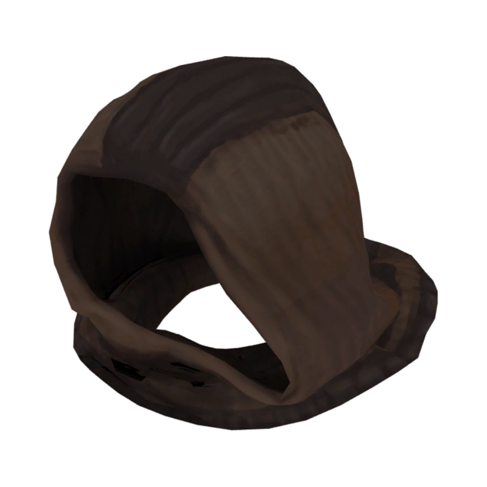
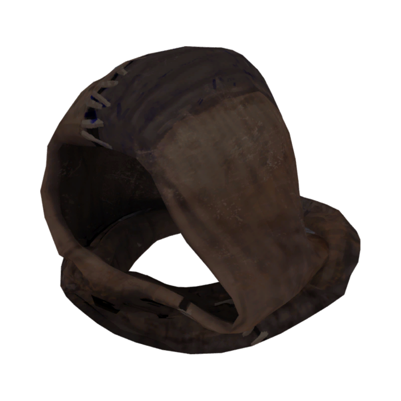

# Fleece Cowl

**Fleece Cowl**

| Property | Details |
| --- | --- |
|  |  / *Fleece\_Cowl\_icon.png* |
| **General** |  |
| Item Type | Clothing\|- |
| Clothing Slot | Head |
| **Statistics** |  |
| Weight | 0.25 kg(0.55 lbs) |
| Warmth bonus | 1.5 °C(2.7 °F) |
| Windproof bonus | 1.0 °C(1.8 °F) |
| Waterproof bonus | 20% |
| Protection | 2% |
| Mobility | 0% |
| Harvest | 1 × [Cloth](./Cloth.md) / 10 minutes |
| Repair | 1 × [Cloth](./Cloth.md) / 30 minutes / 60% condition |

> “**A thick cotton cap that covers the head but not the face. Designed to be layered under something warmer.**”
>
> — In-game description

**Fleece Cowl** is a type of headgear in *[The Long Dark](./The%20Long%20Dark.md)*.

## Overview

Despite its description, the fleece cowl is best used as an outer layer for wind protection, as its warmth value isn't as good as items like the [Wool Toque](./Wool%20Toque.md) or the [Balaclava](./Balaclava.md). As a scarf, the [Long Wool Scarf](./Long%20Wool%20Scarf.md) would be better suited to the environment, or any of the aforementioned options.

| Column 1 | Column 2 |
| --- | --- |
|  / *Model icon* |  / *Model icon damaged* |

## Update history

- UPDATE **19 December 2016 ([Update](./The%20Long%20Dark%20%E2%80%94%20Early%20Access%20Changelog.md#0.386)):**
  - Added to game

**Lua execution error in Module:Navbox function navbox** [ru:Флисовый капюшон](ru:%D0%A4%D0%BB%D0%B8%D1%81%D0%BE%D0%B2%D1%8B%D0%B9_%D0%BA%D0%B0%D0%BF%D1%8E%D1%88%D0%BE%D0%BD)
