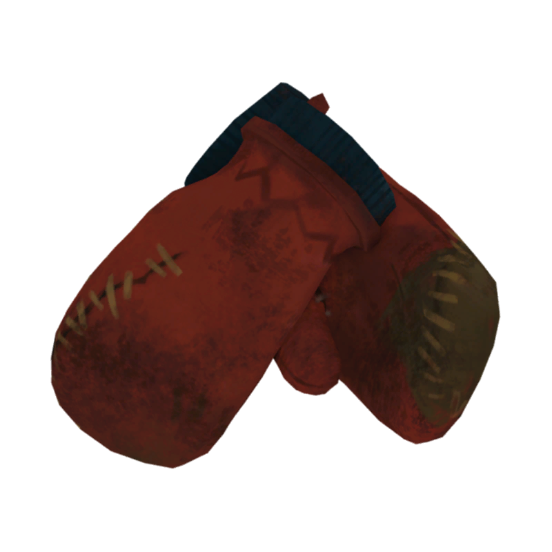

# Fleece Mittens

**Categories:** Clothing, Pages with update history · **Source:** [Fandom](https://thelongdark.fandom.com/wiki/Fleece_Mittens)

**Fleece Mittens**

[Fleece Mittens icon](../assets/Fleece_Mittens_icon.png)

**General**

**Item Type:** Clothing

**Clothing Slot:** Hands

**Statistics**

**Weight:** [Weight icon](../assets/Weight_icon.png)0.10 kg(0.22 lbs)

**Warmth bonus:** [Temp icon](../assets/Temp_icon.png)0.5 °C(0.9 °F)

**Windproof bonus:** [Windproofness icon](../assets/Windproofness_icon.png)0.5 °C(0.9 °F)

**Waterproof bonus:** [Waterproofness icon](../assets/Waterproofness_icon.png)5%

**Protection:** [Protection icon](../assets/Protection_icon.png)1%

**Mobility:** [Mobility icon](../assets/Mobility_icon.png)0%

**Harvest:** 1 × [Cloth](./Cloth.md) 10 minutes

**Repair:** 1 × [Cloth](./Cloth.md) 30 minutes 65% condition

> “**Basic fleece mitts. Pretty warm, but useless when wet.**”
>
> — In-game description

**Fleece mittens** are a type of [clothing](./Clothing.md) in _[The Long Dark](./The%20Long%20Dark.md)_.

## Overview

Fleece mittens have identical stats to [Driving Gloves](./Driving%20Gloves.md), with the exception of being more waterproof. Fleece mittens can also be repaired with easily obtained [cloth](./Cloth.md) whereas driving gloves require [cured leather](./Cured%20Leather.md).

They should be replaced with [Wool Mittens](./Wool%20Mittens.md) once a pair is found, as they give an extra 15% waterproofing and 0.5°C (0.9°F) warmth bonus for no downsides.

## Gallery

## Update history

- UPDATE **19 December 2016 ([Update](./The%20Long%20Dark%20%E2%80%94%20Early%20Access%20Changelog.md#0.386)):**
  - Added to game
