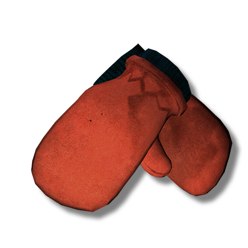

# Fleece Mittens

**Fleece Mittens**

| Property | Details |
| --- | --- |
|  |  / *Fleece\_Mittens\_icon.png* |
| **General** |  |
| Item Type | Clothing\|- |
| Clothing Slot | Hands |
| **Statistics** |  |
| Weight | 0.10 kg(0.22 lbs) |
| Warmth bonus | 0.5 °C(0.9 °F) |
| Windproof bonus | 0.5 °C(0.9 °F) |
| Waterproof bonus | 5% |
| Protection | 1% |
| Mobility | 0% |
| Harvest | 1 × [Cloth](./Cloth.md) / 10 minutes |
| Repair | 1 × [Cloth](./Cloth.md) / 30 minutes / 65% condition |

> “**Basic fleece mitts. Pretty warm, but useless when wet.**”
>
> — In-game description

**Fleece mittens** are a type of [clothing](./Clothing.md) in *[The Long Dark](./The%20Long%20Dark.md)*.

## Overview

Fleece mittens have identical stats to [Driving Gloves](./Driving%20Gloves.md), with the exception of being more waterproof. Fleece mittens can also be repaired with easily obtained [cloth](./Cloth.md) whereas driving gloves require [cured leather](./Cured%20Leather.md).

They should be replaced with [Wool Mittens](./Wool%20Mittens.md) once a pair is found, as they give an extra 15% waterproofing and 0.5°C (0.9°F) warmth bonus for no downsides.

## Gallery

| Column 1 | Column 2 | Column 3 |
| --- | --- | --- |
|  / *Pre Alpha model.* |  / *Clothing model* |  / *Clothing model damaged* |

## Update history

- UPDATE **19 December 2016 ([Update](./The%20Long%20Dark%20%E2%80%94%20Early%20Access%20Changelog.md#0.386)):**
  - Added to game

**Lua execution error in Module:Navbox function navbox** [ru:Флисовые варежки](ru:%D0%A4%D0%BB%D0%B8%D1%81%D0%BE%D0%B2%D1%8B%D0%B5_%D0%B2%D0%B0%D1%80%D0%B5%D0%B6%D0%BA%D0%B8)
