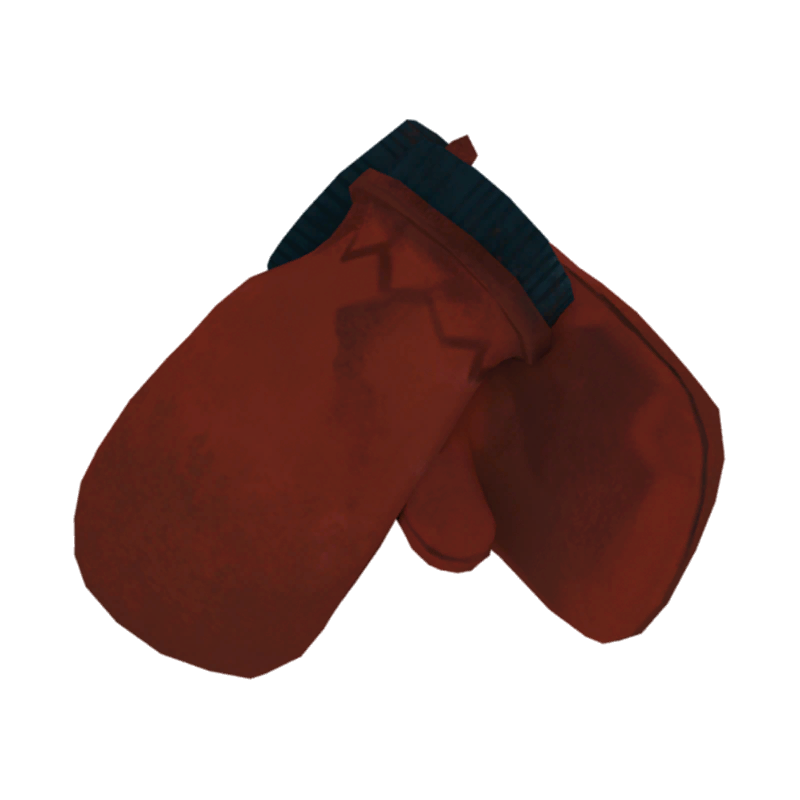

# Fleece Mittens

<table class="infobox">
<caption>Fleece Mittens</caption>
<colgroup>
<col style="width: 50%" />
<col style="width: 50%" />
</colgroup>
<tbody>
<tr>
<td colspan="2"><figure>

<figcaption>Fleece_Mittens_icon.png</figcaption>
</figure></td>
</tr>
<tr>
<td colspan="2" class="section">
<strong>General</strong>
</td>
</tr>
<tr>
<td>
Item Type
</td>
<td>
Clothing|-
</td>
</tr>
<tr>
<td>
Clothing Slot
</td>
<td>
Hands
</td>
</tr>
<tr>
<td colspan="2" class="section">
<strong>Statistics</strong>
</td>
</tr>
<tr>
<td>
Weight
</td>
<td>
0.10 kg(0.22 lbs)
</td>
</tr>
<tr>
<td>
Warmth bonus
</td>
<td>
0.5 °C(0.9 °F)
</td>
</tr>
<tr>
<td>
Windproof bonus
</td>
<td>
0.5 °C(0.9 °F)
</td>
</tr>
<tr>
<td>
Waterproof bonus
</td>
<td>
5%
</td>
</tr>
<tr>
<td>
Protection
</td>
<td>
1%
</td>
</tr>
<tr>
<td>
Mobility
</td>
<td>
0%
</td>
</tr>
<tr>
<td>
Harvest
</td>
<td>
1 × <a href="./Cloth.md" class="wikilink" title="Cloth">Cloth</a> 
10 minutes
</td>
</tr>
<tr>
<td>
Repair
</td>
<td>
1 × <a href="./Cloth.md" class="wikilink" title="Cloth">Cloth</a> 
30 minutes 
65% condition
</td>
</tr>
</tbody>
</table>

<table>
<colgroup>
<col style="width: 33%" />
<col style="width: 33%" />
<col style="width: 33%" />
</colgroup>
<tbody>
<tr>
<td style="vertical-align: top; font-size: 3em; color: #5d5980; padding-right: 10px">
“
</td>
<td>
Basic fleece mitts. Pretty warm, but useless when wet.

&#10;

In-game description

</td>
<td style="vertical-align: bottom; font-size: 3em; color: #5d5980; padding-left: 10px">
”
</td>
</tr>
</tbody>
</table>

**Fleece mittens** are a type of <a href="./Clothing.md" class="wikilink" title="clothing">clothing</a> in *<a href="./The%20Long%20Dark.md" class="wikilink" title="The Long Dark">The Long Dark</a>*.

## Overview

Fleece mittens have identical stats to <a href="./Driving%20Gloves.md" class="wikilink" title="Driving Gloves">Driving Gloves</a>, with the exception of being more waterproof. Fleece mittens can also be repaired with easily obtained <a href="./Cloth.md" class="wikilink" title="cloth">cloth</a> whereas driving gloves require <a href="./Cured%20Leather.md" class="wikilink" title="cured leather">cured leather</a>.

They should be replaced with <a href="./Wool%20Mittens.md" class="wikilink" title="Wool Mittens">Wool Mittens</a> once a pair is found, as they give an extra 15% waterproofing and 0.5°C (0.9°F) warmth bonus for no downsides.

## Gallery

<table class="gallery">
<colgroup>
<col style="width: 33%" />
<col style="width: 33%" />
<col style="width: 33%" />
</colgroup>
<tbody>
<tr>
<td><figure>

<figcaption>Pre Alpha model.</figcaption>
</figure></td>
<td><figure>

<figcaption>Clothing model</figcaption>
</figure></td>
<td><figure>

<figcaption>Clothing model damaged</figcaption>
</figure></td>
</tr>
</tbody>
</table>

## Update history

- UPDATE **19 December 2016 (<a href="./The%20Long%20Dark%20%E2%80%94%20Early%20Access%20Changelog.md#0.386" class="wikilink" title="Update">Update</a>):**
  - Added to game

**Lua execution error in Module:Navbox function navbox** <a href="ru:%D0%A4%D0%BB%D0%B8%D1%81%D0%BE%D0%B2%D1%8B%D0%B5_%D0%B2%D0%B0%D1%80%D0%B5%D0%B6%D0%BA%D0%B8" class="wikilink" title="ru:Флисовые варежки">ru:Флисовые варежки</a>

