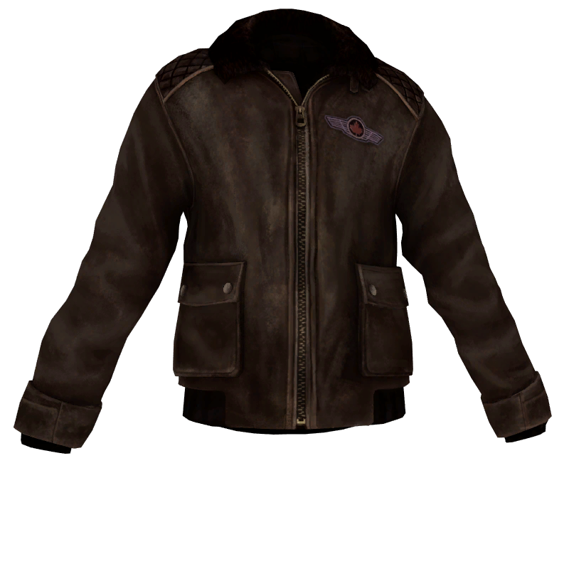

# Flight Jacket

**Categories:** Clothing, DLC Content, Pages with update history · **Source:** [Fandom](https://thelongdark.fandom.com/wiki/Flight_Jacket)

**Flight Jacket**

| Property | Details |
| --- | --- |
|  | [Flight Jacket icon](../assets/Flight_Jacket_icon.png) |
| **General** |  |
| Item Type | Clothing |
| Wintermute |  |
| Clothing Slot | Outer torso |
| **Statistics** |  |
| Weight | [Weight icon](../assets/Weight_icon.png)2.50 kg(5.5 lbs) |
| Warmth bonus | [Temp icon](../assets/Temp_icon.png)3.0 °C(5.4 °F) |
| Windproof bonus | [Windproofness icon](../assets/Windproofness_icon.png)5.0 °C(9 °F) |
| Waterproof bonus | [Waterproofness icon](../assets/Waterproofness_icon.png)50% |
| Protection | [Protection icon](../assets/Protection_icon.png)10% |
| Mobility | [Mobility icon](../assets/Mobility_icon.png)-5% |
| Harvest | 3 × [Cured Leather](./Cured%20Leather.md) / 30 minutes |
| Repair | 2 × [Cured Leather](./Cured%20Leather.md) / 60 minutes / 40% condition |

**DLC-Exclusive content.**

This content requires the [Tales from the Far Territory](./Tales%20from%20the%20Far%20Territory.md) addon to be installed before it can be seen or used in regular gameplay.

> “**Its thick leather and heavy stitching keep bush pilots warm at altitude. Also offers good protection when operating at ground level.**”
>
> — In-game description

A **Flight Jacket** is a type of [Clothing](./Clothing.md) in The Long Dark. It is part of the [Tales from the Far Territory](./Tales%20from%20the%20Far%20Territory.md) DLC.

## Overview

Flight Jackets are rare, mostly located in places related to airplanes like the multiple planes around [Field 31](./Field%2031.md) in [Forsaken Airfield](./Forsaken%20Airfield.md) or the occasional [crashed planes](./Plane%20Crashes.md) in Lower Great Bear. This clothing piece offers an excellent windproof bonus and a good amount of warmth, plus balanced stats overall, making a great choice if you don't have an [Expedition Parka](./Expedition%20Parka.md) or a better clothing piece.

Note: While it used to spawn, it is no longer available on [Interloper](./Interloper.md) difficulty.

## Locations

- On the bed in the [Hangar Basement](./Hangar%20Basement.md) of the [Main Hangar.](./Main%20Hangar.md)
- Inside the various vehicles in & around the Hangar.
- Inside a crate near the crashed plane in [Mountain Town](./Mountain%20Town.md).
- In locked lockers throughout the island.
- Available rarely from trunks found when [beachcombing](./Beachcombing.md) after a blizzard.

## Update history

- UPDATE **30 March 2023 ([Update](./The%20Long%20Dark%20%E2%80%94%20Changelog.md#2.10)):**
  - Added to game.
