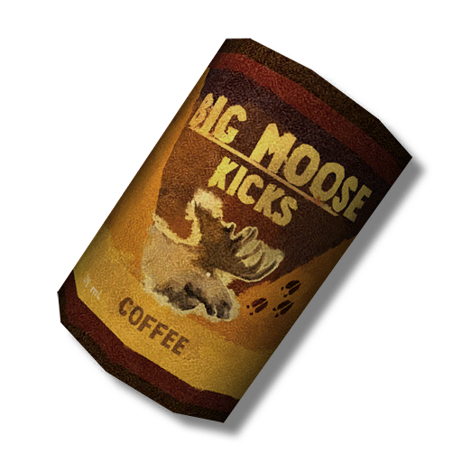
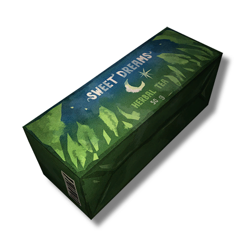
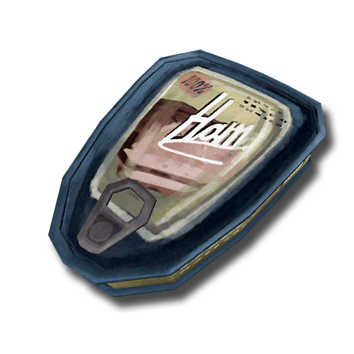
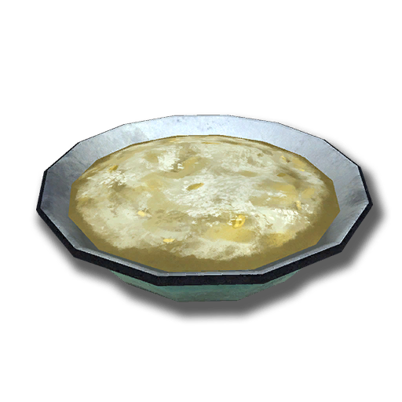

# Food And Drink

**Contents**

- [Overview](#overview)
- [Strategies](#strategies)
- [Survival Mode Foods](#survival-mode-foods)
- [Foods](#foods)
- [Drinks](#drinks)
- [Brew-able Materials](#brew-able-materials)
- [Carcass](#carcass)
- [First Aid Items](#first-aid-items)
- [Tales from the Far Territory Foods](#tales-from-the-far-territory-foods)
- [Types of Food](#types-of-food)
- [Recipes](#recipes)
- [Ingredients](#ingredients)
- [Carcass](#carcass-1)
- [Wintermute Foods](#wintermute-foods)
- [Seasonal Foods](#seasonal-foods)
- [Trivia](#trivia)

A wide variety of **foods and drinks** exist in *[The Long Dark](./The%20Long%20Dark.md),* including prepackaged foods, meat, brewable beverages, and medicinal remedies. Some foods can be eaten as is or cooked.

Food and drink items primarily designed to refill the [Hunger](./Hunger.md) (Calorie Store) and [Thirst](./Thirst.md) [Needs](./Needs.md), but can sometimes refill [Fatigue](./Fatigue.md) or [Warmth](./Warmth.md). Attempting to eat or drink when Hunger or Thirst is full will result in the error messages "you are too full to eat/you are not thirsty".

Keep in mind that some foods are only available for those that purchase the [Tales from the Far Territory](./Tales%20from%20the%20Far%20Territory.md) expansion.

## Overview

### Strategies

Especially when moving from place to place, it is usually wise to first consume the food that [spoils](./Decay.md#Food_and_drink) the fastest and has lower energy density, while saving energy-dense products for traveling or for an emergency.

For long-term food options, keep in mind the following:

- Ruined food generally cannot be eaten safely (unless [Cooking](./Cooking.md) Level 5 is achieved).
- Ruined raw meat can be cooked to add 50% condition--as can raw meat in any condition.
- It is generally advised to never eat raw meat, as even at Cooking level 5, the player can still get [Food Poisoning](./Food%20Poisoning.md). The only exception to the former rule regards eating fish raw vs eating fish cooked, as certain raw fish contain higher Vitamin-C doses to prevent [Scurvy](./Scurvy.md), though this will still cause Food Poisoning.
- If non-canned food is stored outdoors, decay is slowed substantially and the lifespan of the food is extended (except for meat quarters).
- Another long-term food option is [Cat Tail Stalks](./Cat%20Tail%20Stalk.md). While low in calories, they do not decay, are plentiful in most regions, and serve as good emergency food caches.

It is important to note that cooking Food and Drink adds more calories to the cooked item version (up to 25% extra calories at Level 5 Cooking). The caloric content for each item below is listed at the base Level 0 Cooking values for reference.

## Survival Mode Foods

### Foods

Food and Drink have their own 2 dedicated sections within the [Radial Menu](./Radial%20Menu.md), but share the same menu in the Backpack [Survival Menu](./Survival%20Menu.md). **Note**: Most of these foods and drinks can be found in Wintermute.

The following items are found in the Foods section of the Radial Menu.

|  / *Cooking.png* | Item | Calories | Hydration | Weight | Calorie density | Vitamin C |
| --- | --- | --- | --- | --- | --- | --- |
|  / *Acorns\_(Cooked)\_icon.png* | [Acorns (Cooked)](./Acorns%20%28Cooked%29.md) | 100 kcal | 0% | 0.03 kg / *(0.066 lb)* | *3333 kcal / kg / *(1,515 kcal / lb)** |  |
|  / *Acorns\_(Cooked\_-\_Large\_Portion)\_icon.png* | [Acorns (Cooked - Large Portion)](./Acorns%20%28Cooked%20-%20Large%20Portion%29.md) | 320 kcal | 0% | 0.25 kg / *(0.55 lb)* | 1280 kcal / kg (582 kcal / lb) |  |
|  / *Airline\_Food\_-\_Chicken\_icon.png* | [Airline Food - Chicken](./Airline%20Food%20-%20Chicken.md) | 620 kcal | 5% | 0.25 kg / *(0.55 lb)* | 2480 kcal / kg / *(1,127 kcal / lb)* | 29% |
|  / *Airline\_Food\_-\_Vegetarian\_icon.png* | [Airline Food - Vegetarian](./Airline%20Food%20-%20Vegetarian.md) | 560 kcal | 5% | 0.25 kg / *(0.55 lb)* | 2240 kcal / kg / *(1,018 kcal / lb)* | 73% |
|  / *Bear\_Meat\_(Cooked)\_icon.png* | [Bear Meat (Cooked)](./Bear%20Meat%20%28Raw%29.md) | 900 kcal | -15% | 1.00 kg / *(2.2 lb)* | 900 kcal / kg / *(409 kcal / lb)* |  |
|  / *Bear\_Meat\_(Raw)\_icon.png* | [Bear Meat (Raw)](./Bear%20Meat%20%28Raw%29.md) | 900 kcal | -5% | 1.00 kg / *(2.2 lb)* | 900 kcal / kg / *(409 kcal / lb)* | \|- \|- |
|  / *Burbot\_(Cooked)\_icon.png* | [Burbot (Cooked)](./Burbot%20%28Cooked%29.md) | 1952.50 kcal | -5% | *4.00 kg / *(8.8 lb)** | 488 kcal / kg / *(222 kcal / lb)* |  |
|  / *Burbot\_(Raw)\_icon.png* | [Burbot (Raw)](./Burbot%20%28Raw%29.md) | 1950 kcal | 0% | *6.00 kg / *(13.2 lb)** | *325 kcal / kg / *(148 kcal / lb)** |  |
|  / *Cat\_Tail\_Stalk\_icon.png* | [Cat Tail Stalk](./Cat%20Tail%20Stalk.md) | 150 kcal | 0% | 0.05 kg / *(0.11 lb)* | 3000 kcal / kg / *(1,364 kcal / lb)* | 1% |
|  / *Chocolate\_Bar\_icon.png* | [Chocolate Bar](./Chocolate%20Bar.md) | 250 kcal | -3% | 0.10 kg / *(0.22 lb)* | 2500 kcal / kg / *(1,136 kcal / lb)* |  |
|  / *Coho\_Salmon\_(Cooked)\_icon.png* | [Coho Salmon (Cooked)](./Coho%20Salmon%20%28Cooked%29.md) | 1650 kcal | -5% | 3.70 kg / *(8.14 lb)* | 455 kcal / kg / *(207 kcal / lb)* | 49% |
|  / *Coho\_Salmon\_(Raw)\_icon.png* | [Coho Salmon (Raw)](./Coho%20Salmon%20%28Raw%29.md) | 1650 kcal | 0% | 5.50 kg / *(12.1 lb)* | 300 kcal / kg / *(136 kcal / lb)* | 62% |
|  / *Condensed\_Milk\_icon.png* | [Condensed Milk](./Condensed%20Milk.md) | 750 kcal | 25% | 0.25 kg / *(0.55 lb)* | 3000 kcal / kg / *(1,364 kcal / lb)* | 12% |
|  / *Dog\_Food\_icon.png* | [Dog Food](./Dog%20Food.md) | 500 kcal | 5% | 0.30 kg / *(0.66 lb)* | 1667 kcal / kg / *(758 kcal / lb)* |  |
|  / *Energy\_Bar\_icon.png* | [Energy Bar](./Energy%20Bar.md) | 500 kcal | 0% | 0.10 kg / *(0.22 lb)* | 5000 kcal / kg / *(2,273 kcal / lb)* | 4% |
|  / *Granola\_Bar\_icon.png* | [Granola Bar](./Granola%20Bar.md) | 300 kcal | -5% | 0.10 kg / *(0.22 lb)* | 3000 kcal / kg / *(1,364 kcal / lb)* | 2% |
|  / *Goldeye\_(Cooked)\_icon.png* | [Goldeye (Cooked)](./Goldeye%20%28Cooked%29.md) | 630 kcal | -5% | *1.60 kg / *(3.52 lb)** | 300 kcal / kg / *(136 kcal / lb)* |  |
|  / *Goldeye\_(Raw)\_icon.png* | [Goldeye (Raw)](./Goldeye%20%28Raw%29.md) | 630 kcal | 0% | *2.10 kg / *(4.62 lb)** | 300 kcal / kg / *(136 kcal / lb)* |  |
|  / *Ketchup\_Chips\_icon.png* | [Ketchup Chips](./Ketchup%20Chips.md) | 300 kcal | -6% | 0.10 kg / *(0.22 lb)* | 3000 kcal / kg / *(1,364 kcal / lb)* | 5% |
|  / *Lake\_Whitefish\_(Cooked)\_icon.png* | [Lake Whitefish (Cooked)](./Lake%20Whitefish%20%28Cooked%29.md) | 575 kcal | -5% | 1.50 kg / *(3.3 lb)* | 385 kcal / kg / *(175 kcal / lb)* | 37% |
|  / *Lake\_Whitefish\_(Raw)\_icon.png* | [Lake Whitefish (Raw)](./Lake%20Whitefish%20%28Raw%29.md) | 575 kcal | 0% | 2.30 kg / *(5.06 lb)* | 250 kcal / kg / *(114 kcal / lb)* | 50% |
|  / *Maple\_Syrup\_icon.png* | [Maple Syrup](./Maple%20Syrup.md) | 850 kcal | 0% | 0.30 kg / *(0.66 lb)* | 2833 kcal / kg / *(1,288 kcal / lb)* |  |
|  / *Military-Grade\_MRE\_icon.png* | [Military-Grade MRE](./Military-Grade%20MRE.md) | 1750 kcal | 5% | 0.50 kg / *(1.1 lb)* | 3500 kcal / kg / *(1,591 kcal / lb)* | 65% |
|  / *Moose\_Meat\_(Cooked)\_icon.png* | [Moose Meat (Cooked)](./Moose%20Meat%20%28Cooked%29.md) | 900 kcal | -5% | 1.00 kg / *(2.2 lb)* | 900 kcal / kg / *(409 kcal / lb)* |  |
|  / *Moose\_Meat\_(Raw)\_icon.png* | [Moose Meat (Raw)](./Moose%20Meat%20%28Raw%29.md) | 900 kcal | 0% | 1.00 kg / *(2.2 lb)* | 900 kcal / kg / *(409 kcal / lb)* |  |
|  / *Peanut\_Butter\_icon.png* | [Peanut Butter](./Peanut%20Butter.md) | 900 kcal | -5% | 0.50 kg / *(1.1 lb)* | 1800 kcal / kg / *(818 kcal / lb)* |  |
|  / *Pinnacle\_Peaches\_icon.png* | [Pinnacle Peaches](./Pinnacle%20Peaches.md) | 450 kcal | 20% | 0.50 kg / *(1.1 lb)* | 900 kcal / kg / *(409 kcal / lb)* | 56% |
|  / *Pork\_and\_Beans\_icon.png* | [Pork and Beans](./Pork%20and%20Beans.md) | 600 kcal | -5% | 0.25 kg / *(0.55 lb)* | 2400 kcal / kg / *(1,091 kcal / lb)* | 2% |
|  / *Rabbit\_(Cooked)\_icon.png* | [Rabbit (Cooked)](./Rabbit%20%28Cooked%29.md) | 450 kcal | -5% | 1.00 kg / *(2.2 lb)* | 450 kcal / kg / *(205 kcal / lb)* |  |
|  / *Rabbit\_(Raw)\_icon.png* | [Rabbit (Raw)](./Rabbit%20%28Raw%29.md) | 500 kcal | 0% | 1.00 kg / *(2.2 lb)* | 500 kcal / kg / *(227 kcal / lb)* |  |
|  / *Rainbow\_Trout\_(Cooked)\_icon.png* | [Rainbow Trout (Cooked)](./Rainbow%20Trout%20%28Cooked%29.md) | 575 kcal | -5% | 1.50 kg / *(3.3 lb)* | 385 kcal / kg / *(175 kcal / lb)* | 34% |
|  / *Rainbow\_Trout\_(Raw)\_icon.png* | [Rainbow Trout (Raw)](./Rainbow%20Trout%20%28Raw%29.md) | 575 kcal | 0% | 2.30 kg / *(5.06 lb)* | 250 kcal / kg / *(114 kcal / lb)* | 45% |
|  / *Red\_Irish\_Lord\_(Cooked)\_icon.png* | [Red Irish Lord (Cooked)](./Red%20Irish%20Lord%20%28Cooked%29.md) | 930 kcal | -5% | *2.00 kg / *(4.4 lb)** | 300 kcal / kg / *(136 kcal / lb)* |  |
|  / *Red\_Irish\_Lord\_(Raw)\_icon.png* | [Red Irish Lord (Raw)](./Red%20Irish%20Lord%20%28Raw%29.md) | 930 kcal | 0% | *3.10 kg / *(6.82 lb)** | 300 kcal / kg / *(136 kcal / lb)* |  |
|  / *Rockfish\_(Cooked)\_icon.png* | [Rockfish (Cooked)](./Rockfish%20%28Cooked%29.md) | 1500 kcal | 0% | 3.25 kg / *(7.15 lb)* | 300 kcal / kg / *(136 kcal / lb)* |  |
|  / *Rockfish\_(Raw)\_icon.png* | [Rockfish (Raw)](./Rockfish%20%28Raw%29.md) | 1500 kcal | 0% | 5.00 kg / *(11 lb)* | 300 kcal / kg / *(136 kcal / lb)* |  |
|  / *Salty\_Crackers\_icon.png* | [Salty Crackers](./Salty%20Crackers.md) | 600 kcal | -20% | 0.10 kg / *(0.22 lb)* | 6000 kcal / kg / *(2,727 kcal / lb)* |  |
|  / *Smallmouth\_Bass\_(Cooked)\_icon.png* | [Smallmouth Bass (Cooked)](./Smallmouth%20Bass%20%28Cooked%29.md) | 1500 kcal | -5% | 3.30 kg / *(7.26 lb)* | 300 kcal / kg / *(136 kcal / lb)* | 41% |
|  / *Smallmouth\_Bass\_(Raw)\_icon.png* | [Smallmouth Bass (Raw)](./Smallmouth%20Bass%20%28Raw%29.md) | 1500 kcal | 0% | 5.00 kg / *(11 lb)* | 300 kcal / kg / *(136 kcal / lb)* | 55% |
|  / *Tin\_of\_Sardines\_icon.png* | [Tin of Sardines](./Tin%20of%20Sardines.md) | 300 kcal | 5% | 0.10 kg / *(0.22 lb)* | 3000 kcal / kg / *(1,364 kcal / lb)* | 3% |
|  / *Tomato\_Soup\_icon.png* | [Tomato Soup](./Tomato%20Soup.md) | 300 kcal | 10% | 0.25 kg / *(0.55 lb)* | 1200 kcal / kg / *(545 kcal / lb)* | 30% |
|  / *Venison\_(Cooked)\_icon.png* | [Venison (Cooked)](./Venison%20%28Cooked%29.md) | 800 kcal | -5% | 1.00 kg / *(2.2 lb)* | 800 kcal / kg / *(364 kcal / lb)* |  |
|  / *Venison\_(Raw)\_icon.png* | [Venison (Raw)](./Venison%20%28Cooked%29.md) | 900 kcal | 0% | 1.00 kg / *(2.2 lb)* | 900 kcal / kg / *(409 kcal / lb)* |  |
|  / *Wolf\_Meat\_(Cooked)\_icon.png* | [Wolf Meat (Cooked)](./Wolf%20Meat%20%28Cooked%29.md) | 700 kcal | -10% | 1.00 kg / *(2.2 lb)* | 700 kcal / kg / *(318 kcal / lb)* |  |
|  / *Wolf\_Meat\_(Raw)\_icon.png* | [Wolf Meat (Raw)](./Wolf%20Meat%20%28Raw%29.md) | 800 kcal | 0% | 1.00 kg / *(2.2 lb)* | 800 kcal / kg / *(364 kcal / lb)* |  |

### Drinks

The following items are found in the Drinks section of the Radial Menu.

|  / *Cooking.png* | Item | Calories | Hydration | Weight | Calorie density | Vitamin C |
| --- | --- | --- | --- | --- | --- | --- |
|  / *Cup\_of\_Acorn\_Coffee\_icon.png* | [Cup of Acorn Coffee](./Cup%20of%20Acorn%20Coffee.md) | 100 kcal | 30% | *0.10 kg / *(0.22 lb)** | 1000 kcal / kg / *(455 kcal / lb)* |  |
|  / *Cup\_of\_Coffee\_icon.png* | [Cup of Coffee](./Cup%20of%20Coffee.md) | 100 kcal | 30% | 0.10 kg / *(0.22 lb)* | 1000 kcal / kg / *(455 kcal / lb)* |  |
|  / *Cup\_of\_Herbal\_Tea\_icon.png* | [Cup of Herbal Tea](./Cup%20of%20Herbal%20Tea.md) | 100 kcal | 30% | 0.10 kg / *(0.22 lb)* | 1000 kcal / kg / *(455 kcal / lb)* | 11% |
|  / *Orange\_Soda\_icon.png* | [Orange Soda](./Orange%20Soda.md) | 250 kcal | 30% | 0.25 kg / *(0.55 lb)* | 1000 kcal / kg / *(455 kcal / lb)* |  |
|  / *Stacy's\_Grape\_Soda\_icon.png* | [Stacy's Grape Soda](./Stacy%27s%20Grape%20Soda.md) | 250 kcal | 30% | 0.25 kg / *(0.55 lb)* | 1000 kcal / kg / *(455 kcal / lb)* |  |
|  / *Summit\_Soda\_icon.png* | [Summit Soda](./Summit%20Soda.md) | 250 kcal | 30% | 0.25 kg / *(0.55 lb)* | 1000 kcal / kg / *(455 kcal / lb)* |  |
|  / *Water\_(Potable)\_icon.png* | [Water (Potable)](./Water%20%28Potable%29.md) | 0 kcal | 150% | 1.00 kg / *(2.2 lb)* | 0 kcal / kg / *(0 kcal / lb)* |  |
|  / *Water\_(Unsafe)\_icon.png* | [Water (Unsafe)](./Water%20%28Unsafe%29.md)[¹](#fn1) | 0 kcal | 150% | 1.00 kg / *(2.2 lb)* | 0 kcal / kg / *(0 kcal / lb)* |  |

### Brew-able Materials

Below is a list of foods cannot be eaten as is, and must be brewed in an active fire along with Potable Water in order to turn them into consumable drinks.

|  / *Cooking.png* | Item | Weight |
| --- | --- | --- |
|  / *Tin\_of\_Coffee\_icon.png* | [Tin of Coffee](./Tin%20of%20Coffee.md) | 0.01 kg / *(0.022 lb)* |
|  / *Herbal\_Tea\_icon.png* | [Herbal Tea](./Herbal%20Tea.md) | 0.01 kg / *(0.022 lb)* |

### Carcass

Carcasses cannot be eaten as is, and must be harvested for usable meat. A [Rabbit](./Rabbit.md) can be killed and butchered on the spot for it's meat, or the corpse can be carried to a safer location to be butchered later. Larger animals can be quartered into meat bag quarters and carried away.

|  / *Cooking.png* | Item |
| --- | --- |
|  / *Bear\_Quarter\_icon.png* | [Bear Quarter](./Bear%20Quarter.md) |
|  / *Deer\_Quarter\_icon.png* | [Deer Quarter](./Deer%20Quarter.md) |
|  / *Moose\_Quarter\_icon.png* | [Moose Quarter](./Moose%20Quarter.md) |
|  / *Rabbit\_Carcass\_icon.png* | [Rabbit Carcass](./Rabbit%20Carcass.md) |
|  / *Wolf\_Quarter\_icon.png* | [Wolf Quarter](./Wolf%20Quarter.md) |

### First Aid Items

Below is a list of items that are classified as [First Aid](./First%20Aid.md) items. While they can be used to cure [Afflictions](./Afflictions.md), they can also be created and consumed solely for calories (though the error message "That Treatment Didn't Do Anything" will always appear for Reishi Tea, Burdock Tea, and Rose Hip Tea if no Afflictions are present).

|  / *Cooking.png* | Item | Calories | Hydration | Weight | Calorie density | Vitamin C |
| --- | --- | --- | --- | --- | --- | --- |
|  / *Caffeine\_Pills\_icon.png* | [Caffeine Pills](./Caffeine%20Pills.md) | 5 kcal (25 kcal/pack) | 0% | 0.10 kg / *(0.22 lb)* | 250 kcal / kg / *(114 kcal / lb)* | 0% |
|  / *Birch\_Bark\_Tea\_icon.png* | [Birch Bark Tea](./Birch%20Bark%20Tea.md) | 100 kcal | 30% | 0.10 kg / *(0.22 lb)* | 1000 kcal / kg / *(455 kcal / lb)* | 6% |
|  / *Burdock\_Tea\_icon.png* | [Burdock Tea](./Burdock%20Tea.md) | 100 kcal | 30% | 0.10 kg / *(0.22 lb)* | *1000 kcal / kg / *(455 kcal / lb)** | 7% |
|  / *Go!\_Energy\_Drink\_icon.png* | [Go! Energy Drink](./Go!%20Energy%20Drink.md) | 100 kcal | 30% | 0.25 kg / *(0.55 lb)* | 400 kcal / kg / *(182 kcal / lb)* | 0% |
|  / *Prepared\_Burdock\_icon.png* | [Prepared Burdock](./Prepared%20Burdock.md) | 275 kcal | 0% | 0.15 kg / *(0.33 lb)* | 1833 kcal / kg / *(833 kcal / lb)* | 8% |
|  / *Reishi\_Tea\_icon.png* | [Reishi Tea](./Reishi%20Tea.md) | 100 kcal | 30% | 0.10 kg / *(0.22 lb)* | 1000 kcal / kg / *(455 kcal / lb)* | 5% |
|  / *Rose\_Hip\_Tea\_icon.png* | [Rose Hip Tea](./Rose%20Hip%20Tea.md) | 100 kcal | 30% | 0.10 kg / *(0.22 lb)* | 1000 kcal / kg / *(455 kcal / lb)* | 13% |
|  / *Vitamin-C\_Pills\_icon.png* | [Vitamin-C Pills](./Vitamin-C%20Pills.md) | 5 kcal (25 kcal/bottle) | 0% | 0.10 kg / *(0.22 lb)* | 250 kcal / kg / *(114 kcal / lb)* | 125% |

## Tales from the Far Territory Foods

These foods are only available in Survival Mode to players that purchase the [Tales from the Far Territory](./Tales%20from%20the%20Far%20Territory.md) expansion.

### Types of Food

|  / *Cooking.png* | Item | Calories | Hydration | Weight | Calorie density | Vitamin C |
| --- | --- | --- | --- | --- | --- | --- |
|  / *Animal\_Fat\_icon.png* | [Animal Fat](./Animal%20Fat.md) | 900 kcal | 0% | *1.00 kg / *(2.2 lb)** |  |  |
|  / *Canned\_Corn\_icon.png* | [Canned Corn](./Canned%20Corn.md) | 295 kcal | 5% | *0.30 kg / *(0.66 lb)** | 983 kcal / kg / *(447 kcal / lb)* | 52% |
|  / *Canned\_Ham\_icon.png* | [Canned Ham](./Canned%20Ham.md) | 550 kcal | -5% | *0.40 kg / *(0.88 lb)** | 1375 kcal / kg / *(625 kcal / lb)* |  |
|  / *Canned\_Pineapple\_icon.png* | [Canned Pineapple](./Canned%20Pineapple.md) | 295 kcal | 5% | *0.40 kg / *(0.88 lb)** | 737.5 kcal / kg / *(335 kcal / lb)* | 56% |
|  / *Carrot\_icon.png* | [Carrot](./Carrot.md) | 175 kcal | 0% | 0.10 kg / *(0.22 lb)* | 1750 kcal / kg / *(795 kcal / lb)* | 9% |
|  / *Cereal\_icon.png* | [Cereal](./Cereal.md) | 700 kcal | -10% | 0.20 kg / *(0.44 lb)* | 4500 kcal / kg / *(2,045 kcal / lb)* |  |
|  / *Cured\_Fish\_icon.png* | [Cured Fish](./Cured%20Fish.md) | 900 kcal | -5% | 0.20 kg / *(0.44 lb)* | 4500 kcal / kg / *(2,045 kcal / lb)* |  |
|  / *Cured\_Meat\_icon.png* | [Cured Meat](./Cured%20Meat.md) | 900 kcal | -5% | 0.25 kg / *(0.55 lb)* | 3600 kcal / kg / *(1,636 kcal / lb)* |  |
|  / *Cougar\_Meat\_(Cooked)\_icon.png* | [Cougar Meat (Cooked)](./Cougar%20Meat%20%28Cooked%29.md) | 800 kcal | -5% | 1.00 kg / *(2.2 lb)* | 800 kcal / kg / *(364 kcal / lb)* |  |
|  / *Cougar\_Meat\_(Raw)\_icon.png* | [Cougar Meat (Raw)](./Cougar%20Meat%20%28Raw%29.md) | 850 kcal | 0% | 1.00 kg / *(2.2 lb)* | 850 kcal / kg / *(386 kcal / lb)* |  |
|  / *Cooked\_Potato\_icon.png* | [Cooked Potato](./Cooked%20Potato.md) | 250 kcal | -3% | *0.15 kg / *(0.33 lb)** | 1666 kcal / kg / *(757 kcal / lb)* | 24% |
|  / *Dried\_Apples\_icon.png* | [Dried Apples](./Dried%20Apples.md) | 400 kcal | 0% | *0.15 kg / *(0.33 lb)** | 2666.67 kcal / kg / *(1,212 kcal / lb)* | 4% |
|  / *Pickles\_icon.png* | [Pickles](./Pickles.md) | 650 kcal | 5% | *0.60 kg / *(1.32 lb)** | 1083.33 kcal / kg / *(492 kcal / lb)* | 50% |
|  / *Ptarmigan\_(Cooked)\_icon.png* | [Ptarmigan (Cooked)](./Ptarmigan%20%28Cooked%29.md) | 450 kcal | -5% | *1.00 kg / *(2.2 lb)** | 500 kcal / kg / *(227 kcal / lb)* |  |
|  / *Ptarmigan\_(Raw)\_icon.png* | [Ptarmigan (Raw)](./Ptarmigan%20%28Raw%29.md) | 500 kcal | 0% | *1.00 kg / *(2.2 lb)** | 500 kcal / kg / *(227 kcal / lb)* |  |

### Recipes

Recipes are food items that cannot simply be cooked over a Fire, and instead require multiple ingredients, dedicated cooking containers ([Cooking Pot](./Cooking%20Pot.md), [Cooking Skillet](./Cooking%20Skillet.md)), and additional time to prepare before cooking in a Fire. Some Recipes require a survivor to find [Recipe Cards](./Recipe%20Cards.md) before they can be created. (the following list shows calories at cooking lv1 even if that food can't be made at cooking lv1 to make calories density comparable)

|  / *Cooking.png* | Item | Calories | Hydration | Weight | Calorie density | Vitamin C |
| --- | --- | --- | --- | --- | --- | --- |
|  / *Acorn\_Bannock\_icon.png* | [Acorn Bannock](./Acorn%20Bannock.md) | 250 kcal | -3% | *0.05 kg / *(0.11 lb)** | 5000 kcal / kg / *(2,273 kcal / lb)* |  |
|  / *Acorn\_Pancakes\_icon.png* | [Acorn Pancakes](./Acorn%20Pancakes.md) | 750 kcal | -3% | *0.15 kg / *(0.33 lb)** | 5000 kcal / kg / *(2,273 kcal / lb)* |  |
|  / *Bannock\_icon.png* | [Bannock](./Bannock.md) | 200 kcal | -3% | *0.05 kg / *(0.11 lb)** | 4000 kcal / kg / *(1,818 kcal / lb)* |  |
|  / *Breyerhouse\_Pie\_icon.png* | [Breyerhouse Pie](./Breyerhouse%20Pie.md) | 1700 kcal | -3% | *0.30 kg / *(0.66 lb)** | 5667 kcal / kg / *(2,576 kcal / lb)* |  |
|  / *Broth\_icon.png* | [Broth](./Broth.md) | 680 kcal | 5% | *0.80 kg / *(1.76 lb)** | 850 kcal / kg / *(386 kcal / lb)* |  |
|  / *Camber\_Flight\_Porridge\_icon.png* | [Camber Flight Porridge](./Camber%20Flight%20Porridge.md) | 1000 kcal | 0% | *0.30 kg / *(0.66 lb)** | 3333 kcal / kg / *(1,515 kcal / lb)* | 59% |
|  / *Coastal\_Fishcakes\_icon.png* | [Coastal Fishcakes](./Coastal%20Fishcakes.md) | 250 kcal | 0% | *0.053 kg / *(0.117 lb)** | 4762 kcal / kg / *(2,165 kcal / lb)* | 14% |
|  / *Dockworker's\_Pie\_icon.png* | [Dockworker's Pie](./Dockworker%27s%20Pie.md) | 1500 kcal | -3% | *0.30 kg / *(0.66 lb)** | 5000 kcal / kg / *(2,273 kcal / lb)* | 68% |
|  / *Last\_Resort\_Soup\_icon.png* | [Last Resort Soup](./Last%20Resort%20Soup.md) | 800 kcal | 6% | *0.35 kg / *(0.77 lb)** | 2285 kcal / kg *(1038 kcal / lb*) |  |
|  / *Lily's\_Pancakes\_icon.png* | [Lily's Pancakes](./Lily%27s%20Pancakes.md) | 1000 kcal | 0% | *0.20 kg / *(0.44 lb)** | 5000 kcal / kg / *(2,273 kcal / lb)* | 57% |
|  / *Pancakes\_icon.png* | [Pancakes](./Pancakes.md) | 500 kcal | -3% | *0.15 kg / *(0.33 lb)** | 3333 kcal / kg / *(1,515 kcal / lb)* |  |
|  / *Peach\_Pie\_icon.png* | [Peach Pie](./Peach%20Pie.md) | 250 kcal | 0% | *0.10 kg / *(0.22 lb)** | 2500 kcal / kg / *(1,136 kcal / lb)* | 19% |
|  / *Pemmican\_Bar\_icon.png* | [Pemmican Bar](./Pemmican%20Bar.md) | 450 kcal | -6% | *0.0625 kg / *(0.138 lb)** | 7200 kcal / kg / *(3,273 kcal / lb)* |  |
|  / *Porridge\_icon.png* | [Porridge](./Porridge.md) | 350 kcal | 0% | *0.20 kg / *(0.44 lb)** | 1750 kcal / kg / *(795 kcal / lb)* |  |
|  / *Ptarmigan\_Pie\_icon.png* | [Ptarmigan Pie](./Ptarmigan%20Pie.md) | 250 kcal | 0% | *0.10 kg / *(0.22 lb)** | 2500 kcal / kg / *(1,136 kcal / lb)* |  |
|  / *Ptarmigan\_Stew\_icon.png* | [Ptarmigan Stew](./Ptarmigan%20Stew.md) | 750 kcal | 3% | *0.35 kg / *(0.77 lb)** | 2142 kcal / kg / *(974 kcal / lb)* |  |
|  / *Prepper's\_Pie\_icon.png* | [Prepper's Pie](./Prepper%27s%20Pie.md) | 900 kcal | -3% | *0.30 kg / *(0.66 lb)** | 3000 kcal / kg / *(1,364 kcal / lb)* | 22% |
|  / *Porter's\_Soup\_icon.png* | [Porter's Soup](./Porter%27s%20Soup.md) | 1200 kcal | 6% | *0.40 kg / *(0.88 lb)** | 3000 kcal / kg *(1363 kcal / lb)* |  |
|  / *Rabbit\_Pie\_icon.png* | [Rabbit Pie](./Rabbit%20Pie.md) | 250 kcal | 0% | *0.10 kg / *(0.22 lb)** | 2500 kcal / kg / *(1,136 kcal / lb)* |  |
|  / *Rabbit\_Stew\_icon.png* | [Rabbit Stew](./Rabbit%20Stew.md) | 750 kcal | 3% | *0.35 kg / *(0.77 lb)** | 2142 kcal / kg / *(974 kcal / lb)* |  |
|  / *Ranger\_Stew\_icon.png* | [Ranger Stew](./Ranger%20Stew.md) | 1600 kcal | -3% | *0.40 kg / *(0.88 lb)** | 4000 kcal / kg / *(1,818 kcal / lb)* | 42% |
|  / *Rose\_Hip\_Pie\_icon.png* | [Rose Hip Pie](./Rose%20Hip%20Pie.md) | 225 kcal | 0% | *0.10 kg / *(0.22 lb)** | 2250 kcal / kg / *(1,023 kcal / lb)* | 6% |
|  / *Stalker's\_Pie\_icon.png* | [Stalker's Pie](./Stalker%27s%20Pie.md) | 1600 kcal | -3% | *0.30 kg / *(0.66 lb)** | 5333 kcal / kg / *(2,424 kcal / lb)* |  |
|  / *Thomson\_Family\_Stew\_icon.png* | [Thomson Family Stew](./Thomson%20Family%20Stew.md) | 900 kcal | 3% | *0.40 kg / *(0.88 lb)** | 2250 kcal / kg / *(1,023 kcal / lb)* | 80% |
|  / *Trout\_Stew\_icon.png* | [Trout Stew](./Trout%20Stew.md) | 750 kcal | 3% | *0.35 kg / *(0.77 lb)** | 2142 kcal / kg / *(974 kcal / lb)* | 17% |
|  / *Vagabond\_Soup\_icon.png* | [Vagabond Soup](./Vagabond%20Soup.md) | 550 kcal | 6% | *0.35 kg / *(0.77 lb)** | 1571 kcal / kg *(714 kcal / lb)* |  |
|  / *Venison\_Pie\_icon.png* | [Venison Pie](./Venison%20Pie.md) | 325 kcal | 0% | *0.10 kg / *(0.22 lb)** | 3250 kcal / kg / *(1,477 kcal / lb)* |  |
|  / *Venison\_Stew\_icon.png* | [Venison Stew](./Venison%20Stew.md) | 900 kcal | 3% | *0.35 kg / *(0.77 lb)** | 2571 kcal / kg / *(1,169 kcal / lb)* |  |

### Ingredients

Note\* none of these items are edible despite being food items, and can only be used in the creation of Recipes.[²](#fn2)

|  / *Cooking.png* | Item | Weight |
| --- | --- | --- |
|  / *Cooking\_Oil\_icon.png* | [Cooking Oil](./Cooking%20Oil.md) | *0.75 kg / *(1.65 lb)** |
|  / *Old\_Mill\_Flour\_icon.png* | [Old Mill Flour](./Old%20Mill%20Flour.md) | *1.50 kg / *(3.3 lb)** |
|  / *Potato\_icon.png* | [Potato](./Potato.md) | *0.20 kg / *(0.44 lb)** |
|  / *Running\_River\_Oats\_icon.png* | [Running River Oats](./Running%20River%20Oats.md) | *0.80 kg / *(1.76 lb)** |
|  / *Salt\_icon.png* | [Salt](./Salt.md) | *0.25 kg / *(0.55 lb)** |
|  / *Salt\_(Bag)\_icon.png* | [Salt (Bag)](./Salt%20%28Bag%29.md) | *10.00 kg / *(22 lb)** |

### Carcass

A [Ptarmigan](./Ptarmigan.md) can be killed and butchered on the spot for its meat, or the corpse can be carried to a safer location to be butchered later. If you survive your encounter with a [Cougar](./Cougar.md), its carcass can be butchered for around 2 quarters.

|  / *Cooking.png* | Item | Weight |
| --- | --- | --- |
|  / *Ptarmigan\_Carcass\_icon.png* | [Ptarmigan Carcass](./Ptarmigan%20Carcass.md) | *3.00 kg / *(6.6 lb)** |
|  / *Cougar\_Quarter\_icon.png* | [Cougar Quarter](./Cougar%20Quarter.md) | *4.00 kg / *(8.8 lb)** |

## Wintermute Foods

These foods are exclusive to [Wintermute](./Wintermute.md).

|  / *Cooking.png* | Item | Calories | Hydration | Weight | Calorie density |
| --- | --- | --- | --- | --- | --- |
|  / *Big\_Bass\_(Cooked)\_icon.png* | [Big Bass (Cooked)](./Big%20Bass%20%28Cooked%29.md) | 4313 kcal | -5% | *15.00 kg / *(33 lb)** |  |
|  / *Big\_Bass\_(Raw)\_icon.png* | [Big Bass (Raw)](./Big%20Bass%20%28Raw%29.md) | 3750 kcal | 0% | *15.00 kg / *(33 lb)** |  |
|  / *Home-made\_Soup\_icon.png* | [Home-made Soup](./Home-made%20Soup.md) | 600 kcal | 0% | *0.25 kg / *(0.55 lb)** |  |

## Seasonal Foods

These foods are exclusive to the [4 Days of Night Event](./4%20Days%20of%20Night%20Event.md) [Challenge](./Challenge.md).

|  / *Cooking.png* | Item | Calories | Hydration | Weight | Calorie density |
| --- | --- | --- | --- | --- | --- |
|  / *Pumpkin\_Pie\_icon.png* | [Pumpkin Pie](./Pumpkin%20Pie.md) | 2000 kcal | -5% | 0.50 kg / *(1.1 lb)* | 4000 kcal / kg / *(1,818 kcal / lb)* |
|  / *Chocolate\_Bar\_icon.png* | [Chocolate Bar (4 Days of Night)](./Chocolate%20Bar%20%284%20Days%20of%20Night%29.md) | 2500 kcal | N/A | *0.10 kg / *(0.22 lb)** |  |

## Trivia

- If meat transitions to a ruined status during cooking (i.e., condition is very low at 1-3% when cooking begins), it will vanish and will not be available for consumption. This behavior may be a bug.
- During the Challenge [Escape The Darkwalker](./Escape%20the%20Darkwalker.md), when a [Region](./Region.md) is fully enveloped in [Toxic Fog](./Toxic%20Fog.md), it ruins all food item conditions, as well as converting their calorie amounts to 0.
- A bottle of whiskey with the brand "Cariboo" can be found in many places throughout Wintermute, but cannot be consumed. The bottle is branded as "Cariboo Trail, Canadian Whiskey"

| Column 1 |
| --- |
|  / *A bottle of Cariboo* |

**Lua execution error in Module:Navbox function navbox** [es:Comida y bebida](es:Comida_y_bebida) [fr:Nourriture\_et\_Boissons](fr:Nourriture_et_Boissons) [ru:Еда](ru:%D0%95%D0%B4%D0%B0)

## Notes

---

1. Dirty Water cannot be consumed from the Radial Menu, only from the Backpack.[↩︎](#fnref1)
2. A Potato can be cooked into a Cooked Potato[↩︎](#fnref2)
