# Food Poisoning

**Contents**

- [Overview](#Overview)
- [Effects](#Effects)
- [Treatment](#Treatment)
- [Risk by item](#Risk_by_item)
- [Tales from the Far Territory Food](#Tales_from_the_Far_Territory_Food)
- [Wintermute Foods](#Wintermute_Foods)
- [Seasonal Foods](#Seasonal_Foods)
- [Gallery](#Gallery)
- [Update history](#Update_history)

<table class="infobox">
<caption>Food Poisoning</caption>
<colgroup>
<col style="width: 50%" />
<col style="width: 50%" />
</colgroup>
<tbody>
<tr>
<td colspan="2"><figure>
[Missing image: Food_Poisoning_icon.png]
<figcaption>Food_Poisoning_icon.png</figcaption>
</figure></td>
</tr>
<tr>
<td>
Release
</td>
<td>
<a href="./The%20Long%20Dark%20%E2%80%94%20Changelog.md#0.01" class="wikilink" title="14 June 2014">14 June 2014</a>
</td>
</tr>
<tr>
<td>
Update
</td>
<td>
0.01
</td>
</tr>
<tr>
<td colspan="2" class="section">
<strong>Properties</strong>
</td>
</tr>
<tr>
<td>
Category
</td>
<td>
<a href="./Afflictions.md" class="wikilink" title="Afflictions">Afflictions</a>
</td>
</tr>
<tr>
<td>
Description
</td>
<td>
Something you ate has made you very sick. You will weaken until you treat it, it passes, or you die.
</td>
</tr>
<tr>
<td>
Caused By
</td>
<td>
Low Condition <a href="./Food%20And%20Drink.md" class="wikilink" title="Food And Drink">Food And Drink</a> Eating Raw Meat
</td>
</tr>
<tr>
<td>
Effect
</td>
<td>
Negative
</td>
</tr>
<tr>
<td>
Type
</td>
<td>
Disease
</td>
</tr>
<tr>
<td>
Affliction Duration
</td>
<td>
Until Treated or it passes
</td>
</tr>
<tr>
<td colspan="2" class="section">
<strong>Treatment</strong>
</td>
</tr>
<tr>
<td>
Treatment
</td>
<td>
2 x 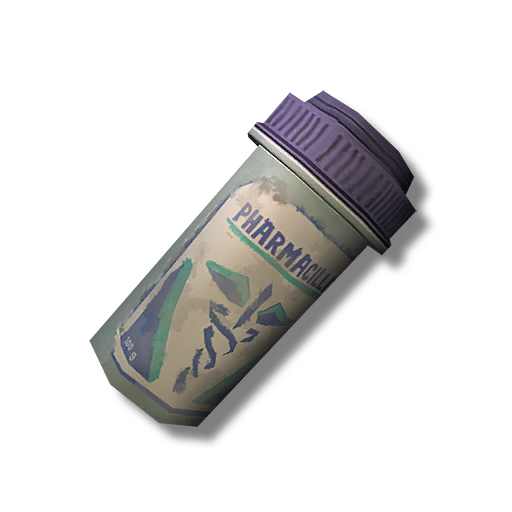 <a href="./Antibiotics.md" class="wikilink" title="Antibiotics">Antibiotics</a>
</td>
</tr>
<tr>
<td>
Alternate Treatment
</td>
<td>
1 x  <a href="./Reishi%20Tea.md" class="wikilink" title="Reishi Tea">Reishi Tea</a>/ <a href="./Burdock%20Tea.md" class="wikilink" title="Burdock Tea">Burdock Tea</a>
</td>
</tr>
<tr>
<td>
Recovery Time
</td>
<td>
10 hours (treated) 
12 - 24 hours (untreated)
</td>
</tr>
<tr>
<td colspan="2" class="section">
<strong>Advanced Data</strong>
</td>
</tr>
<tr>
<td>
Item Key
</td>
<td>
GAMEPLAY_FoodPoisoning
</td>
</tr>
</tbody>
</table>

**Food Poisoning** is a negative affliction that is contracted by eating raw meat, or food with a low item <a href="./Condition.md" class="wikilink" title="Condition">Condition</a>.

## Overview

Food Poisoning occurs randomly when consuming <a href="./Food%20And%20Drink.md" class="wikilink" title="food items">food items</a>. Raw meat and low-condition foods pose the highest risk, whereas high-condition cooked, canned, or processed foods are generally safer options.

Beverage items cannot cause food poisoning; however, <a href="./Water%20%28Unsafe%29.md" class="wikilink" title="Non-Potable Water">Non-Potable Water</a> can cause <a href="./Dysentery.md" class="wikilink" title="Dysentery">Dysentery</a>.

Food above 75% condition will never cause food poisoning, except raw meat and fish. Packaged or canned food items at or above 20% condition are also completely safe; the only exceptions are <a href="./Chocolate%20Bar.md" class="wikilink" title="Chocolate Bar">Chocolate Bar</a>, <a href="./Granola%20Bar.md" class="wikilink" title="Granola Bar">Granola Bar</a>, <a href="./Peanut%20Butter.md" class="wikilink" title="Peanut Butter">Peanut Butter</a>, and <a href="./Tin%20of%20Sardines.md" class="wikilink" title="Tin of Sardines">Tin of Sardines</a>, each posing a risk between 1 and 3 percent.

After achieving Level 5 in <a href="./Cooking.md" class="wikilink" title="Cooking">Cooking</a>, only raw meat, raw fish, and animal fat will cause Food Poisoning. Contracting <a href="./Sour%20Stomach.md" class="wikilink" title="Sour Stomach">Sour Stomach</a> (acquired from playing on <a href="./Misery.md" class="wikilink" title="Misery">Misery</a>) will remove this benefit however.

## Effects

While suffering from Food Poisoning, the player's Condition while not sleeping will decrease by 10% per hour (to a minimum of 15%) and the player's <a href="./Fatigue.md" class="wikilink" title="Fatigue">Fatigue</a> will decrease by 30% per hour. Food Poisoning cannot kill the player directly, but being at such low condition makes hazards like predator encounters, cold weather, dehydration, or even short falls likely to be deadly.

Instances of Food Poisoning do not stack, but a second instance will reset the duration of the first.

## Treatment

- Treatment requires consuming one dose (two pills) of <a href="./Antibiotics.md" class="wikilink" title="Antibiotics">Antibiotics</a> or one cup of <a href="./Reishi%20Tea.md" class="wikilink" title="Reishi Tea">Reishi Tea</a>/<a href="./Burdock%20Tea.md" class="wikilink" title="Burdock Tea">Burdock Tea</a>, followed by resting for a total of 10 hours. Condition will not drain after treatment and while sleeping, but the condition drain will resume upon waking if the player has not slept for the full 10 hours required. Condition regeneration from sleep is disabled while the affliction remains.
- Left untreated, Food Poisoning will pass automatically after 12 - 24 hours. This clock is not visible and the exact duration is decided at random. This can allow the strategic consumption of spoiled food at a safe location without having to consume antibiotics, but care should be taken to ensure <a href="./Cabin%20Fever.md" class="wikilink" title="Cabin Fever">Cabin Fever</a> is not a risk.

## Risk by item

The food poisoning chance depends on both the type of food and the condition of that food item:

<table style="width:100%;">
<colgroup>
<col style="width: 16%" />
<col style="width: 16%" />
<col style="width: 16%" />
<col style="width: 16%" />
<col style="width: 16%" />
<col style="width: 16%" />
</colgroup>
<thead>
<tr>
<th class="unsortable" style="border-style: solid none solid solid"><figure>

<figcaption>Cooking.png</figcaption>
</figure></th>
<th style="border-style: solid solid solid none">
Item
</th>
<th data-sort-type="number">
Above 75%
</th>
<th data-sort-type="number">
Between 20 - 75%
</th>
<th data-sort-type="number">
Below 20%
</th>
<th data-sort-type="number">
Ruined (0%)
</th>
</tr>
</thead>
<tbody>
<tr>
<td><figure>

<figcaption>Acorns_(Cooked)_icon.png</figcaption>
</figure></td>
<td>
<a href="./Acorns%20%28Cooked%29.md" class="wikilink" title="Acorns (Cooked)">Acorns (Cooked)</a>
</td>
<td>
0%
</td>
<td>
0%
</td>
<td>
0%
</td>
<td>
10%
</td>
</tr>
<tr>
<td><figure>

<figcaption>Acorns_(Cooked_-_Large_Portion)_icon.png</figcaption>
</figure></td>
<td>
<a href="./Acorns%20%28Cooked%20-%20Large%20Portion%29.md" class="wikilink" title="Acorns (Cooked - Large Portion)">Acorns (Cooked - Large Portion)</a>
</td>
<td>
0%
</td>
<td>
0%
</td>
<td>
0%
</td>
<td>
10%
</td>
</tr>
<tr>
<td><figure>
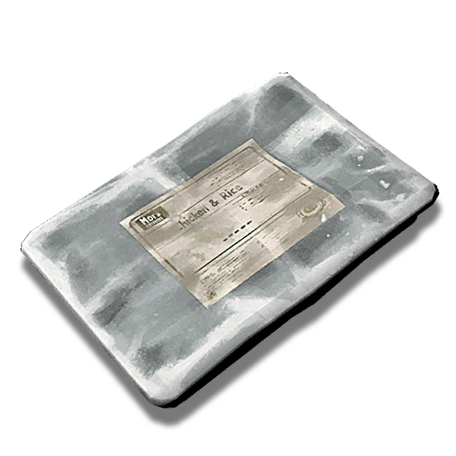
<figcaption>Airline_Food_-_Chicken_icon.png</figcaption>
</figure></td>
<td>
<a href="./Airline%20Food%20-%20Chicken.md" class="wikilink" title="Airline Food - Chicken">Airline Food - Chicken</a>
</td>
<td>
0%
</td>
<td>
0%
</td>
<td>
5%
</td>
<td>
10%
</td>
</tr>
<tr>
<td><figure>
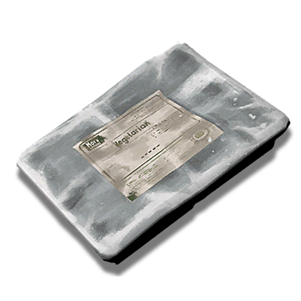
<figcaption>Airline_Food_-_Vegetarian_icon.png</figcaption>
</figure></td>
<td>
<a href="./Airline%20Food%20-%20Vegetarian.md" class="wikilink" title="Airline Food - Vegetarian">Airline Food - Vegetarian</a>
</td>
<td>
0%
</td>
<td>
0%
</td>
<td>
5%
</td>
<td>
10%
</td>
</tr>
<tr>
<td><figure>

<figcaption>Beef_Jerky_icon.png</figcaption>
</figure></td>
<td>
<a href="./Beef%20Jerky.md" class="wikilink" title="Beef Jerky">Beef Jerky</a>
</td>
<td>
0%
</td>
<td>
0%
</td>
<td>
5%
</td>
<td>
10%
</td>
</tr>
<tr>
<td><figure>

<figcaption>Birch_Bark_Tea_icon.png</figcaption>
</figure></td>
<td>
<a href="./Birch%20Bark%20Tea.md" class="wikilink" title="Birch Bark Tea">Birch Bark Tea</a>
</td>
<td>
0%
</td>
<td>
0%
</td>
<td>
0%
</td>
<td>
0%
</td>
</tr>
<tr>
<td><figure>

<figcaption>Bear_Meat_(Cooked)_icon.png</figcaption>
</figure></td>
<td>
<a href="./Bear%20Meat%20%28Raw%29.md" class="wikilink" title="Bear Meat (Cooked)">Bear Meat (Cooked)</a>
</td>
<td>
0%
</td>
<td>
3%
</td>
<td>
30%
</td>
<td>
60%
</td>
</tr>
<tr>
<td><figure>

<figcaption>Bear_Meat_(Raw)_icon.png</figcaption>
</figure></td>
<td>
<a href="./Bear%20Meat%20%28Raw%29.md" class="wikilink" title="Bear Meat (Raw)">Bear Meat (Raw)</a>
</td>
<td>
70%
</td>
<td>
70%
</td>
<td>
95%
</td>
<td>
95%
</td>
</tr>
<tr>
<td><figure>

<figcaption>Burbot_(Cooked)_icon.png</figcaption>
</figure></td>
<td>
<a href="./Burbot%20%28Cooked%29.md" class="wikilink" title="Burbot (Cooked)">Burbot (Cooked)</a>
</td>
<td>
0%
</td>
<td>
3%
</td>
<td>
50%
</td>
<td>
50%
</td>
</tr>
<tr>
<td><figure>

<figcaption>Burbot_(Raw)_icon.png</figcaption>
</figure></td>
<td>
<a href="./Burbot%20%28Raw%29.md" class="wikilink" title="Burbot (Raw)">Burbot (Raw)</a>
</td>
<td>
50%
</td>
<td>
50%
</td>
<td>
95%
</td>
<td>
95%
</td>
</tr>
<tr>
<td><figure>

<figcaption>Burdock_Tea_icon.png</figcaption>
</figure></td>
<td>
<a href="./Burdock%20Tea.md" class="wikilink" title="Burdock Tea">Burdock Tea</a>
</td>
<td>
0%
</td>
<td>
0%
</td>
<td>
0%
</td>
<td>
0%
</td>
</tr>
<tr>
<td><figure>

<figcaption>Chocolate_Bar_icon.png</figcaption>
</figure></td>
<td>
<a href="./Chocolate%20Bar.md" class="wikilink" title="Chocolate Bar">Chocolate Bar</a>
</td>
<td>
0%
</td>
<td>
1%
</td>
<td>
5%
</td>
<td>
10%
</td>
</tr>
<tr>
<td><figure>

<figcaption>Cat_Tail_Stalk_icon.png</figcaption>
</figure></td>
<td>
<a href="./Cat%20Tail%20Stalk.md" class="wikilink" title="Cat Tail Stalk">Cat Tail Stalk</a>
</td>
<td>
0%
</td>
<td>
1%
</td>
<td>
5%
</td>
<td>
10%
</td>
</tr>
<tr>
<td><figure>

<figcaption>Coho_Salmon_(Cooked)_icon.png</figcaption>
</figure></td>
<td>
<a href="./Coho%20Salmon%20%28Cooked%29.md" class="wikilink" title="Coho Salmon (Cooked)">Coho Salmon (Cooked)</a>
</td>
<td>
0%
</td>
<td>
3%
</td>
<td>
25%
</td>
<td>
50%
</td>
</tr>
<tr>
<td><figure>

<figcaption>Coho_Salmon_(Raw)_icon.png</figcaption>
</figure></td>
<td>
<a href="./Coho%20Salmon%20%28Raw%29.md" class="wikilink" title="Coho Salmon (Raw)">Coho Salmon (Raw)</a>
</td>
<td>
50%
</td>
<td>
50%
</td>
<td>
95%
</td>
<td>
95%
</td>
</tr>
<tr>
<td><figure>

<figcaption>Condensed_Milk_icon.png</figcaption>
</figure></td>
<td>
<a href="./Condensed%20Milk.md" class="wikilink" title="Condensed Milk">Condensed Milk</a>
</td>
<td>
0%
</td>
<td>
0%
</td>
<td>
20%
</td>
<td>
40%
</td>
</tr>
<tr>
<td><figure>

<figcaption>Cup_of_Coffee_icon.png</figcaption>
</figure></td>
<td>
<a href="./Cup%20of%20Coffee.md" class="wikilink" title="Cup of Coffee">Cup of Coffee</a>
</td>
<td>
0%
</td>
<td>
0%
</td>
<td>
0%
</td>
<td>
0%
</td>
</tr>
<tr>
<td><figure>

<figcaption>Cup_of_Herbal_Tea_icon.png</figcaption>
</figure></td>
<td>
<a href="./Cup%20of%20Herbal%20Tea.md" class="wikilink" title="Cup of Herbal Tea">Cup of Herbal Tea</a>
</td>
<td>
0%
</td>
<td>
0%
</td>
<td>
0%
</td>
<td>
0%
</td>
</tr>
<tr>
<td><figure>
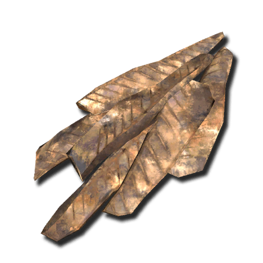
<figcaption>Cured_Fish_icon.png</figcaption>
</figure></td>
<td>
<a href="./Cured%20Fish.md" class="wikilink" title="Cured Fish">Cured Fish</a>
</td>
<td>
0%
</td>
<td>
1%
</td>
<td>
10%
</td>
<td>
50%
</td>
</tr>
<tr>
<td><figure>
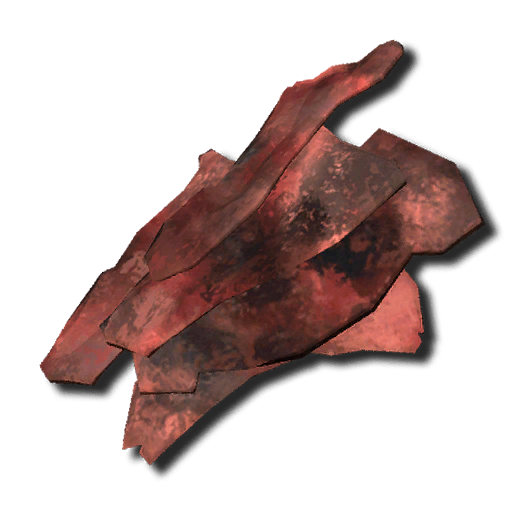
<figcaption>Cured_Meat_icon.png</figcaption>
</figure></td>
<td>
<a href="./Cured%20Meat.md" class="wikilink" title="Cured Meat">Cured Meat</a>
</td>
<td>
0%
</td>
<td>
1%
</td>
<td>
10%
</td>
<td>
50%
</td>
</tr>
<tr>
<td><figure>

<figcaption>Dog_Food_icon.png</figcaption>
</figure></td>
<td>
<a href="./Dog%20Food.md" class="wikilink" title="Dog Food">Dog Food</a>
</td>
<td>
0%
</td>
<td>
0%
</td>
<td>
30%
</td>
<td>
60%
</td>
</tr>
<tr>
<td><figure>

<figcaption>Energy_Bar_icon.png</figcaption>
</figure></td>
<td>
<a href="./Energy%20Bar.md" class="wikilink" title="Energy Bar">Energy Bar</a>
</td>
<td>
0%
</td>
<td>
0%
</td>
<td>
10%
</td>
<td>
20%
</td>
</tr>
<tr>
<td><figure>

<figcaption>Goldeye_(Cooked)_icon.png</figcaption>
</figure></td>
<td>
<a href="./Goldeye%20%28Cooked%29.md" class="wikilink" title="Goldeye (Cooked)">Goldeye (Cooked)</a>
</td>
<td>
0%
</td>
<td>
3%
</td>
<td>
50%
</td>
<td>
50%
</td>
</tr>
<tr>
<td><figure>

<figcaption>Goldeye_(Raw)_icon.png</figcaption>
</figure></td>
<td>
<a href="./Goldeye%20%28Raw%29.md" class="wikilink" title="Goldeye (Raw)">Goldeye (Raw)</a>
</td>
<td>
50%
</td>
<td>
50%
</td>
<td>
95%
</td>
<td>
95%
</td>
</tr>
<tr>
<td><figure>

<figcaption>Go!_Energy_Drink_icon.png</figcaption>
</figure></td>
<td>
<a href="./Go!%20Energy%20Drink.md" class="wikilink" title="Go! Energy Drink">Go! Energy Drink</a>
</td>
<td>
0%
</td>
<td>
0%
</td>
<td>
0%
</td>
<td>
0%
</td>
</tr>
<tr>
<td><figure>

<figcaption>Granola_Bar_icon.png</figcaption>
</figure></td>
<td>
<a href="./Granola%20Bar.md" class="wikilink" title="Granola Bar">Granola Bar</a>
</td>
<td>
0%
</td>
<td>
1%
</td>
<td>
10%
</td>
<td>
20%
</td>
</tr>
<tr>
<td><figure>

<figcaption>Ketchup_Chips_icon.png</figcaption>
</figure></td>
<td>
<a href="./Ketchup%20Chips.md" class="wikilink" title="Ketchup Chips">Ketchup Chips</a>
</td>
<td>
0%
</td>
<td>
0%
</td>
<td>
5%
</td>
<td>
10%
</td>
</tr>
<tr>
<td><figure>

<figcaption>Lake_Whitefish_(Cooked)_icon.png</figcaption>
</figure></td>
<td>
<a href="./Lake%20Whitefish%20%28Cooked%29.md" class="wikilink" title="Lake Whitefish (Cooked)">Lake Whitefish (Cooked)</a>
</td>
<td>
0%
</td>
<td>
3%
</td>
<td>
50%
</td>
<td>
95%
</td>
</tr>
<tr>
<td><figure>

<figcaption>Lake_Whitefish_(Raw)_icon.png</figcaption>
</figure></td>
<td>
<a href="./Lake%20Whitefish%20%28Raw%29.md" class="wikilink" title="Lake Whitefish (Raw)">Lake Whitefish (Raw)</a>
</td>
<td>
50%
</td>
<td>
50%
</td>
<td>
95%
</td>
<td>
95%
</td>
</tr>
<tr>
<td><figure>

<figcaption>Maple_Syrup_icon.png</figcaption>
</figure></td>
<td>
<a href="./Maple%20Syrup.md" class="wikilink" title="Maple Syrup">Maple Syrup</a>
</td>
<td>
0%
</td>
<td>
0%
</td>
<td>
20%
</td>
<td>
40%
</td>
</tr>
<tr>
<td><figure>

<figcaption>Military-Grade_MRE_icon.png</figcaption>
</figure></td>
<td>
<a href="./Military-Grade%20MRE.md" class="wikilink" title="Military-Grade MRE">Military-Grade MRE</a>
</td>
<td>
0%
</td>
<td>
0%
</td>
<td>
5%
</td>
<td>
10%
</td>
</tr>
<tr>
<td><figure>

<figcaption>Moose_Meat_(Cooked)_icon.png</figcaption>
</figure></td>
<td>
<a href="./Moose%20Meat%20%28Cooked%29.md" class="wikilink" title="Moose Meat (Cooked)">Moose Meat (Cooked)</a>
</td>
<td>
0%
</td>
<td>
3%
</td>
<td>
30%
</td>
<td>
60%
</td>
</tr>
<tr>
<td><figure>

<figcaption>Moose_Meat_(Raw)_icon.png</figcaption>
</figure></td>
<td>
<a href="./Moose%20Meat%20%28Raw%29.md" class="wikilink" title="Moose Meat (Raw)">Moose Meat (Raw)</a>
</td>
<td>
75%
</td>
<td>
75%
</td>
<td>
90%
</td>
<td>
90%
</td>
</tr>
<tr>
<td><figure>

<figcaption>Orange_Soda_icon.png</figcaption>
</figure></td>
<td>
<a href="./Orange%20Soda.md" class="wikilink" title="Orange Soda">Orange Soda</a>
</td>
<td>
0%
</td>
<td>
0%
</td>
<td>
0%
</td>
<td>
0%
</td>
</tr>
<tr>
<td><figure>
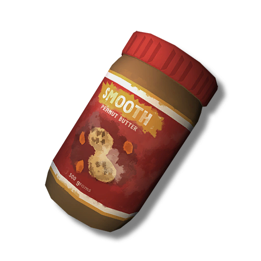
<figcaption>Peanut_Butter_icon.png</figcaption>
</figure></td>
<td>
<a href="./Peanut%20Butter.md" class="wikilink" title="Peanut Butter">Peanut Butter</a>
</td>
<td>
0%
</td>
<td>
1%
</td>
<td>
25%
</td>
<td>
50%
</td>
</tr>
<tr>
<td><figure>

<figcaption>Pinnacle_Peaches_icon.png</figcaption>
</figure></td>
<td>
<a href="./Pinnacle%20Peaches.md" class="wikilink" title="Pinnacle Peaches">Pinnacle Peaches</a>
</td>
<td>
0%
</td>
<td>
0%
</td>
<td>
20%
</td>
<td>
40%
</td>
</tr>
<tr>
<td><figure>

<figcaption>Pork_and_Beans_icon.png</figcaption>
</figure></td>
<td>
<a href="./Pork%20and%20Beans.md" class="wikilink" title="Pork and Beans">Pork and Beans</a>
</td>
<td>
0%
</td>
<td>
0%
</td>
<td>
20%
</td>
<td>
40%
</td>
</tr>
<tr>
<td><figure>

<figcaption>Prepared_Burdock_icon.png</figcaption>
</figure></td>
<td>
<a href="./Prepared%20Burdock.md" class="wikilink" title="Prepared Burdock">Prepared Burdock</a>
</td>
<td>
0%
</td>
<td>
0%
</td>
<td>
5%
</td>
<td>
10%
</td>
</tr>
<tr>
<td><figure>

<figcaption>Rabbit_(Cooked)_icon.png</figcaption>
</figure></td>
<td>
<a href="./Rabbit%20%28Cooked%29.md" class="wikilink" title="Rabbit (Cooked)">Rabbit (Cooked)</a>
</td>
<td>
0%
</td>
<td>
3%
</td>
<td>
25%
</td>
<td>
50%
</td>
</tr>
<tr>
<td><figure>

<figcaption>Rabbit_(Raw)_icon.png</figcaption>
</figure></td>
<td>
<a href="./Rabbit%20%28Raw%29.md" class="wikilink" title="Rabbit (Raw)">Rabbit (Raw)</a>
</td>
<td>
60%
</td>
<td>
60%
</td>
<td>
90%
</td>
<td>
90%
</td>
</tr>
<tr>
<td><figure>

<figcaption>Rainbow_Trout_(Cooked)_icon.png</figcaption>
</figure></td>
<td>
<a href="./Rainbow%20Trout%20%28Cooked%29.md" class="wikilink" title="Rainbow Trout">Rainbow Trout</a>
</td>
<td>
0%
</td>
<td>
3%
</td>
<td>
50%
</td>
<td>
50%
</td>
</tr>
<tr>
<td><figure>

<figcaption>Rainbow_Trout_(Raw)_icon.png</figcaption>
</figure></td>
<td>
<a href="./Rainbow%20Trout%20%28Cooked%29.md" class="wikilink" title="Rainbow Trout">Rainbow Trout</a>
</td>
<td>
50%
</td>
<td>
50%
</td>
<td>
95%
</td>
<td>
95%
</td>
</tr>
<tr>
<td><figure>

<figcaption>Red_Irish_Lord_(Cooked)_icon.png</figcaption>
</figure></td>
<td>
<a href="./Red%20Irish%20Lord%20%28Cooked%29.md" class="wikilink" title="Red Irish Lord (Cooked)">Red Irish Lord (Cooked)</a>
</td>
<td>
0%
</td>
<td>
3%
</td>
<td>
50%
</td>
<td>
50%
</td>
</tr>
<tr>
<td><figure>

<figcaption>Red_Irish_Lord_(Raw)_icon.png</figcaption>
</figure></td>
<td>
<a href="./Red%20Irish%20Lord%20%28Raw%29.md" class="wikilink" title="Red Irish Lord (Raw)">Red Irish Lord (Raw)</a>
</td>
<td>
50%
</td>
<td>
50%
</td>
<td>
95%
</td>
<td>
95%
</td>
</tr>
<tr>
<td><figure>

<figcaption>Reishi_Tea_icon.png</figcaption>
</figure></td>
<td>
<a href="./Reishi%20Tea.md" class="wikilink" title="Reishi Tea">Reishi Tea</a>
</td>
<td>
0%
</td>
<td>
0%
</td>
<td>
0%
</td>
<td>
0%
</td>
</tr>
<tr>
<td><figure>

<figcaption>Rockfish_(Cooked)_icon.png</figcaption>
</figure></td>
<td>
<a href="./Rockfish%20%28Cooked%29.md" class="wikilink" title="Rockfish (Cooked)">Rockfish (Cooked)</a>
</td>
<td>
0%
</td>
<td>
3%
</td>
<td>
50%
</td>
<td>
50%
</td>
</tr>
<tr>
<td><figure>

<figcaption>Rockfish_(Raw)_icon.png</figcaption>
</figure></td>
<td>
<a href="./Rockfish%20%28Raw%29.md" class="wikilink" title="Rockfish (Raw)">Rockfish (Raw)</a>
</td>
<td>
50%
</td>
<td>
50%
</td>
<td>
95%
</td>
<td>
95%
</td>
</tr>
<tr>
<td><figure>

<figcaption>Rose_Hip_Tea_icon.png</figcaption>
</figure></td>
<td>
<a href="./Rose%20Hip%20Tea.md" class="wikilink" title="Rose Hip Tea">Rose Hip Tea</a>
</td>
<td>
0%
</td>
<td>
0%
</td>
<td>
0%
</td>
<td>
0%
</td>
</tr>
<tr>
<td><figure>
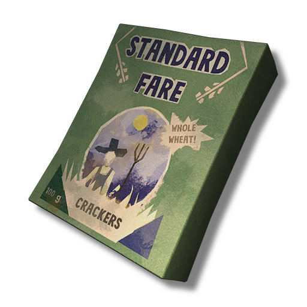
<figcaption>Salty_Crackers_icon.png</figcaption>
</figure></td>
<td>
<a href="./Salty%20Crackers.md" class="wikilink" title="Salty Crackers">Salty Crackers</a>
</td>
<td>
0%
</td>
<td>
0%
</td>
<td>
5%
</td>
<td>
10%
</td>
</tr>
<tr>
<td><figure>

<figcaption>Smallmouth_Bass_(Cooked)_icon.png</figcaption>
</figure></td>
<td>
<a href="./Smallmouth%20Bass%20%28Cooked%29.md" class="wikilink" title="Smallmouth Bass (Cooked)">Smallmouth Bass (Cooked)</a>
</td>
<td>
0%
</td>
<td>
3%
</td>
<td>
25%
</td>
<td>
50%
</td>
</tr>
<tr>
<td><figure>

<figcaption>Smallmouth_Bass_(Raw)_icon.png</figcaption>
</figure></td>
<td>
<a href="./Smallmouth%20Bass%20%28Raw%29.md" class="wikilink" title="Smallmouth Bass (Raw)">Smallmouth Bass (Raw)</a>
</td>
<td>
50%
</td>
<td>
50%
</td>
<td>
95%
</td>
<td>
95%
</td>
</tr>
<tr>
<td><figure>

<figcaption>Stacy's_Grape_Soda_icon.png</figcaption>
</figure></td>
<td>
<a href="./Stacy%27s%20Grape%20Soda.md" class="wikilink" title="Stacy&#39;s Grape Soda">Stacy's Grape Soda</a>
</td>
<td>
0%
</td>
<td>
0%
</td>
<td>
0%
</td>
<td>
0%
</td>
</tr>
<tr>
<td><figure>

<figcaption>Summit_Soda_icon.png</figcaption>
</figure></td>
<td>
<a href="./Summit%20Soda.md" class="wikilink" title="Summit Soda">Summit Soda</a>
</td>
<td>
0%
</td>
<td>
0%
</td>
<td>
0%
</td>
<td>
0%
</td>
</tr>
<tr>
<td><figure>
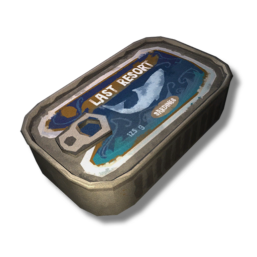
<figcaption>Tin_of_Sardines_icon.png</figcaption>
</figure></td>
<td>
<a href="./Tin%20of%20Sardines.md" class="wikilink" title="Tin of Sardines">Tin of Sardines</a>
</td>
<td>
0%
</td>
<td>
3%
</td>
<td>
20%
</td>
<td>
40%
</td>
</tr>
<tr>
<td><figure>

<figcaption>Tomato_Soup_icon.png</figcaption>
</figure></td>
<td>
<a href="./Tomato%20Soup.md" class="wikilink" title="Tomato Soup">Tomato Soup</a>
</td>
<td>
0%
</td>
<td>
0%
</td>
<td>
20%
</td>
<td>
40%
</td>
</tr>
<tr>
<td><figure>

<figcaption>Venison_(Cooked)_icon.png</figcaption>
</figure></td>
<td>
<a href="./Venison%20%28Cooked%29.md" class="wikilink" title="Venison (Cooked)">Venison (Cooked)</a>
</td>
<td>
0%
</td>
<td>
3%
</td>
<td>
30%
</td>
<td>
60%
</td>
</tr>
<tr>
<td><figure>

<figcaption>Venison_(Raw)_icon.png</figcaption>
</figure></td>
<td>
<a href="./Venison%20%28Raw%29.md" class="wikilink" title="Venison (Raw)">Venison (Raw)</a>
</td>
<td>
75%
</td>
<td>
75%
</td>
<td>
90%
</td>
<td>
90%
</td>
</tr>
<tr>
<td><figure>

<figcaption>Wolf_Meat_(Cooked)_icon.png</figcaption>
</figure></td>
<td>
<a href="./Wolf%20Meat%20%28Cooked%29.md" class="wikilink" title="Wolf Meat (Cooked)">Wolf Meat (Cooked)</a>
</td>
<td>
0%
</td>
<td>
3%
</td>
<td>
30%
</td>
<td>
60%
</td>
</tr>
<tr>
<td><figure>

<figcaption>Wolf_Meat_(Raw)_icon.png</figcaption>
</figure></td>
<td>
<a href="./Wolf%20Meat%20%28Raw%29.md" class="wikilink" title="Wolf Meat (Raw)">Wolf Meat (Raw)</a>
</td>
<td>
55%
</td>
<td>
55%
</td>
<td>
95%
</td>
<td>
95%
</td>
</tr>
</tbody>
</table>

### Tales from the Far Territory Food

<table style="width:100%;">
<colgroup>
<col style="width: 16%" />
<col style="width: 16%" />
<col style="width: 16%" />
<col style="width: 16%" />
<col style="width: 16%" />
<col style="width: 16%" />
</colgroup>
<thead>
<tr>
<th class="unsortable" style="border-style: solid none solid solid"><figure>

<figcaption>Cooking.png</figcaption>
</figure></th>
<th style="border-style: solid solid solid none">
Item
</th>
<th data-sort-type="number">
Above 75%
</th>
<th data-sort-type="number">
Between 20 - 75%
</th>
<th data-sort-type="number">
Below 20%
</th>
<th data-sort-type="number">
Ruined (0%)
</th>
</tr>
</thead>
<tbody>
<tr>
<td><figure>

<figcaption>Acorn_Bannock_icon.png</figcaption>
</figure></td>
<td>
<a href="./Acorn%20Bannock.md" class="wikilink" title="Acorn Bannock">Acorn Bannock</a>
</td>
<td>
0%
</td>
<td>
0%
</td>
<td>
5%
</td>
<td>
10%
</td>
</tr>
<tr>
<td><figure>

<figcaption>Acorn_Pancakes_icon.png</figcaption>
</figure></td>
<td>
<a href="./Acorn%20Pancakes.md" class="wikilink" title="Acorn Pancakes">Acorn Pancakes</a>
</td>
<td>
0%
</td>
<td>
0%
</td>
<td>
5%
</td>
<td>
10%
</td>
</tr>
<tr>
<td><figure>

<figcaption>Bannock_icon.png</figcaption>
</figure></td>
<td>
<a href="./Bannock.md" class="wikilink" title="Bannock">Bannock</a>
</td>
<td>
0%
</td>
<td>
0%
</td>
<td>
5%
</td>
<td>
10%
</td>
</tr>
<tr>
<td><figure>

<figcaption>Breyerhouse_Pie_icon.png</figcaption>
</figure></td>
<td>
<a href="./Breyerhouse%20Pie.md" class="wikilink" title="Breyerhouse Pie">Breyerhouse Pie</a>
</td>
<td>
0%
</td>
<td>
0%
</td>
<td>
5%
</td>
<td>
10%
</td>
</tr>
<tr>
<td><figure>

<figcaption>Broth_icon.png</figcaption>
</figure></td>
<td>
<a href="./Broth.md" class="wikilink" title="Broth">Broth</a>
</td>
<td>
0%
</td>
<td>
0%
</td>
<td>
5%
</td>
<td>
10%
</td>
</tr>
<tr>
<td><figure>

<figcaption>Camber_Flight_Porridge_icon.png</figcaption>
</figure></td>
<td>
<a href="./Camber%20Flight%20Porridge.md" class="wikilink" title="Camber Flight Porridge">Camber Flight Porridge</a>
</td>
<td>
0%
</td>
<td>
0%
</td>
<td>
5%
</td>
<td>
10%
</td>
</tr>
<tr>
<td><figure>

<figcaption>Canned_Corn_icon.png</figcaption>
</figure></td>
<td>
<a href="./Canned%20Corn.md" class="wikilink" title="Canned Corn">Canned Corn</a>
</td>
<td>
0%
</td>
<td>
0%
</td>
<td>
20%
</td>
<td>
40%
</td>
</tr>
<tr>
<td><figure>
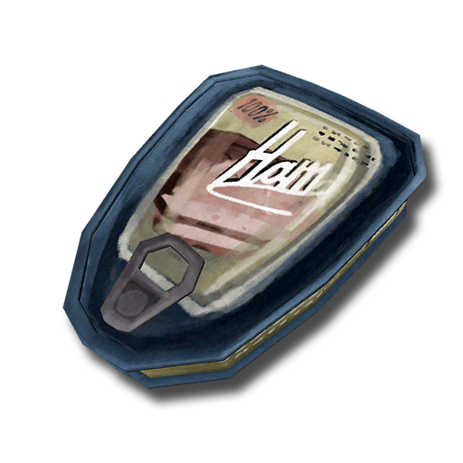
<figcaption>Canned_Ham_icon.png</figcaption>
</figure></td>
<td>
<a href="./Canned%20Ham.md" class="wikilink" title="Canned Ham">Canned Ham</a>
</td>
<td>
0%
</td>
<td>
0%
</td>
<td>
30%
</td>
<td>
50%
</td>
</tr>
<tr>
<td><figure>

<figcaption>Canned_Pineapple_icon.png</figcaption>
</figure></td>
<td>
<a href="./Canned%20Pineapple.md" class="wikilink" title="Canned Pineapple">Canned Pineapple</a>
</td>
<td>
0%
</td>
<td>
0%
</td>
<td>
20%
</td>
<td>
40%
</td>
</tr>
<tr>
<td><figure>

<figcaption>Carrot_icon.png</figcaption>
</figure></td>
<td>
<a href="./Carrot.md" class="wikilink" title="Carrot">Carrot</a>
</td>
<td>
0%
</td>
<td>
0%
</td>
<td>
5%
</td>
<td>
10%
</td>
</tr>
<tr>
<td><figure>
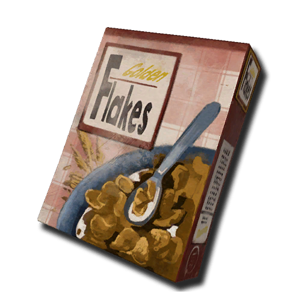
<figcaption>Cereal_icon.png</figcaption>
</figure></td>
<td>
<a href="./Cereal.md" class="wikilink" title="Cereal">Cereal</a>
</td>
<td>
0%
</td>
<td>
0%
</td>
<td>
2%
</td>
<td>
10%
</td>
</tr>
<tr>
<td><figure>

<figcaption>Coastal_Fishcakes_icon.png</figcaption>
</figure></td>
<td>
<a href="./Coastal%20Fishcakes.md" class="wikilink" title="Coastal Fishcakes">Coastal Fishcakes</a>
</td>
<td>
0%
</td>
<td>
0%
</td>
<td>
5%
</td>
<td>
10%
</td>
</tr>
<tr>
<td><figure>

<figcaption>Cooked_Potato_icon.png</figcaption>
</figure></td>
<td>
<a href="./Cooked%20Potato.md" class="wikilink" title="Cooked Potato">Cooked Potato</a>
</td>
<td>
0%
</td>
<td>
0%
</td>
<td>
5%
</td>
<td>
10%
</td>
</tr>
<tr>
<td><figure>

<figcaption>Dockworker's_Pie_icon.png</figcaption>
</figure></td>
<td>
<a href="./Dockworker%27s%20Pie.md" class="wikilink" title="Dockworker&#39;s Pie">Dockworker's Pie</a>
</td>
<td>
0%
</td>
<td>
0%
</td>
<td>
5%
</td>
<td>
10%
</td>
</tr>
<tr>
<td><figure>
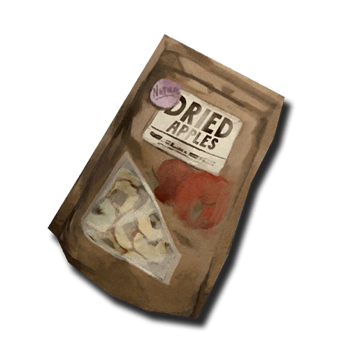
<figcaption>Dried_Apples_icon.png</figcaption>
</figure></td>
<td>
<a href="./Dried%20Apples.md" class="wikilink" title="Dried Apples">Dried Apples</a>
</td>
<td>
0%
</td>
<td>
0%
</td>
<td>
5%
</td>
<td>
10%
</td>
</tr>
<tr>
<td><figure>

<figcaption>Last_Resort_Soup_icon.png</figcaption>
</figure></td>
<td>
<a href="./Last%20Resort%20Soup.md" class="wikilink" title="Last Resort Soup">Last Resort Soup</a>
</td>
<td>
0%
</td>
<td>
0%
</td>
<td>
5%
</td>
<td>
10%
</td>
</tr>
<tr>
<td><figure>

<figcaption>Lily's_Pancakes_icon.png</figcaption>
</figure></td>
<td>
<a href="./Lily%27s%20Pancakes.md" class="wikilink" title="Lily&#39;s Pancakes">Lily's Pancakes</a>
</td>
<td>
0%
</td>
<td>
0%
</td>
<td>
5%
</td>
<td>
10%
</td>
</tr>
<tr>
<td><figure>

<figcaption>Pancakes_icon.png</figcaption>
</figure></td>
<td>
<a href="./Pancakes.md" class="wikilink" title="Pancakes">Pancakes</a>
</td>
<td>
0%
</td>
<td>
0%
</td>
<td>
5%
</td>
<td>
10%
</td>
</tr>
<tr>
<td><figure>

<figcaption>Peach_Pie_icon.png</figcaption>
</figure></td>
<td>
<a href="./Peach%20Pie.md" class="wikilink" title="Peach Pie">Peach Pie</a>
</td>
<td>
0%
</td>
<td>
0%
</td>
<td>
5%
</td>
<td>
10%
</td>
</tr>
<tr>
<td><figure>

<figcaption>Pemmican_Bar_icon.png</figcaption>
</figure></td>
<td>
<a href="./Pemmican%20Bar.md" class="wikilink" title="Pemmican Bar">Pemmican Bar</a>
</td>
<td>
0%
</td>
<td>
0%
</td>
<td>
5%
</td>
<td>
10%
</td>
</tr>
<tr>
<td><figure>
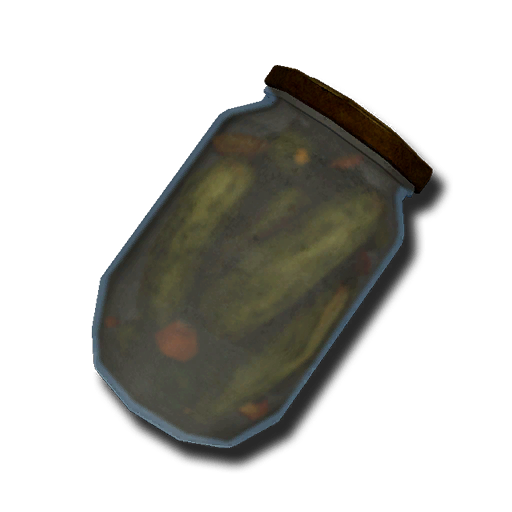
<figcaption>Pickles_icon.png</figcaption>
</figure></td>
<td>
<a href="./Pickles.md" class="wikilink" title="Pickles">Pickles</a>
</td>
<td>
0%
</td>
<td>
0%
</td>
<td>
5%
</td>
<td>
10%
</td>
</tr>
<tr>
<td><figure>

<figcaption>Porridge_icon.png</figcaption>
</figure></td>
<td>
<a href="./Porridge.md" class="wikilink" title="Porridge">Porridge</a>
</td>
<td>
0%
</td>
<td>
0%
</td>
<td>
5%
</td>
<td>
10%
</td>
</tr>
<tr>
<td><figure>

<figcaption>Porter's_Soup_icon.png</figcaption>
</figure></td>
<td>
<a href="./Porter%27s%20Soup.md" class="wikilink" title="Porter&#39;s Soup">Porter's Soup</a>
</td>
<td>
0%
</td>
<td>
0%
</td>
<td>
5%
</td>
<td>
10%
</td>
</tr>
<tr>
<td><figure>

<figcaption>Ptarmigan_(Cooked)_icon.png</figcaption>
</figure></td>
<td>
<a href="./Ptarmigan%20%28Cooked%29.md" class="wikilink" title="Ptarmigan (Cooked)">Ptarmigan (Cooked)</a>
</td>
<td>
0%
</td>
<td>
3%
</td>
<td>
25%
</td>
<td>
50%
</td>
</tr>
<tr>
<td><figure>

<figcaption>Ptarmigan_(Raw)_icon.png</figcaption>
</figure></td>
<td>
<a href="./Ptarmigan%20%28Raw%29.md" class="wikilink" title="Ptarmigan (Raw)">Ptarmigan (Raw)</a>
</td>
<td>
60%
</td>
<td>
60%
</td>
<td>
90%
</td>
<td>
90%
</td>
</tr>
<tr>
<td><figure>

<figcaption>Ptarmigan_Pie_icon.png</figcaption>
</figure></td>
<td>
<a href="./Ptarmigan%20Pie.md" class="wikilink" title="Ptarmigan Pie">Ptarmigan Pie</a>
</td>
<td>
0%
</td>
<td>
0%
</td>
<td>
5%
</td>
<td>
10%
</td>
</tr>
<tr>
<td><figure>

<figcaption>Ptarmigan_Stew_icon.png</figcaption>
</figure></td>
<td>
<a href="./Ptarmigan%20Stew.md" class="wikilink" title="Ptarmigan Stew">Ptarmigan Stew</a>
</td>
<td>
0%
</td>
<td>
0%
</td>
<td>
5%
</td>
<td>
10%
</td>
</tr>
<tr>
<td><figure>

<figcaption>Prepper's_Pie_icon.png</figcaption>
</figure></td>
<td>
<a href="./Prepper%27s%20Pie.md" class="wikilink" title="Prepper&#39;s Pie">Prepper's Pie</a>
</td>
<td>
0%
</td>
<td>
0%
</td>
<td>
5%
</td>
<td>
10%
</td>
</tr>
<tr>
<td><figure>

<figcaption>Rabbit_Pie_icon.png</figcaption>
</figure></td>
<td>
<a href="./Rabbit%20Pie.md" class="wikilink" title="Rabbit Pie">Rabbit Pie</a>
</td>
<td>
0%
</td>
<td>
0%
</td>
<td>
5%
</td>
<td>
10%
</td>
</tr>
<tr>
<td><figure>

<figcaption>Rabbit_Stew_icon.png</figcaption>
</figure></td>
<td>
<a href="./Rabbit%20Stew.md" class="wikilink" title="Rabbit Stew">Rabbit Stew</a>
</td>
<td>
0%
</td>
<td>
0%
</td>
<td>
5%
</td>
<td>
10%
</td>
</tr>
<tr>
<td><figure>

<figcaption>Ranger_Stew_icon.png</figcaption>
</figure></td>
<td>
<a href="./Ranger%20Stew.md" class="wikilink" title="Ranger Stew">Ranger Stew</a>
</td>
<td>
0%
</td>
<td>
0%
</td>
<td>
5%
</td>
<td>
10%
</td>
</tr>
<tr>
<td><figure>

<figcaption>Rose_Hip_Pie_icon.png</figcaption>
</figure></td>
<td>
<a href="./Rose%20Hip%20Pie.md" class="wikilink" title="Rose Hip Pie">Rose Hip Pie</a>
</td>
<td>
0%
</td>
<td>
0%
</td>
<td>
5%
</td>
<td>
10%
</td>
</tr>
<tr>
<td><figure>

<figcaption>Stalker's_Pie_icon.png</figcaption>
</figure></td>
<td>
<a href="./Stalker%27s%20Pie.md" class="wikilink" title="Stalker&#39;s Pie">Stalker's Pie</a>
</td>
<td>
0%
</td>
<td>
0%
</td>
<td>
5%
</td>
<td>
10%
</td>
</tr>
<tr>
<td><figure>

<figcaption>Thomson_Family_Stew_icon.png</figcaption>
</figure></td>
<td>
<a href="./Thomson%20Family%20Stew.md" class="wikilink" title="Thomson Family Stew">Thomson Family Stew</a>
</td>
<td>
0%
</td>
<td>
0%
</td>
<td>
5%
</td>
<td>
10%
</td>
</tr>
<tr>
<td><figure>

<figcaption>Trout_Stew_icon.png</figcaption>
</figure></td>
<td>
<a href="./Trout%20Stew.md" class="wikilink" title="Trout Stew">Trout Stew</a>
</td>
<td>
0%
</td>
<td>
0%
</td>
<td>
5%
</td>
<td>
10%
</td>
</tr>
<tr>
<td><figure>

<figcaption>Vagabond_Soup_icon.png</figcaption>
</figure></td>
<td>
<a href="./Vagabond%20Soup.md" class="wikilink" title="Vagabond Soup">Vagabond Soup</a>
</td>
<td>
0%
</td>
<td>
0%
</td>
<td>
5%
</td>
<td>
10%
</td>
</tr>
<tr>
<td><figure>

<figcaption>Venison_Pie_icon.png</figcaption>
</figure></td>
<td>
<a href="./Venison%20Pie.md" class="wikilink" title="Venison Pie">Venison Pie</a>
</td>
<td>
0%
</td>
<td>
0%
</td>
<td>
5%
</td>
<td>
10%
</td>
</tr>
<tr>
<td><figure>

<figcaption>Venison_Stew_icon.png</figcaption>
</figure></td>
<td>
<a href="./Venison%20Stew.md" class="wikilink" title="Venison Stew">Venison Stew</a>
</td>
<td>
0%
</td>
<td>
0%
</td>
<td>
5%
</td>
<td>
10%
</td>
</tr>
</tbody>
</table>

### Wintermute Foods

<table style="width:100%;">
<colgroup>
<col style="width: 16%" />
<col style="width: 16%" />
<col style="width: 16%" />
<col style="width: 16%" />
<col style="width: 16%" />
<col style="width: 16%" />
</colgroup>
<thead>
<tr>
<th><figure>

<figcaption>Cooking.png</figcaption>
</figure></th>
<th>
Item
</th>
<th>
Above 75%
</th>
<th>
Between 20 - 75%
</th>
<th>
Below 20%
</th>
<th>
Ruined (0%)
</th>
</tr>
</thead>
<tbody>
<tr>
<td><figure>

<figcaption>Big_Bass_(Cooked)_icon.png</figcaption>
</figure></td>
<td>
<a href="./Big%20Bass%20%28Cooked%29.md" class="wikilink" title="Big Bass (Cooked)">Big Bass (Cooked)</a>
</td>
<td></td>
<td></td>
<td></td>
<td></td>
</tr>
<tr>
<td><figure>

<figcaption>Big_Bass_(Raw)_icon.png</figcaption>
</figure></td>
<td>
<a href="./Big%20Bass%20%28Raw%29.md" class="wikilink" title="Big Bass (Raw)">Big Bass (Raw)</a>
</td>
<td></td>
<td></td>
<td></td>
<td></td>
</tr>
<tr>
<td><figure>
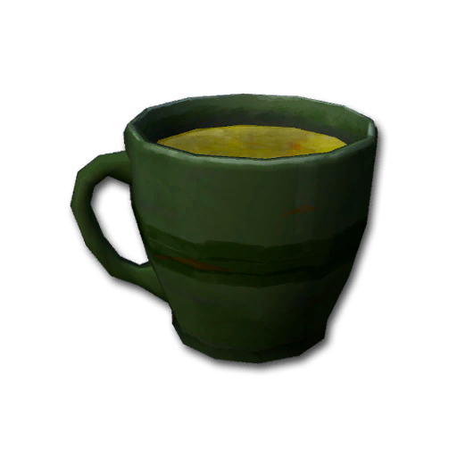
<figcaption>Home-made_Soup_icon.png</figcaption>
</figure></td>
<td>
<a href="./Home-made%20Soup.md" class="wikilink" title="Home-Made Soup">Home-Made Soup</a>
</td>
<td></td>
<td></td>
<td></td>
<td></td>
</tr>
</tbody>
</table>

### Seasonal Foods

<table style="width:100%;">
<colgroup>
<col style="width: 16%" />
<col style="width: 16%" />
<col style="width: 16%" />
<col style="width: 16%" />
<col style="width: 16%" />
<col style="width: 16%" />
</colgroup>
<thead>
<tr>
<th><figure>

<figcaption>Cooking.png</figcaption>
</figure></th>
<th>
Item
</th>
<th>
Above 75%
</th>
<th>
Between 20 - 75%
</th>
<th>
Below 20%
</th>
<th>
Ruined (0%)
</th>
</tr>
</thead>
<tbody>
<tr>
<td><figure>

<figcaption>Pumpkin_Pie_icon.png</figcaption>
</figure></td>
<td>
<a href="./Pumpkin%20Pie.md" class="wikilink" title="Pumpkin Pie">Pumpkin Pie</a>
</td>
<td>
0%
</td>
<td>
0%
</td>
<td>
25%
</td>
<td>
50%
</td>
</tr>
<tr>
<td><figure>

<figcaption>Chocolate_Bar_icon.png</figcaption>
</figure></td>
<td>
<a href="./Chocolate%20Bar%20%284%20Days%20of%20Night%29.md" class="wikilink" title="Candy Bar">Candy Bar</a>
</td>
<td>
0%
</td>
<td>
1%
</td>
<td>
5%
</td>
<td>
10%
</td>
</tr>
</tbody>
</table>

## Gallery

<table class="gallery">
<colgroup>
<col style="width: 50%" />
<col style="width: 50%" />
</colgroup>
<tbody>
<tr>
<td><figure>
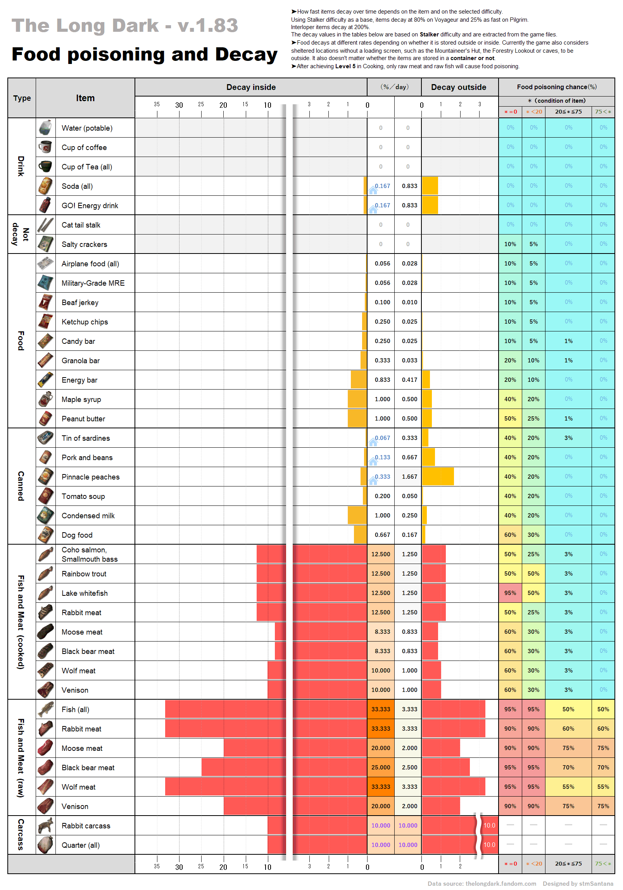
<figcaption>Food poisoning and Decay (outdated)</figcaption>
</figure></td>
<td><figure>
[Missing image: Food_poisoning.png]
<figcaption>Old icon.</figcaption>
</figure></td>
</tr>
</tbody>
</table>

## Update history

- UPDATE **18 September 2015 (<a href="./The%20Long%20Dark%20%E2%80%94%20Early%20Access%20Changelog.md#0.264" class="wikilink" title="Update">Update</a>):**
  - Fixed issue with only rolling for food poisoning when partially eating an item
- HOTFIX **1 April 2015 (<a href="./The%20Long%20Dark%20%E2%80%94%20Early%20Access%20Changelog.md#0.212" class="wikilink" title="Update">Update</a>):**
  - Rebalanced Food Poisoning to re-introduce it as a credible risk.
- HOTFIX **3 December 2014 (<a href="./The%20Long%20Dark%20%E2%80%94%20Early%20Access%20Changelog.md#0.170" class="wikilink" title="Update">Update</a>):**
  - Food with Condition over 75% will never cause Food Poisoning (excludes Raw Meat and Fish).
- HOTFIX **27 November 2014 (<a href="./The%20Long%20Dark%20%E2%80%94%20Early%20Access%20Changelog.md#0.163" class="wikilink" title="Update">Update</a>):**
  - If left untreated, Food Poisoning will now degrade Condition to just before the point of death.
- HOTFIX **31 October 2014 (<a href="./The%20Long%20Dark%20%E2%80%94%20Early%20Access%20Changelog.md#0.154" class="wikilink" title="Update">Update</a>):**
  - Reduced chance of Food Poisoning from all cooked meats.
- HOTFIX **27 September 2014 (<a href="./The%20Long%20Dark%20%E2%80%94%20Early%20Access%20Changelog.md#0.127" class="wikilink" title="Update">Update</a>):**
  - Reduced chance of contracting Food Poisoning for all Food Items.
- UPDATE **22 September 2014 (<a href="./The%20Long%20Dark%20%E2%80%94%20Early%20Access%20Changelog.md#0.117" class="wikilink" title="Update">Update</a>):**
  - All Food items have been tuned for Calorie values, Condition Decay, and % chance of Food Poisoning.
- HOTFIX **9 July 2014 (<a href="./The%20Long%20Dark%20%E2%80%94%20Early%20Access%20Changelog.md#0.05" class="wikilink" title="Update">Update</a>):**
  - Made food poisoning more dangerous. Increased the hourly Condition drain to 10/hr (from 5/hr). Increased the hourly Fatigue increase to 20/hr (from 10/hr).
  - Reduced the chance of getting Food Poisoning from canned goods (Peaches, Beans), and MREs.
- HOTFIX **2 July 2014 (<a href="./The%20Long%20Dark%20%E2%80%94%20Early%20Access%20Changelog.md#0.04" class="wikilink" title="Update">Update</a>):**
  - Improved player death description by including all critical sub-conditions that contribute to player's demise. Also, properly capture cause of death by afflictions (e.g., food poisoning) if there are no critical sub-conditions.
- HOTFIX **20 June 2014 (<a href="./The%20Long%20Dark%20%E2%80%94%20Early%20Access%20Changelog.md#0.03" class="wikilink" title="Update">Update</a>):**
  - Fixed issue with food poisoning continuing to degrade stats when resting (after antibiotics taken).
- UPDATE **14 June 2014 (<a href="./The%20Long%20Dark%20%E2%80%94%20Early%20Access%20Changelog.md#0.01" class="wikilink" title="Update">Update</a>):**
  - Added to game.

**Lua execution error in Module:Navbox function navbox**<a href="ru:%D0%9F%D0%B8%D1%89%D0%B5%D0%B2%D0%BE%D0%B5_%D0%BE%D1%82%D1%80%D0%B0%D0%B2%D0%BB%D0%B5%D0%BD%D0%B8%D0%B5" class="wikilink" title="ru:Пищевое отравление">ru:Пищевое отравление</a>

