# Foraging

**Contents**

- [Types of Flora](#Types_of_Flora)
- [Direct Harvesting Flora](#Direct_Harvesting_Flora)
- [Indirect Harvesting Flora](#Indirect_Harvesting_Flora)
- [First Aid and Cooking](#First_Aid_and_Cooking)
- [First Aid](#First_Aid)
- [Food and Drink](#Food_and_Drink)
- [Fire Starting](#Fire_Starting)
- [Trivia](#Trivia)
- [Gallery](#Gallery)
- [Game History](#Game_History)

**Foraging** is the process of searching the world for harvestable Flora <a href="./Wildlife.md" class="wikilink" title="Wildlife">Wildlife</a> across <a href="./Great%20Bear%20Island.md" class="wikilink" title="Great Bear Island">Great Bear Island</a>, either for the purposes of <a href="./Cooking.md" class="wikilink" title="Cooking">Cooking</a>, <a href="./Fire%20Starting.md" class="wikilink" title="Fire Starting">Fire Starting</a>, <a href="./First%20Aid.md" class="wikilink" title="First Aid">First Aid</a>, or even for crafting <a href="./Tools.md" class="wikilink" title="Tools">Tools</a>. Many plants and fungi can be found relatively easily while traveling across the Island, and can be the key to surviving for long periods of time.

Foraging is often a very quick process that often requires no tools to pick or gather Flora from bushes, conifer tree stumps, or from plants growing out of the ground.

## Types of Flora

There are two types of items obtained from Flora in the game world; directly or indirectly harvestable Flora items:

### Direct Harvesting Flora

Directly harvesting Flora simply requires the player to walk up to and click on the plant/fungus, where it will be turned into an item for the player:

| Item | Found | Notes |
|----|----|----|
|  <a href="./Cat%20Tail%20Stalk.md" class="wikilink" title="Cat Tail Stalk">Cat Tail Stalk</a> | Harvest 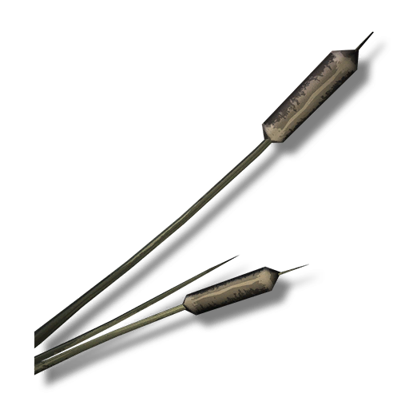 <a href="./Cat%20Tail.md" class="wikilink" title="Cat Tail">Cat Tail</a> | 1 Cat Tail produces 1 Cat Tail Stalk |
| 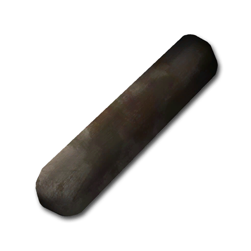 <a href="./Cat%20Tail%20Head.md" class="wikilink" title="Cat Tail Head">Cat Tail Head</a> | Harvest  <a href="./Cat%20Tail.md" class="wikilink" title="Cat Tail">Cat Tail</a> | 1 Cat Tail produces 1 Cat Tail Head |
| 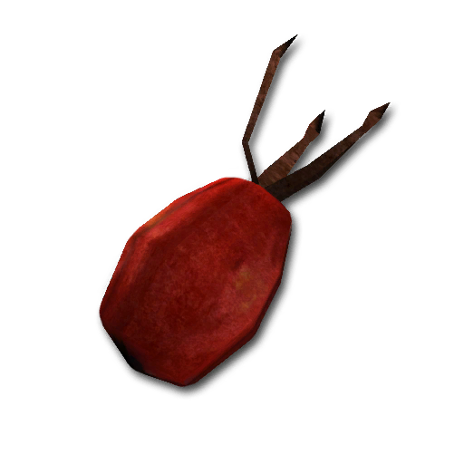 <a href="./Rose%20Hip.md" class="wikilink" title="Rose Hips">Rose Hips</a> | Rose Bushes | 8 Rose Hips are harvested from 1 Rose Bush |
| 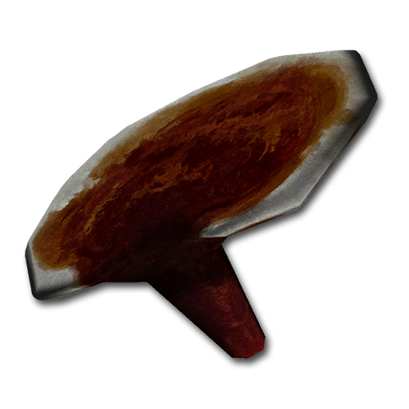 <a href="./Reishi%20Mushroom.md" class="wikilink" title="Reishi Mushrooms">Reishi Mushrooms</a> | Conifer Stumps | 2-3 grow on stumps |
|  <a href="./Old%20Man%27s%20Beard%20Lichen.md" class="wikilink" title="Old Man&#39;s Beard Lichen">Old Man's Beard Lichen</a> | Hanging from certain trees | 2-3 hang from trees |

<table class="gallery">
<colgroup>
<col style="width: 25%" />
<col style="width: 25%" />
<col style="width: 25%" />
<col style="width: 25%" />
</colgroup>
<tbody>
<tr>
<td><figure>

<figcaption>Cat Tail</figcaption>
</figure></td>
<td><figure>
[Missing image: Rose_hip_bush.jpg]
<figcaption>Rose Bush</figcaption>
</figure></td>
<td><figure>
[Missing image: RockClimb.jpg]
<figcaption>Green Rose Bush</figcaption>
</figure></td>
<td><figure>
[Missing image: Reishi_mushrooms_on_tree_stump.jpg]
<figcaption>Reishi Mushroom</figcaption>
</figure></td>
</tr>
<tr>
<td><figure>
[Missing image: Old_Man's_Beard_Lichen_on_trees.jpg]
<figcaption>Old Man's Beard Lichen</figcaption>
</figure></td>
<td></td>
<td></td>
<td></td>
</tr>
</tbody>
</table>

Some plants require a tool to harvest however:

<table>
<colgroup>
<col style="width: 25%" />
<col style="width: 25%" />
<col style="width: 25%" />
<col style="width: 25%" />
</colgroup>
<thead>
<tr>
<th>
Item
</th>
<th>
Found
</th>
<th>
Tool
</th>
<th>
Notes
</th>
</tr>
</thead>
<tbody>
<tr>
<td>
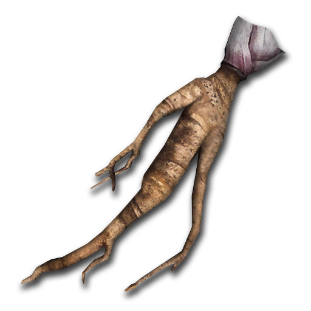 <a href="./Burdock%20Root.md" class="wikilink" title="Burdock Root">Burdock Root</a>
</td>
<td>
<a href="./Burdock.md" class="wikilink" title="Burdock">Burdock</a>
</td>
<td>
 <a href="./Hunting%20Knife.md" class="wikilink" title="Hunting Knife">Hunting Knife</a> 
 <a href="./Improvised%20Knife.md" class="wikilink" title="Improvised Knife">Improvised Knife</a> <a href="./Cougar%20Claw%20Knife.md" class="wikilink" title="Cougar Claw Knife">Cougar Claw Knife</a> 
 <a href="./Hatchet.md" class="wikilink" title="Hatchet">Hatchet</a> 
 <a href="./Improvised%20Hatchet.md" class="wikilink" title="Improvised Hatchet">Improvised Hatchet</a> 
 <a href="./Prybar.md" class="wikilink" title="Prybar">Prybar</a>
</td>
<td>
1 Cat Tail produces 1 Cat Tail Stalk
</td>
</tr>
<tr>
<td>
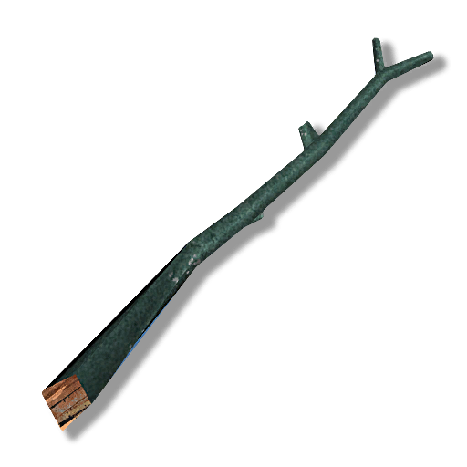 <a href="./Green%20Maple%20Sapling.md" class="wikilink" title="Green Maple Sapling">Green Maple Sapling</a>
</td>
<td>
Maple Sapling
</td>
<td>
 <a href="./Hatchet.md" class="wikilink" title="Hatchet">Hatchet</a> 
 <a href="./Improvised%20Hatchet.md" class="wikilink" title="Improvised Hatchet">Improvised Hatchet</a> 
 <a href="./Hacksaw.md" class="wikilink" title="Hacksaw">Hacksaw</a>
</td>
<td>
1 Cat Tail produces 1 Cat Tail Head
</td>
</tr>
<tr>
<td>
 <a href="./Green%20Birch%20Sapling.md" class="wikilink" title="Green Birch Sapling">Green Birch Sapling</a>
</td>
<td>
Birch Sapling
</td>
<td>
 <a href="./Hatchet.md" class="wikilink" title="Hatchet">Hatchet</a> 
 <a href="./Improvised%20Hatchet.md" class="wikilink" title="Improvised Hatchet">Improvised Hatchet</a> 
 <a href="./Hacksaw.md" class="wikilink" title="Hacksaw">Hacksaw</a>
</td>
<td>
8 Rose Hips are harvested from 1 Rose Bush
</td>
</tr>
<tr>
<td>
 <a href="./Stick.md" class="wikilink" title="Stick">Stick</a>
</td>
<td>
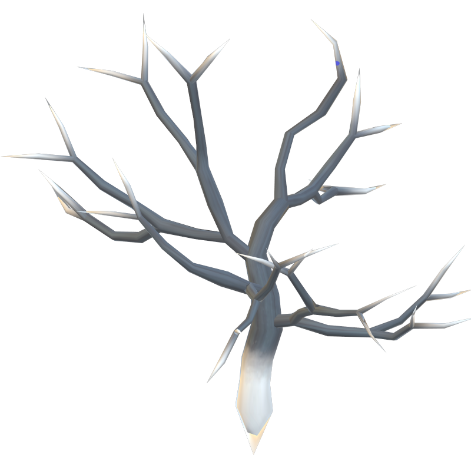 <a href="./Scrub%20Brush.md" class="wikilink" title="Scrub Brush">Scrub Brush</a>
</td>
<td>
 <a href="./Hatchet.md" class="wikilink" title="Hatchet">Hatchet</a> 
 <a href="./Improvised%20Hatchet.md" class="wikilink" title="Improvised Hatchet">Improvised Hatchet</a> 
Bare Hand
</td>
<td>
A single Scrub Brush gives 7 Sticks/ Patches give 12 Sticks (patches cannot be harvested Bare Handed)
</td>
</tr>
</tbody>
</table>

<table class="gallery">
<colgroup>
<col style="width: 25%" />
<col style="width: 25%" />
<col style="width: 25%" />
<col style="width: 25%" />
</colgroup>
<tbody>
<tr>
<td><figure>
[Missing image: Burdock_Plant.jpg]
<figcaption>Burdock</figcaption>
</figure></td>
<td><figure>
[Missing image: Maple_sapling_growing.png]
<figcaption>Maple Sapling</figcaption>
</figure></td>
<td><figure>
[Missing image: Birch_Sapling.jpg]
<figcaption>Birch Sapling</figcaption>
</figure></td>
<td><figure>

<figcaption>Scrub Brush</figcaption>
</figure></td>
</tr>
<tr>
<td><figure>
[Missing image: Scrub_Brush_Group.jpg]
<figcaption>Scrub Brush Patch</figcaption>
</figure></td>
<td></td>
<td></td>
<td></td>
</tr>
</tbody>
</table>

### Indirect Harvesting Flora

| Item | Found |
|----|----|
| 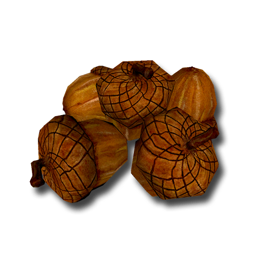 <a href="./Acorns.md" class="wikilink" title="Acorns">Acorns</a> | Near <a href="./Oak%20Tree.md" class="wikilink" title="Oak Trees">Oak Trees</a> |
|  <a href="./Birch%20Bark.md" class="wikilink" title="Birch Bark">Birch Bark</a> | Near Birch Trees |
|  <a href="./Fir%20Firewood.md" class="wikilink" title="Fir Firewood">Fir Firewood</a> | Near Fir Trees |
|  <a href="./Cedar%20Firewood.md" class="wikilink" title="Cedar Firewood">Cedar Firewood</a> | Near Cedar Trees |
|  <a href="./Stick.md" class="wikilink" title="Stick">Stick</a> | Near most Trees |

<table class="gallery">
<colgroup>
<col style="width: 25%" />
<col style="width: 25%" />
<col style="width: 25%" />
<col style="width: 25%" />
</colgroup>
<tbody>
<tr>
<td><figure>
[Missing image: Oak_trees_Transfer_Pass.jpg]
<figcaption>Oak Tree</figcaption>
</figure></td>
<td><figure>
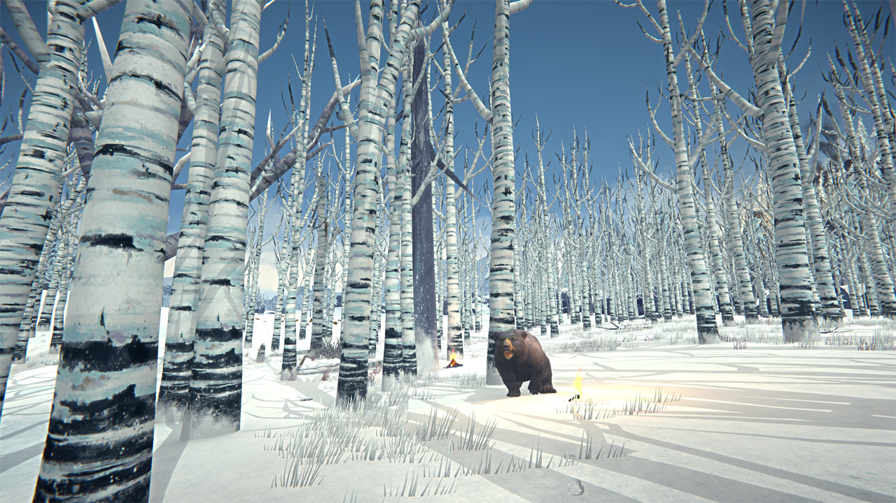
<figcaption>Birch Forest</figcaption>
</figure></td>
<td><figure>
[Missing image: Fir_Limb.jpg]
<figcaption>Fir Limb</figcaption>
</figure></td>
<td><figure>
[Missing image: CedarLimb.jpg]
<figcaption>Cedar Limb</figcaption>
</figure></td>
</tr>
<tr>
<td><figure>
[Missing image: CedarLimbLarge.jpg]
<figcaption>Large Cedar Limb</figcaption>
</figure></td>
<td></td>
<td></td>
<td></td>
</tr>
</tbody>
</table>

## First Aid and Cooking

The natural world often provide many remedies for healing personal ailments. <a href="./Afflictions.md" class="wikilink" title="Afflictions">Afflictions</a> can often be healed via man made <a href="./First%20Aid.md" class="wikilink" title="First Aid">First Aid</a> items, but foraging can produce alternatives that can be produced repeatedly as the man made versions become more scarce. Cooking most forage at a <a href="./Fire.md" class="wikilink" title="Fire">Fire</a> (after it has been prepared) produces First Aid tea.

They can also be cooked simply to create <a href="./Food%20And%20Drink.md" class="wikilink" title="Food And Drink">Food And Drink</a> items made solely for their calories. All teas weigh 0.10kg and provide 100 calories for <a href="./Hunger.md" class="wikilink" title="Hunger">Hunger</a> and 30% hydration for <a href="./Thirst.md" class="wikilink" title="Thirst">Thirst</a>.

### First Aid

The following items heal negative Afflictions:

<table>
<colgroup>
<col style="width: 33%" />
<col style="width: 33%" />
<col style="width: 33%" />
</colgroup>
<thead>
<tr>
<th>
Item
</th>
<th>
Requires
</th>
<th>
Cures
</th>
</tr>
</thead>
<tbody>
<tr>
<td>
 <a href="./Reishi%20Tea.md" class="wikilink" title="Reishi Tea">Reishi Tea</a>
</td>
<td>
1 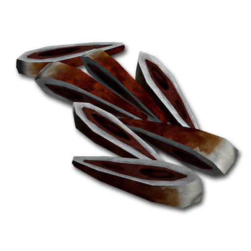 <a href="./Prepared%20Reishi%20Mushrooms.md" class="wikilink" title="Prepared Reishi Mushrooms">Prepared Reishi Mushrooms</a> + 0.25L  <a href="./Water%20%28Potable%29.md" class="wikilink" title="Water (Potable)">Water (Potable)</a>
</td>
<td>
[Missing image: Dysentery_icon.png] <a href="./Dysentery.md" class="wikilink" title="Dysentery">Dysentery</a> 
[Missing image: Food_Poisoning_icon.png] <a href="./Food%20Poisoning.md" class="wikilink" title="Food Poisoning">Food Poisoning</a> 
[Missing image: Infection_icon.png] <a href="./Infection.md" class="wikilink" title="Infection">Infection</a> 
[Missing image: Intestinal_Parasites_icon.png] <a href="./Intestinal%20Parasites.md" class="wikilink" title="Intestinal Parasites">Intestinal Parasites</a>
</td>
</tr>
<tr>
<td>
 <a href="./Rose%20Hip%20Tea.md" class="wikilink" title="Rose Hip Tea">Rose Hip Tea</a>
</td>
<td>
1  <a href="./Prepared%20Rose%20Hips.md" class="wikilink" title="Prepared Rose Hips">Prepared Rose Hips</a> + 0.25L  <a href="./Water%20%28Potable%29.md" class="wikilink" title="Water (Potable)">Water (Potable)</a>
</td>
<td>
[Missing image: Broken_Ribs_icon.png] <a href="./Broken%20Ribs.md" class="wikilink" title="Broken Ribs">Broken Ribs</a> 
[Missing image: Burns_icon.png] <a href="./Burns.md" class="wikilink" title="Burns">Burns</a> 
[Missing image: Pain_icon.png] <a href="./Pain.md" class="wikilink" title="Pain">Pain</a>
</td>
</tr>
<tr>
<td>
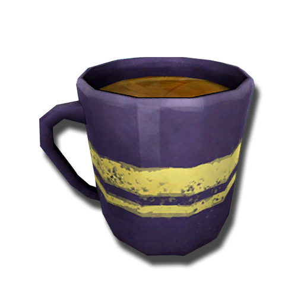 <a href="./Burdock%20Tea.md" class="wikilink" title="Burdock Tea">Burdock Tea</a>
</td>
<td>
1  <a href="./Prepared%20Burdock.md" class="wikilink" title="Prepared Burdock">Prepared Burdock</a> + 0.25L  <a href="./Water%20%28Potable%29.md" class="wikilink" title="Water (Potable)">Water (Potable)</a>
</td>
<td>
[Missing image: Dysentery_icon.png] <a href="./Dysentery.md" class="wikilink" title="Dysentery">Dysentery</a> 
[Missing image: Food_Poisoning_icon.png] <a href="./Food%20Poisoning.md" class="wikilink" title="Food Poisoning">Food Poisoning</a> 
[Missing image: Infection_icon.png] <a href="./Infection.md" class="wikilink" title="Infection">Infection</a> 
[Missing image: Intestinal_Parasites_icon.png] <a href="./Intestinal%20Parasites.md" class="wikilink" title="Intestinal Parasites">Intestinal Parasites</a>
</td>
</tr>
</tbody>
</table>

Some forage can also produce drinks that provide positive Affliction benefits:

| Item | Requires | Benefit |
|----|----|----|
|  <a href="./Birch%20Bark%20Tea.md" class="wikilink" title="Birch Bark Tea">Birch Bark Tea</a> | 1  <a href="./Prepared%20Birch%20Bark.md" class="wikilink" title="Prepared Birch Bark">Prepared Birch Bark</a> + 0.25L  <a href="./Water%20%28Potable%29.md" class="wikilink" title="Water (Potable)">Water (Potable)</a> | \[Missing image: Restore_Condition_icon.png\] <a href="./Restore%20Condition.md" class="wikilink" title="Restore Condition">Restore Condition</a> |

Old Man's Beard Lichen can be crafted into an Infection suppressing bandage. Prepared Burdock is the only First Aid item that does not heal Afflictions, but can be either eaten for calories or brewed into Burdock Tea:

| Item | Requires | Benefit |
|----|----|----|
|  <a href="./Old%20Man%27s%20Beard%20Wound%20Dressing.md" class="wikilink" title="Old Man&#39;s Beard Wound Dressing">Old Man's Beard Wound Dressing</a> | 3 <a href="./Old%20Man%27s%20Beard%20Lichen.md" class="wikilink" title="Old Man&#39;s Beard Lichen">Old Man's Beard Lichen</a> | Cures \[Missing image: Infection_Risk_icon.png\] <a href="./Infection%20Risk.md" class="wikilink" title="Infection Risk">Infection Risk</a> |
|  <a href="./Prepared%20Burdock.md" class="wikilink" title="Prepared Burdock">Prepared Burdock</a> | 1  <a href="./Burdock%20Root.md" class="wikilink" title="Burdock Root">Burdock Root</a> | Can be eaten for 275 calories |

### Food and Drink

The following items can be cooked via forage found in the world:

| Item | Requires | Calories | Benefit |
|----|----|----|----|
|  <a href="./Acorns%20%28Cooked%29.md" class="wikilink" title="Acorns (Cooked)">Acorns (Cooked)</a> | 1 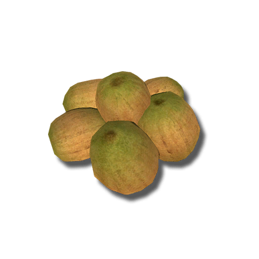 <a href="./Prepared%20Acorns.md" class="wikilink" title="Prepared Acorns">Prepared Acorns</a> + 0.25L  <a href="./Water%20%28Potable%29.md" class="wikilink" title="Water (Potable)">Water (Potable)</a> | 100 | None |
|  <a href="./Acorns%20%28Cooked%20-%20Large%20Portion%29.md" class="wikilink" title="Acorns (Cooked - Large Portion)">Acorns (Cooked - Large Portion)</a> | 1  <a href="./Prepared%20Acorns%20%28Large%20Portion%29.md" class="wikilink" title="Prepared Acorns (Large Portion)">Prepared Acorns (Large Portion)</a> + 0.25L  <a href="./Water%20%28Potable%29.md" class="wikilink" title="Water (Potable)">Water (Potable)</a> | 400 | None |
|  <a href="./Cat%20Tail%20Stalk.md" class="wikilink" title="Cat Tail Stalk">Cat Tail Stalk</a> | Harvest 1  <a href="./Cat%20Tail.md" class="wikilink" title="Cat Tail">Cat Tail</a> plant | 150 | None |
|  <a href="./Cup%20of%20Acorn%20Coffee.md" class="wikilink" title="Cup of Acorn Coffee">Cup of Acorn Coffee</a> | 1 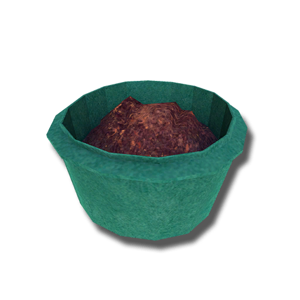 <a href="./Acorn%20Grounds.md" class="wikilink" title="Acorn Grounds">Acorn Grounds</a> + 0.25L  <a href="./Water%20%28Potable%29.md" class="wikilink" title="Water (Potable)">Water (Potable)</a> | 100 | \[Missing image: Fatigue_Reduced_icon.png\] <a href="./Fatigue%20Reduced.md" class="wikilink" title="Fatigue Reduced">Fatigue Reduced</a> |

## Fire Starting

Foraging for <a href="./Fire%20Starting.md" class="wikilink" title="Fire Starting">Fire Starting</a> fuel is an important part of surviving on the Island.

| Item | Found |
|----|----|
|  <a href="./Cedar%20Firewood.md" class="wikilink" title="Cedar Firewood">Cedar Firewood</a> | Near Cedar Trees on <a href="./Cedar%20Limb.md" class="wikilink" title="Cedar Limbs">Cedar Limbs</a> |
|  <a href="./Fir%20Firewood.md" class="wikilink" title="Fir Firewood">Fir Firewood</a> | Near Fir Trees on <a href="./Fir%20Limb.md" class="wikilink" title="Fir Limbs">Fir Limbs</a> |
|  <a href="./Stick.md" class="wikilink" title="Stick">Stick</a> | Near any trees |
|  <a href="./Birch%20Bark.md" class="wikilink" title="Birch Bark">Birch Bark</a> | Near Birch Tree forests |
|  <a href="./Cat%20Tail%20Head.md" class="wikilink" title="Cat Tail Head">Cat Tail Head</a> | On <a href="./Cat%20Tail.md" class="wikilink" title="Cat Tails">Cat Tails</a> |

## Trivia

- Originally, items could not be picked up in the game world at all. A menu option called Abstract Foraging was present during the Pre Alpha builds of the game that would allow the player to dedicated time to make the survivor find unseen usable materials/fuel in the world offscreen. The game would pass time and would often create very small item yields despite the amount of hours spent foraging. The Deep Forest Update removed this feature and instead preplaced items throughout the world for the player to pick up and added plants to forage.

## Gallery

<table class="gallery">
<colgroup>
<col style="width: 100%" />
</colgroup>
<tbody>
<tr>
<td><figure>
[Missing image: Alpha_main_menu.jpg]
<figcaption>The Early Access Abstract Foraging option in the menu</figcaption>
</figure></td>
</tr>
</tbody>
</table>

## Game History

- UPDATE **31 July 2014 (<a href="./The%20Long%20Dark%20%E2%80%94%20Changelog.md#0.073" class="wikilink" title="Update">Update</a>):**
- Added Abstract Foraging option to game.
- UPDATE **1 August 2015 (<a href="./The%20Long%20Dark%20%E2%80%94%20Changelog.md#0.256" class="wikilink" title="Update">Update</a>):**
  - Replaced Abstract Foraging with Direct Harvesting.

**Lua execution error in Module:Navbox function navbox**

