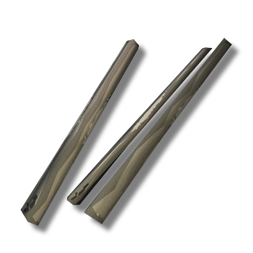
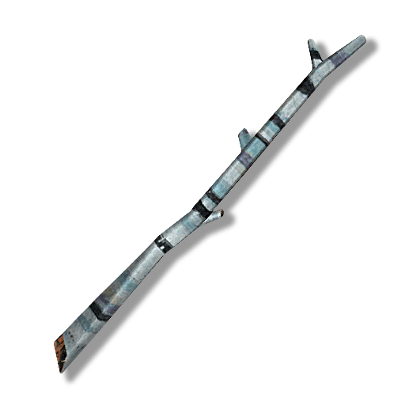
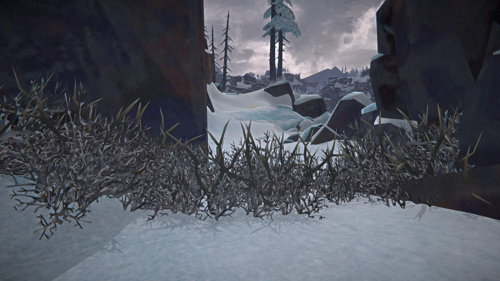
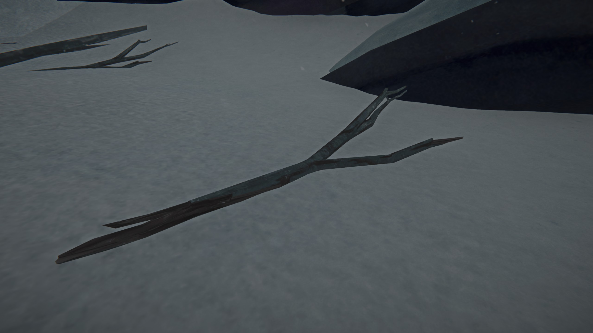
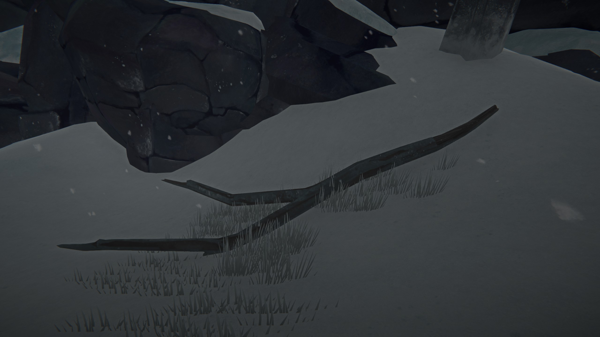
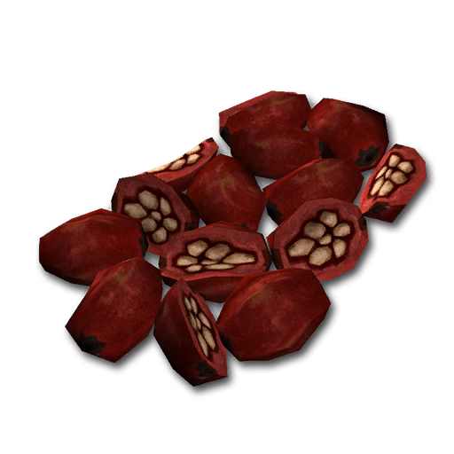

# Foraging

**Categories:** Pages with update history · **Source:** [Fandom](https://thelongdark.fandom.com/wiki/Foraging)

**Contents**

- [Types of Flora](#types-of-flora)
- [Direct Harvesting Flora](#direct-harvesting-flora)
- [Indirect Harvesting Flora](#indirect-harvesting-flora)
- [First Aid and Cooking](#first-aid-and-cooking)
- [First Aid](#first-aid)
- [Food and Drink](#food-and-drink)
- [Fire Starting](#fire-starting)
- [Trivia](#trivia)
- [Gallery](#gallery)
- [Game History](#game-history)

**Foraging** is the process of searching the world for harvestable Flora [Wildlife](./Wildlife.md) across [Great Bear Island](./Great%20Bear%20Island.md), either for the purposes of [Cooking](./Cooking.md), [Fire Starting](./Fire%20Starting.md), [First Aid](./First%20Aid.md), or even for crafting [Tools](./Tools.md). Many plants and fungi can be found relatively easily while traveling across the Island, and can be the key to surviving for long periods of time.

Foraging is often a very quick process that often requires no tools to pick or gather Flora from bushes, conifer tree stumps, or from plants growing out of the ground.

## Types of Flora

There are two types of items obtained from Flora in the game world; directly or indirectly harvestable Flora items:

### Direct Harvesting Flora

Directly harvesting Flora simply requires the player to walk up to and click on the plant/fungus, where it will be turned into an item for the player:

Item

Found

Notes

 [Cat Tail Stalk](./Cat%20Tail%20Stalk.md)

Harvest  [Cat Tail](./Cat%20Tail.md)

1 Cat Tail produces 1 Cat Tail Stalk

 [Cat Tail Head](./Cat%20Tail%20Head.md)

Harvest  [Cat Tail](./Cat%20Tail.md)

1 Cat Tail produces 1 Cat Tail Head

 [Rose Hips](./Rose%20Hip.md)

Rose Bushes

8 Rose Hips are harvested from 1 Rose Bush

 [Reishi Mushrooms](./Reishi%20Mushroom.md)

Conifer Stumps

2-3 grow on stumps

 [Old Man's Beard Lichen](./Old%20Man%27s%20Beard%20Lichen.md)

Hanging from certain trees

2-3 hang from trees

_Cat Tail_

_Rose Bush_

_Green Rose Bush_

_Reishi Mushroom_

_Old Man's Beard Lichen_

Some plants require a tool to harvest however:

Item

Found

Tool

Notes

 [Burdock Root](./Burdock%20Root.md)

[Burdock](./Burdock.md)

 [Hunting Knife](./Hunting%20Knife.md)

 [Improvised Knife](./Improvised%20Knife.md) [Cougar Claw Knife](./Cougar%20Claw%20Knife.md) /  [Hatchet](./Hatchet.md) /  [Improvised Hatchet](./Improvised%20Hatchet.md) /  [Prybar](./Prybar.md)

1 Cat Tail produces 1 Cat Tail Stalk

 [Green Maple Sapling](./Green%20Maple%20Sapling.md)

Maple Sapling

 [Hatchet](./Hatchet.md)

 [Improvised Hatchet](./Improvised%20Hatchet.md) /  [Hacksaw](./Hacksaw.md)

1 Cat Tail produces 1 Cat Tail Head

 [Green Birch Sapling](./Green%20Birch%20Sapling.md)

Birch Sapling

 [Hatchet](./Hatchet.md)

 [Improvised Hatchet](./Improvised%20Hatchet.md) /  [Hacksaw](./Hacksaw.md)

8 Rose Hips are harvested from 1 Rose Bush

 [Stick](./Stick.md)

 [Scrub Brush](./Scrub%20Brush.md)

 [Hatchet](./Hatchet.md)

 [Improvised Hatchet](./Improvised%20Hatchet.md) / Bare Hand

A single Scrub Brush gives 7 Sticks/ Patches give 12 Sticks (patches cannot be harvested Bare Handed)

_Burdock_

_Maple Sapling_

_Birch Sapling_

_Scrub Brush_

_Scrub Brush Patch_

### Indirect Harvesting Flora

**Item:** Found

 [Acorns](./Acorns.md)

Near [Oak Trees](./Oak%20Tree.md)

 [Birch Bark](./Birch%20Bark.md)

Near Birch Trees

 [Fir Firewood](./Fir%20Firewood.md)

Near Fir Trees

 [Cedar Firewood](./Cedar%20Firewood.md)

Near Cedar Trees

 [Stick](./Stick.md)

Near most Trees

_Oak Tree_

_Birch Forest_

_Fir Limb_

_Cedar Limb_

_Large Cedar Limb_

## First Aid and Cooking

The natural world often provide many remedies for healing personal ailments. [Afflictions](./Afflictions.md) can often be healed via man made [First Aid](./First%20Aid.md) items, but foraging can produce alternatives that can be produced repeatedly as the man made versions become more scarce. Cooking most forage at a [Fire](./Fire.md) (after it has been prepared) produces First Aid tea.

They can also be cooked simply to create [Food And Drink](./Food%20And%20Drink.md) items made solely for their calories. All teas weigh 0.10kg and provide 100 calories for [Hunger](./Hunger.md) and 30% hydration for [Thirst](./Thirst.md).

### First Aid

The following items heal negative Afflictions:

Item

Requires

Cures

 [Reishi Tea](./Reishi%20Tea.md)

1  [Prepared Reishi Mushrooms](./Prepared%20Reishi%20Mushrooms.md) + 0.25L  [Water (Potable)](./Water%20%28Potable%29.md)

 [Dysentery](./Dysentery.md)

 [Food Poisoning](./Food%20Poisoning.md) /  [Infection](./Infection.md) /  [Intestinal Parasites](./Intestinal%20Parasites.md)

 [Rose Hip Tea](./Rose%20Hip%20Tea.md)

1  [Prepared Rose Hips](./Prepared%20Rose%20Hips.md) + 0.25L  [Water (Potable)](./Water%20%28Potable%29.md)

 [Broken Ribs](./Broken%20Ribs.md)

 [Burns](./Burns.md) /  [Pain](./Pain.md)

 [Burdock Tea](./Burdock%20Tea.md)

1  [Prepared Burdock](./Prepared%20Burdock.md) + 0.25L  [Water (Potable)](./Water%20%28Potable%29.md)

 [Dysentery](./Dysentery.md)

 [Food Poisoning](./Food%20Poisoning.md) /  [Infection](./Infection.md) /  [Intestinal Parasites](./Intestinal%20Parasites.md)

Some forage can also produce drinks that provide positive Affliction benefits:

Item

Requires

Benefit

 [Birch Bark Tea](./Birch%20Bark%20Tea.md)

1  [Prepared Birch Bark](./Prepared%20Birch%20Bark.md) + 0.25L  [Water (Potable)](./Water%20%28Potable%29.md)

 [Restore Condition](./Restore%20Condition.md)

Old Man's Beard Lichen can be crafted into an Infection suppressing bandage. Prepared Burdock is the only First Aid item that does not heal Afflictions, but can be either eaten for calories or brewed into Burdock Tea:

Item

Requires

Benefit

 [Old Man's Beard Wound Dressing](./Old%20Man%27s%20Beard%20Wound%20Dressing.md)

3 [Old Man's Beard Lichen](./Old%20Man%27s%20Beard%20Lichen.md)

Cures  [Infection Risk](./Infection%20Risk.md)

 [Prepared Burdock](./Prepared%20Burdock.md)

1  [Burdock Root](./Burdock%20Root.md)

Can be eaten for 275 calories

### Food and Drink

The following items can be cooked via forage found in the world:

Item

Requires

Calories

Benefit

 [Acorns (Cooked)](./Acorns%20%28Cooked%29.md)

1  [Prepared Acorns](./Prepared%20Acorns.md) + 0.25L  [Water (Potable)](./Water%20%28Potable%29.md)

100

None

 [Acorns (Cooked - Large Portion)](./Acorns%20%28Cooked%20-%20Large%20Portion%29.md)

1  [Prepared Acorns (Large Portion)](./Prepared%20Acorns%20%28Large%20Portion%29.md) + 0.25L  [Water (Potable)](./Water%20%28Potable%29.md)

400

None

 [Cat Tail Stalk](./Cat%20Tail%20Stalk.md)

Harvest 1  [Cat Tail](./Cat%20Tail.md) plant

150

None

 [Cup of Acorn Coffee](./Cup%20of%20Acorn%20Coffee.md)

1  [Acorn Grounds](./Acorn%20Grounds.md) + 0.25L  [Water (Potable)](./Water%20%28Potable%29.md)

100

 [Fatigue Reduced](./Fatigue%20Reduced.md)

## Fire Starting

Foraging for [Fire Starting](./Fire%20Starting.md) fuel is an important part of surviving on the Island.

**Item:** Found

 [Cedar Firewood](./Cedar%20Firewood.md)

Near Cedar Trees on [Cedar Limbs](./Cedar%20Limb.md)

 [Fir Firewood](./Fir%20Firewood.md)

Near Fir Trees on [Fir Limbs](./Fir%20Limb.md)

 [Stick](./Stick.md)

Near any trees

 [Birch Bark](./Birch%20Bark.md)

Near Birch Tree forests

 [Cat Tail Head](./Cat%20Tail%20Head.md)

On [Cat Tails](./Cat%20Tail.md)

## Trivia

- Originally, items could not be picked up in the game world at all. A menu option called Abstract Foraging was present during the Pre Alpha builds of the game that would allow the player to dedicated time to make the survivor find unseen usable materials/fuel in the world offscreen. The game would pass time and would often create very small item yields despite the amount of hours spent foraging. The Deep Forest Update removed this feature and instead preplaced items throughout the world for the player to pick up and added plants to forage.

## Gallery

_The Early Access Abstract Foraging option in the menu_

## Game History

- UPDATE **31 July 2014 ([Update](./The%20Long%20Dark%20%E2%80%94%20Changelog.md#0.073)):**
- Added Abstract Foraging option to game.
- UPDATE **1 August 2015 ([Update](./The%20Long%20Dark%20%E2%80%94%20Changelog.md#0.256)):**
  - Replaced Abstract Foraging with Direct Harvesting.
