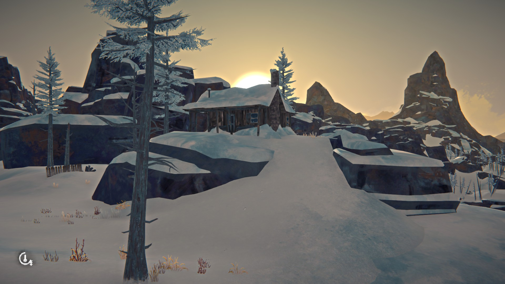
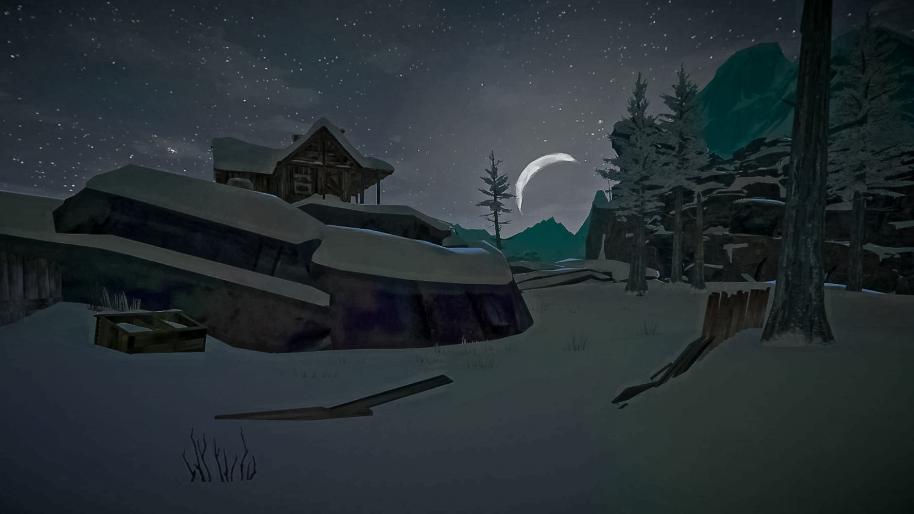
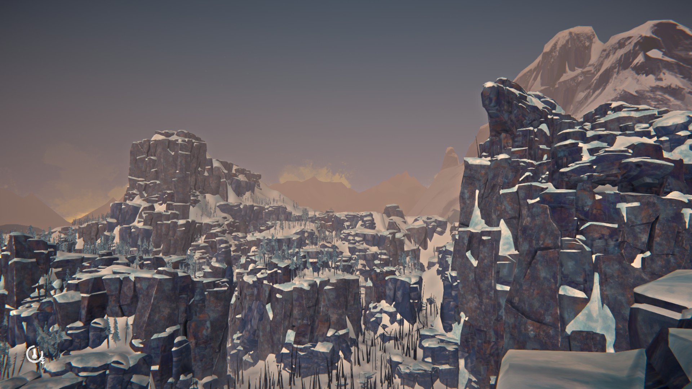
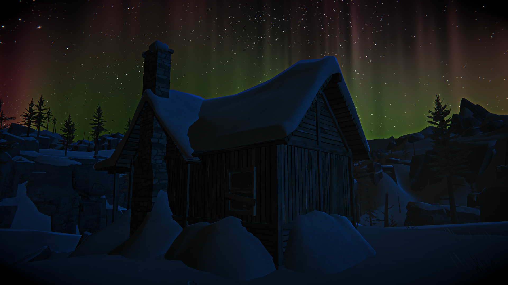

# Foreman's Retreat

**Categories:** Indoor locations, Locations, Locations in Ash Canyon, Residential locations · **Source:** [Fandom](https://thelongdark.fandom.com/wiki/Foreman's_Retreat)

**Contents**

- [Overview](#overview)
- [Safehouse Viability](#safehouse-viability)
- [Location and Vista](#location-and-vista)
- [Gallery](#gallery)

**Foreman's Retreat**

| Property | Details |
| --- | --- |
|  |  / _20201212120850\_1.jpg_ |
| **Location** |  |
|  |  / _Foreman's\_Retreat\_Location.png_ |
| Region | [Ash Canyon](./Ash%20Canyon.md)\|- |
| **General** |  |
| Type | Residential\|- |
|  / _bed\_icon.png_ | Has a bed |

|  / _Close up_ |  / _Foreman's Retreat at night_ /  / _The [Pillar](./Pillar%27s%20Footrest.md) and the [Wolf's Jaw](./Wolf%27s%20Jaw%20Overlook.md) seen by [Foreman's Retreat](./Foreman%27s%20Retreat.md)_ /  / _Inside the house_ |
|  / _The woodstove_ |  / _The bedroom_ /  / _The aurora as seen from near the Foreman's Retreat._ /  / _Looking southeast from the Foreman's Retreat during the aurora._ |
|  / _The Foreman's Retreat during the aurora._ |  |
