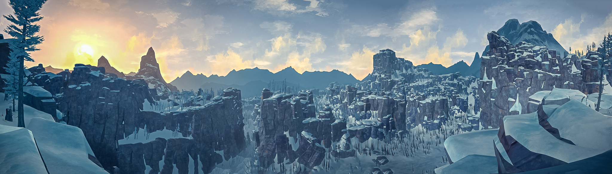
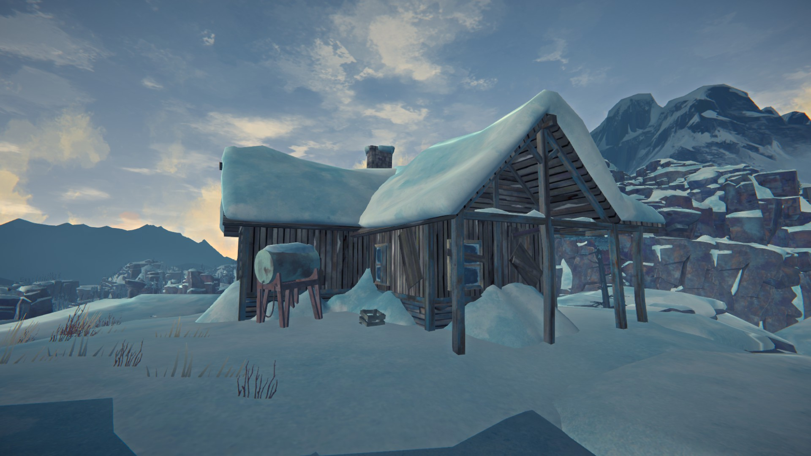
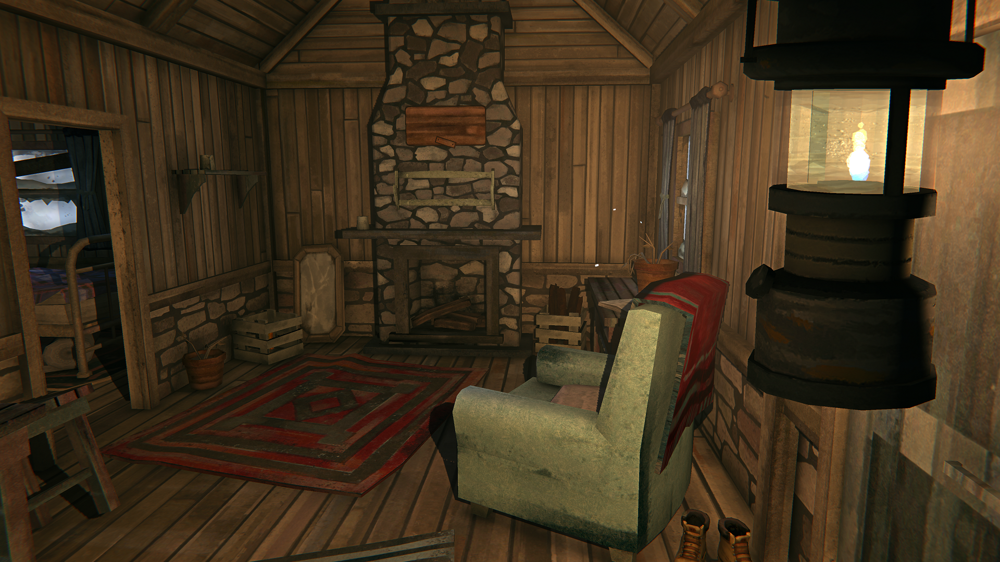
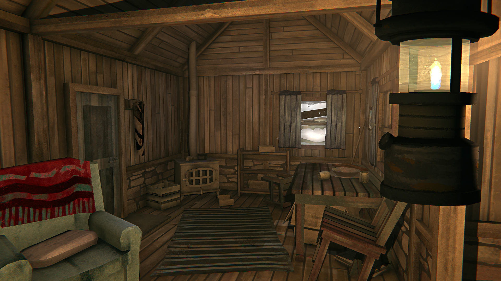
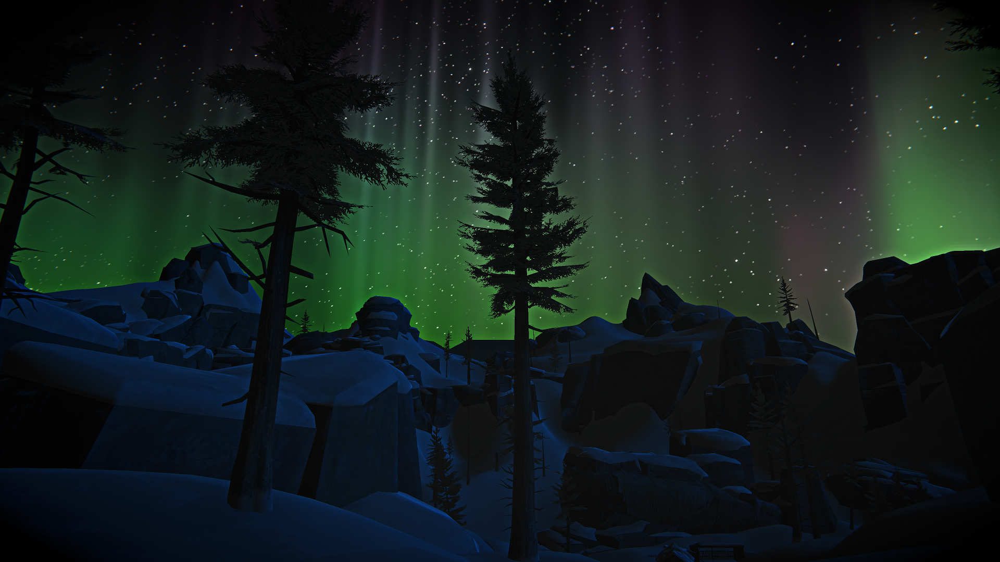
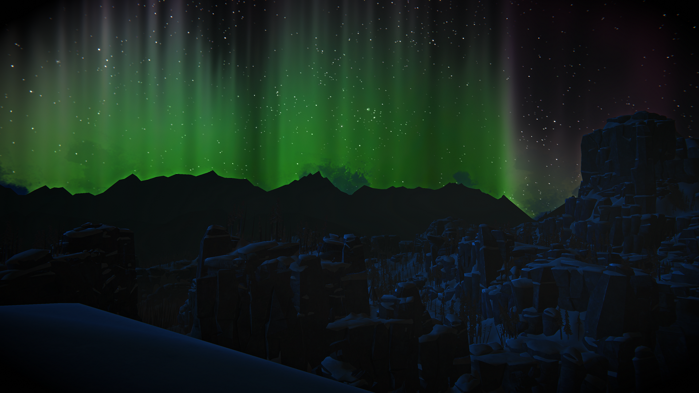

# Foreman's Retreat

**Categories:** Indoor locations, Locations, Locations in Ash Canyon, Residential locations · **Source:** [Fandom](https://thelongdark.fandom.com/wiki/Foreman's_Retreat)

**Contents**

- [Overview](#overview)
- [Safehouse Viability](#safehouse-viability)
- [Location and Vista](#location-and-vista)
- [Gallery](#gallery)

**Foreman's Retreat**

[20201212120850 1](../assets/20201212120850_1.jpg)

**Location**

[Foreman's Retreat Location](../assets/Foreman%27s_Retreat_Location.png)

**Region:** [Ash Canyon](./Ash%20Canyon.md)

**General**

**Type:** Residential

[Bed icon](../assets/Bed_icon.png)

Has a bed

Has an interior **Foreman's Retreat** is a one-story, two-room house located in [Ash Canyon](./Ash%20Canyon.md) not far from [Miner's Folly](./Miner%27s%20Folly.md).

## Overview

This house, being made for the mine's foreman, is far more luxurious than the small cabin found at [Miner's Folly](./Miner%27s%20Folly.md). It has two rooms, a living room and a bedroom with a single [Bed](./Bed.md). The cabin has both a [Wood Stove](./Wood%20Stove.md) and a [Fireplace](./Fireplace.md), but it lacks a [Work Bench](./Work%20Bench.md), although one can be found pretty close in the ruined barn of [Miner's Folly](./Miner%27s%20Folly.md).

It is possible for the [Hunting Rifle](./Hunting%20Rifle.md) to spawn here on the rifle rack. A few [Green Birch Sapling](./Green%20Birch%20Sapling.md) spawn just downhill from the cabin.

Upon purchase of the [Tales from the Far Territory](./Tales%20from%20the%20Far%20Territory.md) DLC, the recipe card for [Ranger Stew](./Ranger%20Stew.md) can be found in varying places within the first room of the cabin, near the kitchenette.

### Safehouse Viability

The Foreman's Retreat, together with [Miner's Folly](./Miner%27s%20Folly.md), can make for a good long-term base. Though there's often a pack of [Wolves](./Wolf.md) that spawn along the path between Foreman's Retreat and Miner's Folly, the latter provides an outdoor workbench and a [Fire Barrel](./Fire%20Barrel.md), allowing for crafting without increasing [Cabin Fever Risk](./Cabin%20Fever%20Risk.md). Two to three [Deer](./Deer.md) often spawn not too far away, while another one or two may be found by heading east, crossing over the rope bridge near [Narrow Falls Cave](./Narrow%20Falls%20Cave.md). [Rabbits](./Rabbit.md) can also spawn down the hill. Ptarmigan spawn both immediately behind the building as well as down the hill. A [Moose](./Moose.md) spawns in the clearing just north of [Miner's Folly](./Miner%27s%20Folly.md). Players can climb on top of either fallen trees or rock outcroppings surrounding the clearing for a safe shot. The nearby [bear](./Bear.md) located north (towards the path located north that leads through the cave to the lower region of the map near the base of [Long Falls](./Long%20Falls.md)) can wander close to front door, so exercise caution. However, this provides many hunting opportunities due to the large amount of rocks players can shoot from, including the different levels the house itself is built on.

The biggest downsides to the region is a lack of firewood (sometimes you have to walk across some of the bridges to find branches), not very much container space, and generally being disconnected from the rest of the map, as you have to travel across a combination of rope bridges or undergo [Rope Climbing](./Rope%20Climbing.md) to get to other parts of the map.

There is a walkthrough cave nearby with a leaf bed, where one can cure possible cabin fever. However, this cave provides no warmth bonus, making it a risky spot to sleep for long periods of time.

- This cave may contain a polaroid inside a loot container (confirmed on Interloper).

## Location and Vista

The house is located at the top of a tall cliff. On a clear day (which can be hard to come by in Ash Canyon), it's possible to see many of the region's major locations, including the [Angler's Den](./Angler%27s%20Den.md), [High Meadow](./High%20Meadow.md), [Pillar's Footrest](./Pillar%27s%20Footrest.md), and [Wolf's Jaw Overlook](./Wolf%27s%20Jaw%20Overlook.md) from just outside the cabin. With deer and bear just to the north and a [Work Bench](./Work%20Bench.md) not far away, it can make for a suitable [Safe House](./Safehouse.md) in the region, so long as intestinal parasites aren't an issue._Panoramic View of AC from Foreman's Retreat_

## Gallery

_The [Pillar](./Pillar%27s%20Footrest.md) and the [Wolf's Jaw](./Wolf%27s%20Jaw%20Overlook.md) seen by [Foreman's Retreat](./Foreman%27s%20Retreat.md)_

