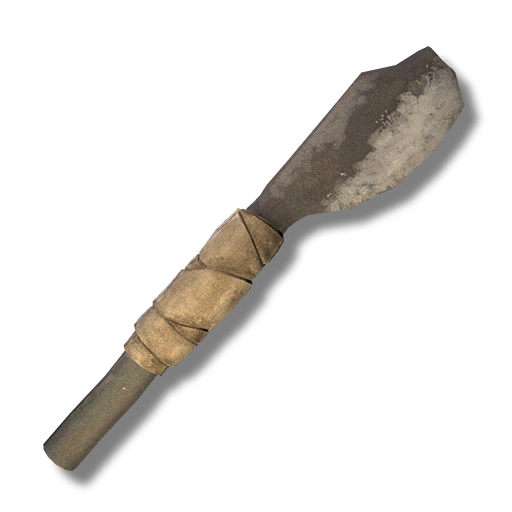

# Foreman's Tool Belt

<table class="infobox">
<caption>Foreman's Tool Belt</caption>
<colgroup>
<col style="width: 50%" />
<col style="width: 50%" />
</colgroup>
<tbody>
<tr>
<td colspan="2"><figure>

<figcaption>Foreman's_Tool_Belt_icon.png</figcaption>
</figure></td>
</tr>
<tr>
<td colspan="2" class="section">
<strong>General</strong>
</td>
</tr>
<tr>
<td>
Item Type
</td>
<td></td>
</tr>
<tr>
<td>
Wintermute
</td>
<td></td>
</tr>
<tr>
<td colspan="2" class="section">
<strong>Statistics</strong>
</td>
</tr>
<tr>
<td>
Weight
</td>
<td>
0.20 kg(0.44 lbs)
</td>
</tr>
<tr>
<td>
Warmth bonus
</td>
<td>
0 °C(0 °F)
</td>
</tr>
<tr>
<td>
Windproof bonus
</td>
<td>
0 °C(0 °F)
</td>
</tr>
<tr>
<td>
Waterproof bonus
</td>
<td>
0
</td>
</tr>
<tr>
<td>
Protection
</td>
<td>
0
</td>
</tr>
<tr>
<td>
Mobility
</td>
<td>
0
</td>
</tr>
<tr>
<td>
Harvest
</td>
<td>
2 x <a href="./Cured%20Leather.md" class="wikilink" title="Cured Leather">Cured Leather</a> 
30 minutes
</td>
</tr>
<tr>
<td>
Repair
</td>
<td>
1 × <a href="./Cured%20Leather.md" class="wikilink" title="Cured Leather">Cured Leather</a> 
25 minutes 
75% condition
</td>
</tr>
</tbody>
</table>

<table>
<colgroup>
<col style="width: 33%" />
<col style="width: 33%" />
<col style="width: 33%" />
</colgroup>
<tbody>
<tr>
<td width="40px"><figure>
[Missing image: Ptarmigan_icon.png]
<figcaption>Ptarmigan_icon.png</figcaption>
</figure></td>
<td>
<strong>DLC-Exclusive content.</strong> 

This content requires the <a href="./Tales%20from%20the%20Far%20Territory.md" class="wikilink" title="Tales from the Far Territory">Tales from the Far Territory</a> addon to be installed before it can be seen or used in regular gameplay.

</td>
<td>
|}

<table>
<colgroup>
<col style="width: 33%" />
<col style="width: 33%" />
<col style="width: 33%" />
</colgroup>
<tbody>
<tr>
<td style="vertical-align: top; font-size: 3em; color: #5d5980; padding-right: 10px">
“
</td>
<td>
A high-quality belt to lighten the load. Perfectly balanced to ensure all-day comfort and stability.

&#10;

In-game description

</td>
<td style="vertical-align: bottom; font-size: 3em; color: #5d5980; padding-left: 10px">
”
</td>
</tr>
</tbody>
</table>

The <strong>Foreman's Tool Belt</strong> is an accessory <a href="./Clothing.md" class="wikilink" title="Clothing">Clothing</a> found in <em>The Long Dark</em>, and once belonged to <a href="./The%20Foreman.md" class="wikilink" title="The Foreman">The Foreman</a> of the <a href="./Langston%20Mine.md" class="wikilink" title="Langston Mine">Langston Mine</a>. It is the ultimate prize that can be found from completing the <a href="./Tales.md" class="wikilink" title="Tale">Tale</a> <a href="./Buried%20Echoes.md" class="wikilink" title="Buried Echoes">Buried Echoes</a> and is found deep inside the Mine in the <a href="./Zone%20of%20Contamination.md" class="wikilink" title="Zone of Contamination">Zone of Contamination</a>.

<h2 id="Overview">Overview</h2>

Wearing it lowers the weight of the following tools if they are in the player's inventory by 50%. This bonus only applies for a maximum of 3 held tools at a given time. If more than 3 qualifying tools are held, the bonus only applies for the heaviest tools held:

<ul>
<li> <a href="./Heavy%20Hammer.md" class="wikilink" title="Heavy Hammer">Heavy Hammer</a> 2.00kg = (1.00kg)</li>
<li> <a href="./Improvised%20Hatchet.md" class="wikilink" title="Improvised Hatchet">Improvised Hatchet</a> 1.75kg = (0.88kg)</li>
<li> <a href="./Hatchet.md" class="wikilink" title="Hatchet">Hatchet</a> 1.50kg = (0.75kg)</li>
<li> <a href="./Hacksaw.md" class="wikilink" title="Hacksaw">Hacksaw</a> 1.00kg = (0.50kg)</li>
<li> <a href="./Prybar.md" class="wikilink" title="Prybar">Prybar</a> 1.00kg = (0.50kg)</li>
<li> <a href="./Simple%20Tools.md" class="wikilink" title="Simple Tools">Simple Tools</a> 1.00kg = (0.50kg)</li>
<li> <a href="./Quality%20Tools.md" class="wikilink" title="Quality Tools">Quality Tools</a> 0.75kg = (0.38kg)</li>
<li> <a href="./Improvised%20Knife.md" class="wikilink" title="Improvised Knife">Improvised Knife</a> 0.75kg = (0.38kg)</li>
<li> <a href="./Survival%20Knife.md" class="wikilink" title="Survival Knife">Survival Knife</a> 0.75kg = (0.38kg)</li>
<li> <a href="./Cougar%20Claw%20Knife.md" class="wikilink" title="Cougar Claw Knife">Cougar Claw Knife</a> 0.60kg = (0.30kg)</li>
<li> <a href="./Hunting%20Knife.md" class="wikilink" title="Hunting Knife">Hunting Knife</a> 0.50kg = (0.25kg)</li>
</ul>
<table class="gallery">
<colgroup>
<col style="width: 33%" />
<col style="width: 33%" />
<col style="width: 33%" />
</colgroup>
<tbody>
<tr>
<td><figure>

<figcaption>Clothing model icon</figcaption>
</figure></td>
<td><figure>

<figcaption>Clothing model icon damaged</figcaption>
</figure></td>
<td><figure>
[Missing image: Foreman's_Tool_Belt_Location.jpg]
<figcaption>The toolbelt location in game</figcaption>
</figure></td>
</tr>
</tbody>
</table>
<h2 id="Update_history">Update history</h2>

<ul>
<li>UPDATE <strong>5 December 2023 (<a href="./The%20Long%20Dark%20%E2%80%94%20Changelog.md#2.25" class="wikilink" title="Update">Update</a>):</strong>
<ul>
<li>Added to game.</li>
</ul></li>
</ul>

<strong>Lua execution error in Module:Navbox function navbox</strong> <a href="ru:%D0%9F%D0%BE%D1%8F%D1%81_%D0%B4%D0%BB%D1%8F_%D0%B8%D0%BD%D1%81%D1%82%D1%80%D1%83%D0%BC%D0%B5%D0%BD%D1%82%D0%BE%D0%B2_%D0%B1%D1%80%D0%B8%D0%B3%D0%B0%D0%B4%D0%B8%D1%80%D0%B0" class="wikilink" title="ru:Пояс для инструментов бригадира">ru:Пояс для инструментов бригадира</a>
</td>
</tr>
</tbody>
</table>

