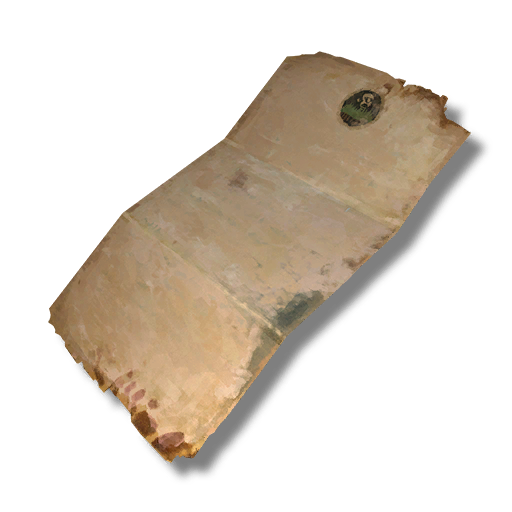

# Forest Talker Bunker Memo

**Categories:** Collectibles, Pages with update history · **Source:** [Fandom](https://thelongdark.fandom.com/wiki/Forest_Talker_Bunker_Memo)

**Forest Talker Bunker Memo**

_Forest\_Talker\_Bunker\_Memo\_icon.png_

**Release:** [22 October 2019](./The%20Long%20Dark%20%E2%80%94%20Changelog.md#1.60)

**Wintermute:** [Episode 3](./Episode%203%20-%20Crossroads%20Elegy.md) - [Joplin's Bunker Raid](./Joplin%27s%20Bunker%20Raid.md)

**Properties**

**Item type:** [Collectibles](./Collectibles.md)

**Stackable:** No

**Examine:** A Forest Talker memo containing the location of a prepper bunker.

**Values**

**Weight:** 0.00 kg (0 lbs)

**Actions**

**Backpack:** Examine

**On ground:** Take It, Read Text, Leave It

**Advanced data**

**Item key:** STORY\_Collectible\_JoplinsCacheNote

**Forest Talker Bunker Memo** is a [Collectible](./Collectibles.md) item found in [Episode 3](./Episode%203%20-%20Crossroads%20Elegy.md) of the [Wintermute](./Wintermute.md) story mode as a part of the [Joplin's Bunker Raid](./Joplin%27s%20Bunker%20Raid.md) side mission.

During the course of the mission, [Astrid Greenwood](./Astrid%20Greenwood.md) finds the note _Forest Talker Bunker Memo_ from in the [Rural Store](./Rural%20Store.md) of [Thomson's Crossing](./Thomson%27s%20Crossing.md) on Green and Capable Survivor difficulty. On Hardened Survivor, the note is found in a backpack next to a corpse at the [Derelict Cabins](./Derelict%20Cabins.md).

## Transcript

_The following text is transcribed from **Forest Talker Bunker Memo**_

**This old guy has struck off who knows where. But there's bound to be some gear left behind. Anyway we're out of options. -- M.**

## Update history

- UPDATE **22 October 2019 ([Update](./The%20Long%20Dark%20%E2%80%94%20Changelog.md#1.60)):**
  - Added to game.
