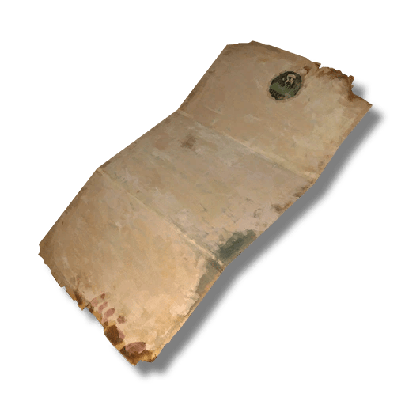

# Forest Talker Documents

<table class="infobox">
<caption>Forest Talker Documents</caption>
<colgroup>
<col style="width: 50%" />
<col style="width: 50%" />
</colgroup>
<tbody>
<tr>
<td colspan="2"><figure>

<figcaption>Forest_Talker_Documents_icon.png</figcaption>
</figure></td>
</tr>
<tr>
<td>
Release
</td>
<td>
<a href="./The%20Long%20Dark%20%E2%80%94%20Early%20Access%20Changelog.md#1.00" class="wikilink" title="1 August 2017">1 August 2017</a>
</td>
</tr>
<tr>
<td>
Wintermute
</td>
<td>
<a href="./Episode%202%20-%20Luminance%20Fugue.md" class="wikilink" title="Episode 2">Episode 2</a> - <a href="./Lake%20Gunshots.md" class="wikilink" title="Lake Gunshots">Lake Gunshots</a>
</td>
</tr>
<tr>
<td colspan="2" class="section">
<strong>Properties</strong>
</td>
</tr>
<tr>
<td>
Item type
</td>
<td>
<a href="./Collectibles.md" class="wikilink" title="Collectibles">Collectibles</a>|-
</td>
</tr>
<tr>
<td>
Stackable
</td>
<td>
No
</td>
</tr>
<tr>
<td>
Examine
</td>
<td>
Documents found by the Forest Talkers. They think they are important to their cause.
</td>
</tr>
<tr>
<td colspan="2" class="section">
<strong>Values</strong>
</td>
</tr>
<tr>
<td>
Weight
</td>
<td>
0.00 kg (0 lbs)
</td>
</tr>
<tr>
<td colspan="2" class="section">
<strong>Actions</strong>
</td>
</tr>
<tr>
<td>
Backpack
</td>
<td>
Examine
</td>
</tr>
<tr>
<td>
On ground
</td>
<td>
Take It, Leave It
</td>
</tr>
</tbody>
</table>

**Forest Talker Documents** is a <a href="./Collectibles.md" class="wikilink" title="Collectible">Collectible</a> item found in <a href="./Episode%202%20-%20Luminance%20Fugue.md" class="wikilink" title="Episode 2">Episode 2</a> of the <a href="./Wintermute.md" class="wikilink" title="Wintermute">Wintermute</a> story mode. It is found under a Loose Tile in the upper <a href="./Carter%20Hydro%20Dam.md" class="wikilink" title="Carter Hydro Dam">Carter Hydro Dam</a> after agreeing to help the Forest Talker in the <a href="./Lake%20Gunshots.md" class="wikilink" title="Lake Gunshots">Lake Gunshots</a> side mission.

## Transcript

The following text is transcribed from **Forest Talker Documents**

"We finally have the evidence we've been looking for. All the photos of the logging we shared on social media have been totally ignored -- and I mean, who can blame them. Nobody believes what they see anymore. BUT, we stole some documents from a logging camp that prove that Breyerhouse is here \*illegally\*. Like, they don't actually have the correct permits or even permission to be here. And they are cutting down OLD GROWTH trees out here. It's exactly the kind of ammunition we need to take them down. Even if the lawyers and the corporate shills try to bury this -- and they will -- we'll be able to use this to drive up our recruitment, as well as cash for our crowdfunding campaign. With this, we can finally takes (sic) things to the \*next level\*."

## Update history

- UPDATE **1 August 2017 (<a href="./The%20Long%20Dark%20%E2%80%94%20Changelog.md#1.00" class="wikilink" title="Update">Update</a>):**
  - Added to game.

**Lua execution error in Module:Navbox function navbox**

