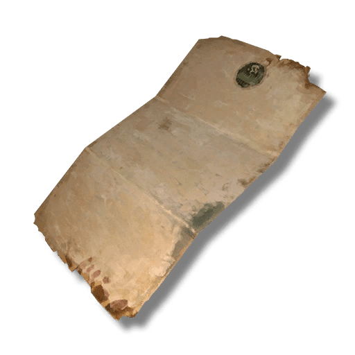

# Forest Talker Letter

<table class="infobox">
<caption>Forest Talker Letter</caption>
<colgroup>
<col style="width: 50%" />
<col style="width: 50%" />
</colgroup>
<tbody>
<tr>
<td colspan="2"><figure>

<figcaption>Forest_Talker_Letter_icon.png</figcaption>
</figure></td>
</tr>
<tr>
<td>
Release
</td>
<td>
<a href="./The%20Long%20Dark%20%E2%80%94%20Changelog.md#1.95" class="wikilink" title="6 October 2021">6 October 2021</a>
</td>
</tr>
<tr>
<td>
Wintermute
</td>
<td>
<a href="./Episode%204%20-%20Fury%2C%20Then%20Silence.md" class="wikilink" title="Episode 4">Episode 4</a> - <a href="./A%20Riddle%20Among%20the%20Shadows.md" class="wikilink" title="A Riddle Among the Shadows">A Riddle Among the Shadows</a>
</td>
</tr>
<tr>
<td colspan="2" class="section">
<strong>Properties</strong>
</td>
</tr>
<tr>
<td>
Item type
</td>
<td>
<a href="./Collectibles.md" class="wikilink" title="Collectibles">Collectibles</a>|-
</td>
</tr>
<tr>
<td>
Stackable
</td>
<td>
No
</td>
</tr>
<tr>
<td>
Examine
</td>
<td>
Faded writing on old Forest Talker letterhead.
</td>
</tr>
<tr>
<td colspan="2" class="section">
<strong>Values</strong>
</td>
</tr>
<tr>
<td>
Weight
</td>
<td>
0.00 kg (0 lbs)
</td>
</tr>
<tr>
<td colspan="2" class="section">
<strong>Actions</strong>
</td>
</tr>
<tr>
<td>
Backpack
</td>
<td>
Examine
</td>
</tr>
<tr>
<td>
On ground
</td>
<td>
Take It, Read Text, Leave It
</td>
</tr>
</tbody>
</table>

**Forest Talker Letter** is 3 <a href="./Collectibles.md" class="wikilink" title="Collectibles">Collectibles</a> found in <a href="./Episode%204%20-%20Fury%2C%20Then%20Silence.md" class="wikilink" title="Episode 4">Episode 4</a> of the <a href="./Wintermute.md" class="wikilink" title="Wintermute">Wintermute</a> story as part of the <a href="./A%20Riddle%20Among%20the%20Shadows.md" class="wikilink" title="A Riddle Among the Shadows">A Riddle Among the Shadows</a> side mission. They are found inside the <a href="./Last%20Prospect.md" class="wikilink" title="Last Prospect">Last Prospect</a> mine at different points and are the key to opening the <a href="./Forest%20Talkers.md" class="wikilink" title="Forest Talker">Forest Talker</a> cache at the start of the mine.

## Transcript

<u>The first is found on the barrel with the <a href="./Elevator%20Crank.md" class="wikilink" title="Elevator Crank">Elevator Crank</a>. The letter reads:</u>

The following text is transcribed from **Forest Talker Letter**

We finally reached the mine and found the supply cache. If that last transmission was right, this could be what I've been looking for all along.

We know that 18 was the last number in the padlock combination, now I just have to find the other two. There must be more clues left behind.

There's a creeping darkness in here. I hate it. But I have to go deeper.

<u>The second letter is found on a corpse holding the <a href="./Mine%20Gate%20Key.md" class="wikilink" title="Mine Gate Key">Mine Gate Key</a>. The letter reads:</u>

The following text is transcribed from **Forest Talker Letter**

The gas, my god.

There's some kind (Sic) light system rigged up to deliver one of the numbers for the padlock.

I have to find a way to reach the right spot on the second floor so I can see it and decipher the number from the flashing light. The others went on without me. Just need to rest here a while.

<u>The third letter is found on a corpse below the <a href="./Detonators.md" class="wikilink" title="Detonators">Detonators</a>. The letter is soaked in blood and reads:</u>

The following text is transcribed from **Forest Talker Letter**

High explosives. Toxic gas. Bottomless pits.

A fool's errand, but we did decipher the final part of the padlock combination -- they marked the signs leading to the elevator. Clever!

Now to get the hell out of here.

<u>Once all 3 notes are found, the examine text for the **Forest Talker Letter** note reads:</u>

The following text is transcribed from **Forest Talker Letter**

Notes on a dark riddle:

\- Last number is 18.

\- One of the numbers involves a light system on the second floor. Find the marker to see the light.

\- One of the numbers is connected to the yellow markings found on some of the signs.

## Update history

- UPDATE **6 October 2021 (<a href="./The%20Long%20Dark%20%E2%80%94%20Changelog.md#1.95" class="wikilink" title="Update">Update</a>):**
  - Added to game.

**Lua execution error in Module:Navbox function navbox**

