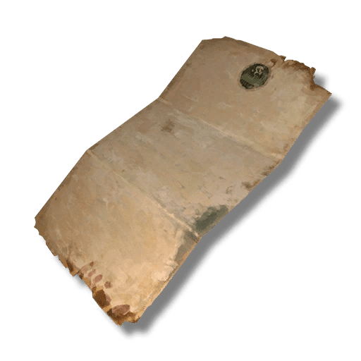

# Forest Talker Memo

<table class="infobox">
<caption>Forest Talker Memo</caption>
<colgroup>
<col style="width: 50%" />
<col style="width: 50%" />
</colgroup>
<tbody>
<tr>
<td colspan="2"><figure>

<figcaption>Forest_Talker_Memo_icon.png</figcaption>
</figure></td>
</tr>
<tr>
<td>
Release
</td>
<td>
<a href="./The%20Long%20Dark%20%E2%80%94%20Changelog.md#1.95" class="wikilink" title="6 October 2021">6 October 2021</a>
</td>
</tr>
<tr>
<td>
Wintermute
</td>
<td>
<a href="./Episode%204%20-%20Fury%2C%20Then%20Silence.md" class="wikilink" title="Episode 4">Episode 4</a> - <a href="./A%20Riddle%20Among%20the%20Shadows.md" class="wikilink" title="A Riddle Among the Shadows">A Riddle Among the Shadows</a>
</td>
</tr>
<tr>
<td colspan="2" class="section">
<strong>Properties</strong>
</td>
</tr>
<tr>
<td>
Item type
</td>
<td>
<a href="./Collectibles.md" class="wikilink" title="Collectibles">Collectibles</a>|-
</td>
</tr>
<tr>
<td>
Stackable
</td>
<td>
No
</td>
</tr>
<tr>
<td>
Examine
</td>
<td>
A sheet of paper, waterstained but crisply-folded.
</td>
</tr>
<tr>
<td colspan="2" class="section">
<strong>Values</strong>
</td>
</tr>
<tr>
<td>
Weight
</td>
<td>
0.00 kg (0 lbs)
</td>
</tr>
<tr>
<td colspan="2" class="section">
<strong>Actions</strong>
</td>
</tr>
<tr>
<td>
Backpack
</td>
<td>
Examine
</td>
</tr>
<tr>
<td>
On ground
</td>
<td>
Take It, Read Text, Leave It
</td>
</tr>
</tbody>
</table>

**Forest Talker Memo** is a <a href="./Collectibles.md" class="wikilink" title="Collectible">Collectible</a> found in <a href="./Episode%204%20-%20Fury%2C%20Then%20Silence.md" class="wikilink" title="Episode 4">Episode 4</a> of the <a href="./Wintermute.md" class="wikilink" title="Wintermute">Wintermute</a> story as part of the <a href="./A%20Riddle%20Among%20the%20Shadows.md" class="wikilink" title="A Riddle Among the Shadows">A Riddle Among the Shadows</a> side mission. It is found inside the cache inside the <a href="./Last%20Prospect.md" class="wikilink" title="Last Prospect">Last Prospect</a> mine once Mackenzie collects the three <a href="./Forest%20Talker%20Letter.md" class="wikilink" title="Forest Talker Letter">Forest Talker Letter</a> notes and opens the padlock.

## Transcript

The following text is transcribed from **Forest Talker Memo**

\[a leaf of paper -- written as a letter but undated and unsigned\]

We built out a waystation of sorts in an old mine in the shadow of Blackrock Mountain. It's not far from the Penitentiary, so we figure it'll sit undisturbed as a stockpile. There's a powerful energy to the place that I can't quite describe. I feel renewed each time I visit.

Our other hope is that since the mine is more modern than many of the other workings on Great Bear, we'll be able to scrounge some valuable gear there, too.

We've got to cut them off from the Mainland. Resilience is the only way forward for us. Dependence on Mainland support will only mean more ecological devastation.

The time for half-measures is over.

## Update history

- UPDATE **6 October 2021 (<a href="./The%20Long%20Dark%20%E2%80%94%20Changelog.md#1.95" class="wikilink" title="Update">Update</a>):**
  - Added to game.

**Lua execution error in Module:Navbox function navbox**

