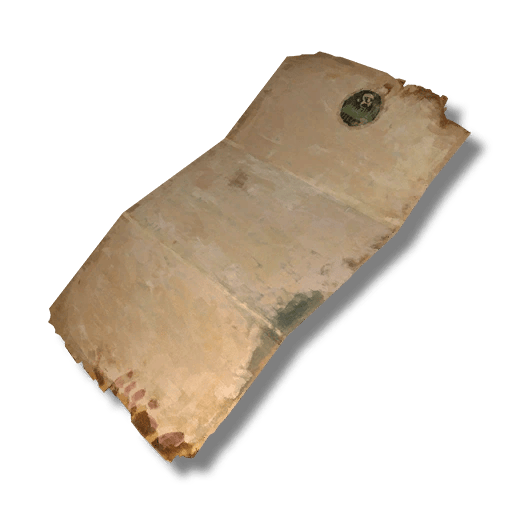

# Forest Talker Note

<table class="infobox">
<caption>Forest Talker Note</caption>
<colgroup>
<col style="width: 50%" />
<col style="width: 50%" />
</colgroup>
<tbody>
<tr>
<td colspan="2"><figure>

<figcaption>Forest_Talker_Note_icon.png</figcaption>
</figure></td>
</tr>
<tr>
<td>
Release
</td>
<td>
<a href="./The%20Long%20Dark%20%E2%80%94%20Early%20Access%20Changelog.md#1.00" class="wikilink" title="1 August 2017">1 August 2017</a>
</td>
</tr>
<tr>
<td>
Wintermute
</td>
<td>
<a href="./Episode%202%20-%20Luminance%20Fugue.md" class="wikilink" title="Episode 2">Episode 2</a> - <a href="./Lake%20Gunshots.md" class="wikilink" title="Lake Gunshots">Lake Gunshots</a>
</td>
</tr>
<tr>
<td colspan="2" class="section">
<strong>Properties</strong>
</td>
</tr>
<tr>
<td>
Item type
</td>
<td>
<a href="./Collectibles.md" class="wikilink" title="Collectibles">Collectibles</a>|-
</td>
</tr>
<tr>
<td>
Stackable
</td>
<td>
No
</td>
</tr>
<tr>
<td>
Examine
</td>
<td>
A note left for you by the Forest Talker in the Lake Cabin
</td>
</tr>
<tr>
<td colspan="2" class="section">
<strong>Values</strong>
</td>
</tr>
<tr>
<td>
Weight
</td>
<td>
0.00 kg (0 lbs)
</td>
</tr>
<tr>
<td colspan="2" class="section">
<strong>Actions</strong>
</td>
</tr>
<tr>
<td>
Backpack
</td>
<td>
Examine
</td>
</tr>
<tr>
<td>
On ground
</td>
<td>
Take It, Leave It
</td>
</tr>
</tbody>
</table>

**Forest Talker Note** is a <a href="./Collectibles.md" class="wikilink" title="Collectible">Collectible</a> item found in <a href="./Episode%202%20-%20Luminance%20Fugue.md" class="wikilink" title="Episode 2">Episode 2</a> of the <a href="./Wintermute.md" class="wikilink" title="Wintermute">Wintermute</a> story mode. It is found inside the cabin that the <a href="./Forest%20Talkers.md" class="wikilink" title="Forest Talker">Forest Talker</a> was recovering in at the end of the <a href="./Lake%20Gunshots.md" class="wikilink" title="Lake Gunshots">Lake Gunshots</a> side mission, left for Mackenzie.

## Transcript

This note has two possible transcripts. If the player takes the ammo from the pack, allowing the Forest Talker to die, this note will be left behind on the desk for Mackenzie:

The following text is transcribed from **Forest Talker Note**

"While I appreciate what you've done to help me, stealing ammo may be my death sentence out here. I have a long way to go and with hungry wolves and angry people out there, I have no idea how far I'll get. I hope you can sleep at night. Remember: As You Sow, So Shall You Reap."

If the player leaves the ammo inside the backpack, this note will be left behind on the desk for Mackenzie, along with a pair of <a href="./Deerskin%20Pants.md" class="wikilink" title="Deerskin Pants">Deerskin Pants</a>:

The following text is transcribed from **Forest Talker Note**

Thank you for helping me, not everyone would have done that. I left this item for you, it belonged to my friend, hopefully you'll be able to make use of it? Maybe our paths will cross again.

## Update history

- UPDATE **1 August 2017 (<a href="./The%20Long%20Dark%20%E2%80%94%20Changelog.md#1.00" class="wikilink" title="Update">Update</a>):**
  - Added to game.

**Lua execution error in Module:Navbox function navbox**

