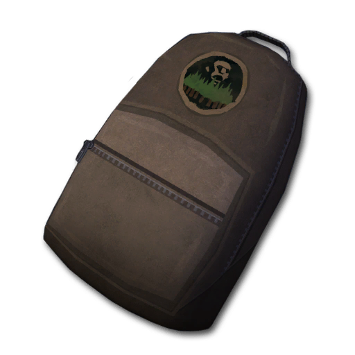

# Forest Talker Supplies

<table class="infobox">
<caption>Forest Talker Supplies</caption>
<colgroup>
<col style="width: 50%" />
<col style="width: 50%" />
</colgroup>
<tbody>
<tr>
<td colspan="2"><figure>

<figcaption>Forest_Talker_Supplies_icon.png</figcaption>
</figure></td>
</tr>
<tr>
<td>
Release
</td>
<td>
<a href="./The%20Long%20Dark%20%E2%80%94%20Early%20Access%20Changelog.md#1.00" class="wikilink" title="1 August 2017">1 August 2017</a>
</td>
</tr>
<tr>
<td>
Wintermute
</td>
<td>
<a href="./Episode%202%20-%20Luminance%20Fugue.md" class="wikilink" title="Episode 2">Episode 2</a> - <a href="./Lake%20Gunshots.md" class="wikilink" title="Lake Gunshots">Lake Gunshots</a>
</td>
</tr>
<tr>
<td colspan="2" class="section">
<strong>Properties</strong>
</td>
</tr>
<tr>
<td>
Item type
</td>
<td>
<a href="./Collectibles.md" class="wikilink" title="Collectibles">Collectibles</a>|-
</td>
</tr>
<tr>
<td>
Stackable
</td>
<td>
No
</td>
</tr>
<tr>
<td>
Examine
</td>
<td>
A backpack full of supplies presumably stashed here by the Forest Talkers.
</td>
</tr>
<tr>
<td colspan="2" class="section">
<strong>Values</strong>
</td>
</tr>
<tr>
<td>
Weight
</td>
<td>
0.00 kg (0 lbs)
</td>
</tr>
<tr>
<td colspan="2" class="section">
<strong>Actions</strong>
</td>
</tr>
<tr>
<td>
Backpack
</td>
<td>
Examine
</td>
</tr>
<tr>
<td>
On ground
</td>
<td>
Take It, Leave It
</td>
</tr>
<tr>
<td colspan="2" class="section">
<strong>Advanced data</strong>
</td>
</tr>
<tr>
<td>
Item key
</td>
<td>
GAMEPLAY_TrailerSupplies
</td>
</tr>
</tbody>
</table>

**Forest Talker Supplies** are a <a href="./Collectibles.md" class="wikilink" title="Collectible">Collectible</a> item found in <a href="./Episode%202%20-%20Luminance%20Fugue.md" class="wikilink" title="Episode 2">Episode 2</a> of the <a href="./Wintermute.md" class="wikilink" title="Wintermute">Wintermute</a> story mode during the <a href="./Lake%20Gunshots.md" class="wikilink" title="Lake Gunshots">Lake Gunshots</a> side mission.

During the course of the mission, the survivor retrieves the Forest Talker Supplies from a logging trailer located at <a href="./Logging%20Camp.md" class="wikilink" title="Logging Camp">Logging Camp</a> in west <a href="./Mystery%20Lake%20%28disambiguation%29.md" class="wikilink" title="Mystery Lake">Mystery Lake</a> near the forestry lookout, and returns them to a <a href="./Forest%20Talkers.md" class="wikilink" title="Forest Talker">Forest Talker</a> at <a href="./Lake%20Cabins.md" class="wikilink" title="Lake Cabins">Lake Cabins</a>.

The player has the option to take the ammo from the Forest Talker Supplies before returning it; however, stealing the ammo causes both the death of the <a href="./Forest%20Talkers.md" class="wikilink" title="Forest Talker">Forest Talker</a> and prevents the player from receiving a pair of <a href="./Deerskin%20Pants.md" class="wikilink" title="Deerskin Pants">Deerskin Pants</a> as a reward for completing the mission.

## Update history

- UPDATE **1 August 2017 (<a href="./The%20Long%20Dark%20%E2%80%94%20Changelog.md#1.00" class="wikilink" title="Update">Update</a>):**
  - Added to game.

**Lua execution error in Module:Navbox function navbox**

