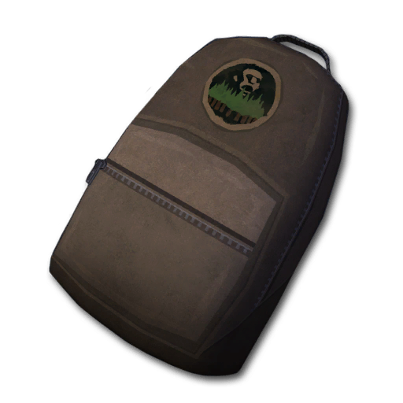

# Forest Talker Supply Caches

<table class="infobox">
<caption>Forest Talker Supply Caches</caption>
<colgroup>
<col style="width: 50%" />
<col style="width: 50%" />
</colgroup>
<tbody>
<tr>
<td colspan="2"><figure>

<figcaption>trailer_supplies_icon.png</figcaption>
</figure></td>
</tr>
<tr>
<td>
Episode
</td>
<td>
<a href="./Episode%202%20-%20Luminance%20Fugue.md" class="wikilink" title="Episode 2">Episode 2</a>|-
</td>
</tr>
<tr>
<td>
Current
</td>
<td>
Forest Talker Supply Caches
</td>
</tr>
<tr>
<td>
Region
</td>
<td>
<a href="./Mystery%20Lake%20%28disambiguation%29.md" class="wikilink" title="Mystery Lake">Mystery Lake</a> 
<a href="./Forlorn%20Muskeg.md" class="wikilink" title="Forlorn Muskeg">Forlorn Muskeg</a> 
<a href="./Broken%20Railroad.md" class="wikilink" title="Broken Railroad">Broken Railroad</a>
</td>
</tr>
<tr>
<td>
Characters
</td>
<td>
<a href="./Forest%20Talkers.md" class="wikilink" title="Forest Talkers">Forest Talkers</a>
</td>
</tr>
</tbody>
</table>

**Template:spoiler**

<table>
<colgroup>
<col style="width: 33%" />
<col style="width: 33%" />
<col style="width: 33%" />
</colgroup>
<tbody>
<tr>
<td style="vertical-align: top; font-size: 3em; color: #5d5980; padding-right: 10px">
“
</td>
<td>
The Forest Talkers, an eco-activist group, have left supply caches hidden in different regions around Great Bear Island. They could prove useful if found.

&#10;

In-game description

</td>
<td style="vertical-align: bottom; font-size: 3em; color: #5d5980; padding-left: 10px">
”
</td>
</tr>
</tbody>
</table>

**Forest Talker Supply Caches** is a side mission in <a href="./Episode%202%20-%20Luminance%20Fugue.md" class="wikilink" title="Episode 2">Episode 2</a> of the <a href="./Wintermute.md" class="wikilink" title="story">story</a>. It is unlocked by reading a note in the Hunting Lodge in the Broken Railroad region. Reading the note unlocks all three caches.

## Tasks

- Forest Talker Cache: Mystery Lake
  - The cache is located near the trailers by the logging camp.
  - The content is: <a href="./Firearm%20Cleaning%20Kit.md" class="wikilink" title="Firearm Cleaning Kit">Firearm Cleaning Kit</a>, a <a href="./Military-Grade%20MRE.md" class="wikilink" title="Military-Grade MRE">Military-Grade MRE</a> and decent <a href="./Ski%20Gloves.md" class="wikilink" title="Ski Gloves">Ski Gloves</a>.
- Forest Talker Cache: Forlorn Muskeg
  - The cache is located at the base of a cliff south of Muskeg Overlook
  - The content is: <a href="./Antiseptic.md" class="wikilink" title="Antiseptic">Antiseptic</a>, <a href="./Long%20Wool%20Scarf.md" class="wikilink" title="Long Wool Scarf">Long Wool Scarf</a>, <a href="./Light%20Shell.md" class="wikilink" title="Light Shell">Light Shell</a>
- Forest Talker Cache: Maintenance Yard
  - To unlock the quest, the player must find a letter in the basement of the hunting lodge.
  - The cache is located in the western part of the maintenance yard area.
  - The content is: 12 <a href="./Wood%20Matches.md" class="wikilink" title="Wood Matches">Wood Matches</a>, a <a href="./Can%20Opener.md" class="wikilink" title="Can Opener">Can Opener</a>, 2 <a href="./Firelog.md" class="wikilink" title="Firelogs">Firelogs</a> and 1 <a href="./Accelerant.md" class="wikilink" title="Accelerant">Accelerant</a>.

**Lua execution error in Module:Navbox function navbox**

