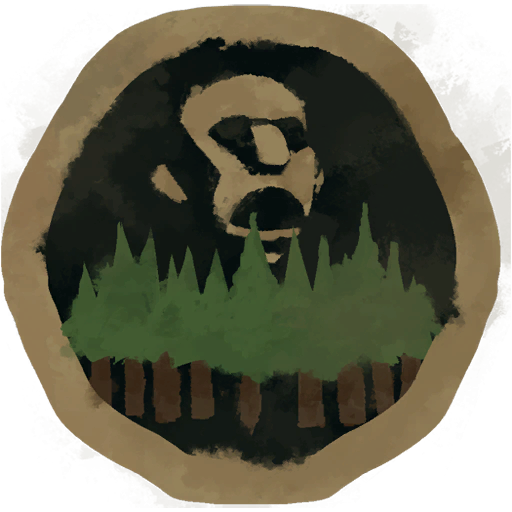

# Forest Talkers

**Categories:** Story · **Source:** [Fandom](https://thelongdark.fandom.com/wiki/Forest_Talkers)

**Contents**

- [History](#history)
- [Missions](#missions)
- [Recent Activities](#recent-activities)
- [Mystery Lake](#mystery-lake)
- [Pleasant Valley](#pleasant-valley)
- [Blackrock Region](#blackrock-region)
- [Other Regions](#other-regions)

**Forest Talkers**

_Forest\_talker\_logo.png_

**Type:** Eco terrorism

**Headquarters:** [Great Bear Island](./Great%20Bear%20Island.md)

> “**Eco-terrorists. Activists, some call them. Depends on who you talk to I guess.**”
>
> — -Jeremiah

The **Forest Talkers**are a group of activists mentioned in the Story Mode of _The Long Dark_. They are also described as 'eco-terrorists'.

## History

The Forest Talkers were formed by several natives of [Great Bear Island](./Great%20Bear%20Island.md) to fight against the mass industrialization and the reaping of their island's natural resources by "outsiders." They claimed to be environmentalists, and some residents did not have a problem with them. Others, such as [Breyerhouse](./Breyerhouse.md) and the owners of the [Carter Hydro Dam](./Carter%20Hydro%20Dam.md) regarded them as terrorists. Notes from disgruntled members reveal that the group was largely ragtag and disorganized. The full extent of their actions and crimes is unknown, but it is implied that they regularly engaged in violence and destruction of property toward industrial sites and workers on the island. Their headquarters was in the [Hunting Lodge](./Hunting%20Lodge.md) in [Broken Railroad](./Broken%20Railroad.md).

## Missions

The following missions involve the Forest Talkers or at least one of its members:

- [Episode 2](./Episode%202%20-%20Luminance%20Fugue.md) - [Lake Gunshots](./Lake%20Gunshots.md)
- [Episode 2](./Episode%202%20-%20Luminance%20Fugue.md) - [Forest Talker Supply Caches](./Forest%20Talker%20Supply%20Caches.md)
- [Episode 3](./Episode%203%20-%20Crossroads%20Elegy.md) - [Forest Talkers (side mission)](./Forest%20Talkers%20%28side%20mission%29.md)
- [Episode 4](./Episode%204%20-%20Fury%2C%20Then%20Silence.md) - [A Riddle Among the Shadows](./A%20Riddle%20Among%20the%20Shadows.md)

## Recent Activities

### Mystery Lake

As a part of the [Lake Gunshots](./Lake%20Gunshots.md) side mission, Mackenzie helps an injured Forest talker recover the [Forest Talker Documents](./Forest%20Talker%20Documents.md) and [Forest Talker Supplies](./Forest%20Talker%20Supplies.md). The [Forest Talker Documents](./Forest%20Talker%20Documents.md) contain evidence of an illegal logging camp cutting down [old growth](Wikipedia:Old-growth_forest) trees that is allegedly run by [Breyerhouse](./Breyerhouse.md). Mackenzie can choose to either remove the [Rifle Ammunition](./Rifle%20Ammunition.md) from the supplies before returning it to the Forest Talker, or leave the ammunition.

As a part of the [Forest Talker Supply Caches](./Forest%20Talker%20Supply%20Caches.md) side mission, Mackenzie finds a supply cache near the [Logging Camp](./Logging%20Camp.md).

### Pleasant Valley

### Blackrock Region

The Forest Talkers have built a supply cache within the Abandoned Mine inside [Last Prospect](./Last%20Prospect.md). The cache was intended as a waystation for storing valuable gear and high explosives.

During the course of the mission [A Riddle Among the Shadows](./A%20Riddle%20Among%20the%20Shadows.md), [Mackenzie](./Will%20Mackenzie.md) finds the corpses of three Forest Talker members that were attempting to access the supply cache prior to their demise.

### Other Regions

Mackenzie views the buffer memory Update - Forest Talkers during the aurora and discovers that a group of Forest Talkers sabotaged a logging truck by pouring water into its gas tank on [Coastal Highway](./Coastal%20Highway.md).

As a part of the [Forest Talker Supply Caches](./Forest%20Talker%20Supply%20Caches.md) side mission, Mackenzie finds a supply cache near the [Maintenance Yard](./Maintenance%20Yard.md) in [Broken Railroad](./Broken%20Railroad.md).

As a part of the [Forest Talker Supply Caches](./Forest%20Talker%20Supply%20Caches.md) side mission, Mackenzie finds a supply cache near the [Bunkhouses](./Bunkhouses.md) in [Forlorn Muskeg](./Forlorn%20Muskeg.md).
