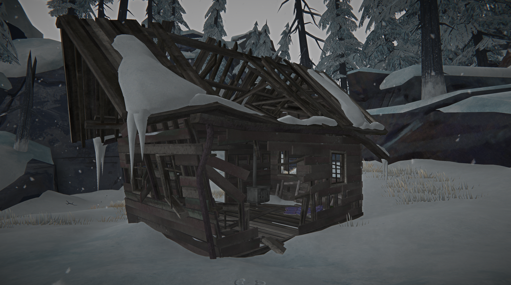
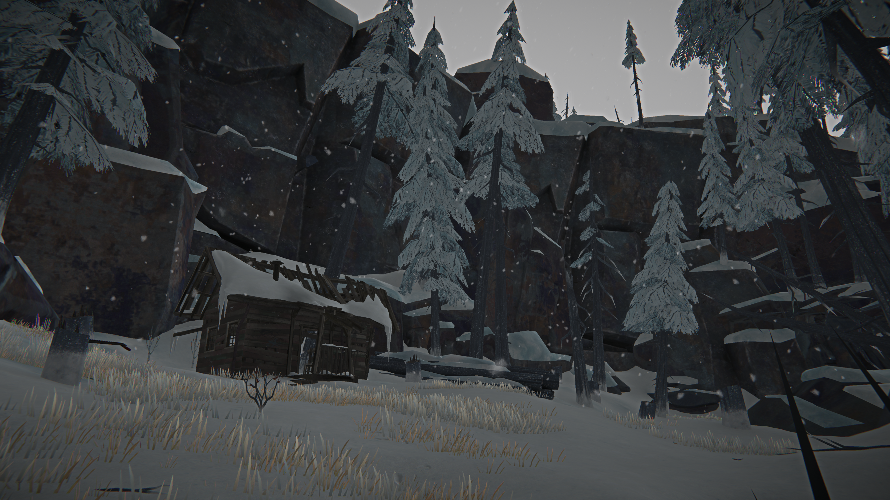

# Forester's Hermitage

<table class="infobox">
<caption>Forester's Hermitage</caption>
<colgroup>
<col style="width: 50%" />
<col style="width: 50%" />
</colgroup>
<tbody>
<tr>
<td colspan="2"><figure>

<figcaption>Forestershermitage.png</figcaption>
</figure></td>
</tr>
<tr>
<td colspan="2" class="section">
<strong>Location</strong>
</td>
</tr>
<tr>
<td colspan="2"><figure>
[Missing image: Forester's_Hermitage_Location.png]
<figcaption>Forester's_Hermitage_Location.png</figcaption>
</figure></td>
</tr>
<tr>
<td>
Region
</td>
<td></td>
</tr>
<tr>
<td>
Description
</td>
<td>
A partially ruined cabin
</td>
</tr>
<tr>
<td colspan="2" class="section">
<strong>General</strong>
</td>
</tr>
<tr>
<td>
Firebox
</td>
<td>
<a href="./Wood%20Stove.md" class="wikilink" title="Wood Stove">Wood Stove</a>
</td>
</tr>
<tr>
<td><figure>

<figcaption>bed_icon.png</figcaption>
</figure></td>
<td>
Has a bed
</td>
</tr>
<tr>
<td></td>
<td>
Provides some shelter|}

<strong>Forester's Hermitage</strong> is a small ruined cabin and the only man-made refuge in the <a href="./Keeper%27s%20Pass%20North.md" class="wikilink" title="Keeper&#39;s Pass North">Keeper's Pass North</a>.

<h2 id="Overview">Overview</h2>

Even if the warmth bonus is negligible, the cabin offers the ability to light a fire and rest via a <a href="./Wood%20Stove.md" class="wikilink" title="Wood Stove">Wood Stove</a>, offering some protection from the frequent blizzards in the Pass. Enough food can be found for one or two nights in the surrounding clearing, with both <a href="./Rabbit.md" class="wikilink" title="Rabbit">Rabbits</a> spawning nearby and <a href="./Cat%20Tail%20Stalk.md" class="wikilink" title="Cat Tail Stalk">Cat Tail Stalks</a>, <a href="./Rose%20Hip.md" class="wikilink" title="Rose Hips">Rose Hips</a> and <a href="./Reishi%20Mushroom.md" class="wikilink" title="Reishi Mushroom">Reishi Mushrooms</a> growing around this area's pond.

During <a href="./Episode%204%20-%20Fury%2C%20Then%20Silence.md" class="wikilink" title="Episode 4: Fury, Then Silence">Episode 4: Fury, Then Silence</a>, <a href="./Will%20Mackenzie.md" class="wikilink" title="Mackenzie">Mackenzie</a> uses the two-man saw in the stump to cut the ropes binding his hands together, and a <a href="./Letter.md" class="wikilink" title="Letter">Letter</a> can be found inside the building.

<h2 id="Gallery">Gallery</h2>
<table class="gallery">
<colgroup>
<col style="width: 100%" />
</colgroup>
<tbody>
<tr>
<td><figure>

<figcaption>Feahsrjtkjrew.png</figcaption>
</figure></td>
</tr>
</tbody>
</table>

<strong>Lua execution error in Module:Navbox function navbox</strong>
</td>
</tr>
</tbody>
</table>

