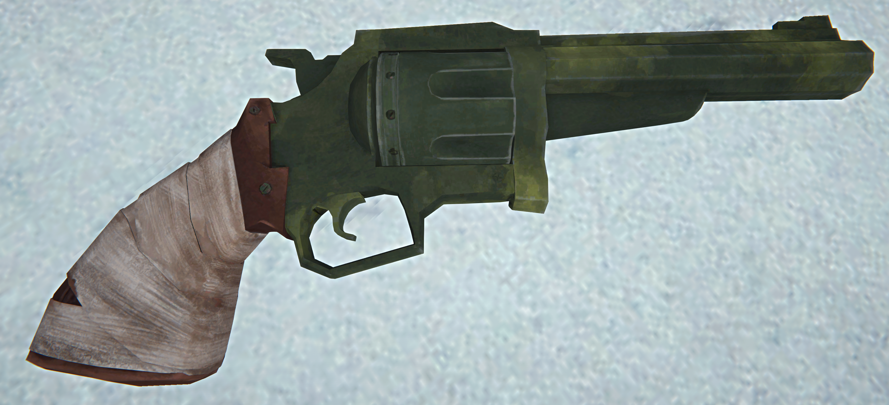

# Forester's Revolver

**Categories:** DLC Content, Pages with update history, Tools · **Source:** [Fandom](https://thelongdark.fandom.com/wiki/Forester's_Revolver)

**Contents**

- [Overview](#overview)
- [Differences from Revolver](#differences-from-revolver)
- [Locations](#locations)
- [Gallery](#gallery)
- [Update history](#update-history)

**DLC-Exclusive content.**

This content requires the [Tales from the Far Territory](./Tales%20from%20the%20Far%20Territory.md) addon to be installed before it can be seen or used in regular gameplay.

**Forester's Revolver**

**Release:** [21 June 2023](./The%20Long%20Dark%20%E2%80%94%20Changelog.md#2.17)

**Wintermute:** No

**Renewable:** No (unique item)

**Properties**

**Item type:** [Tools](./Tools.md)

**Stackable:** No

**Examine:** An old, reliable weapon. Durable. Taken from a Breyerhouse worker by an unknown forest talker.

**Values**

**Weight:** 1.50 kg (3.3 lbs)

**Actions**

**Backpack:** Use, Actions, Drop

**On ground:** Take It, Equip It, Leave It

**Advanced data**

**Item key:** GEAR\_RevolverGreen

**Forester's Revolver** is a unique variant of the [Revolver](./Revolver.md) in _The Long Dark_, added by the _[Tales from the Far Territory](./Tales%20from%20the%20Far%20Territory.md)_ expansion.

## Overview

The Forester's Revolver is an old double action, six-round chambered revolver. It has a soft green camouflage paint job and its wooden grip is wrapped with a white cloth. It's unique attribute is that each shot fired only degrades the gun by 0.75% condition instead of the standard revolvers 1% per shot. This means that it would take up to 133 shots to go from 100% to ruined, and can fire up to 266 shots total with Revolver Firearm level 5. The only potential drawback is that the gun is missing its rear iron sights, which may make aiming a challenge.

## Differences from Revolver

- Total durability is 33% more than the Revolver (Uses 0.75%-0.375% condition per shot based on [Revolver Skill](./Revolver%20Firearm.md))
- Lacks rear iron sights, but has a narrower front post

## Locations

The Forester's Revolver spawns somewhere within [Bleak Inlet](./Bleak%20Inlet.md), specifically within the mountain area accessible via the Ravine Basin section of [The Ravine](./The%20Ravine.md):

- On the ground below the [Pensive Lookout](./Pensive%20Lookout.md)
- On the desk inside the [Pensive Lookout](./Pensive%20Lookout.md)
- On the dashboard of the [Breyerhouse Truck](./Truck.md) in the parking lot prior to [Echo One Radio Tower](./Echo%20One%20Radio%20Tower.md)
- Buried in the snow with only the handle visible, next to a broken cable reel, at the foot of [Echo One Radio Tower](./Echo%20One%20Radio%20Tower.md)

## Gallery

## Update history

- UPDATE **21 June 2023 ([Update](./The%20Long%20Dark%20%E2%80%94%20Changelog.md#2.17)):**
  - Added to game.
