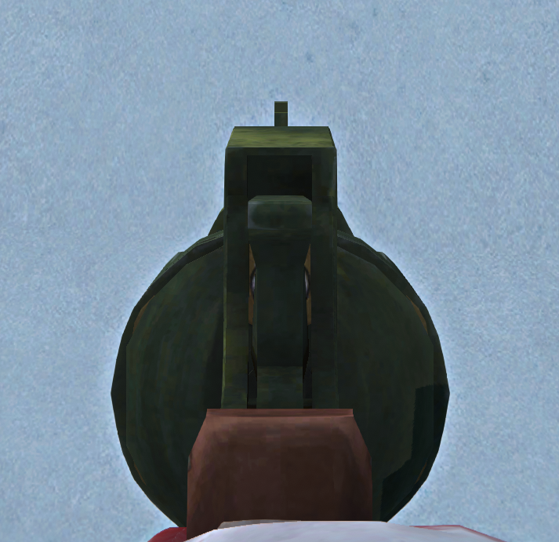

# Forester's Revolver

**Categories:** DLC Content, Pages with update history, Tools · **Source:** [Fandom](https://thelongdark.fandom.com/wiki/Forester's_Revolver)

**Contents**

- [Overview](#overview)
- [Differences from Revolver](#differences-from-revolver)
- [Locations](#locations)
- [Gallery](#gallery)
- [Update history](#update-history)

_Ptarmigan\_icon.png_

**DLC-Exclusive content.** / This content requires the [Tales from the Far Territory](./Tales%20from%20the%20Far%20Territory.md) addon to be installed before it can be seen or used in regular gameplay.

_Forester's\_Revolver\_icon.png_

**Release:** [21 June 2023](./The%20Long%20Dark%20%E2%80%94%20Changelog.md#2.17)

**Wintermute:** No

**Renewable:** No (unique item)

**Properties**

**Item type:** [Tools](./Tools.md)\|-

**Stackable:** No

**Examine:** An old, reliable weapon. Durable. Taken from a Breyerhouse worker by an unknown forest talker.

**Values**

**Weight:** 1.50 kg (3.3 lbs)

**Actions**

**Backpack:** Use, Actions, Drop

**On ground:** Take It, Equip It, Leave It

**Advanced data**

**Item key:** GEAR\_RevolverGreen

_The Revolver on the desk in Pensive Lookout_

_The Iron sights of the Foresters Revolver_

_Foresters Revolver Ground Model_
