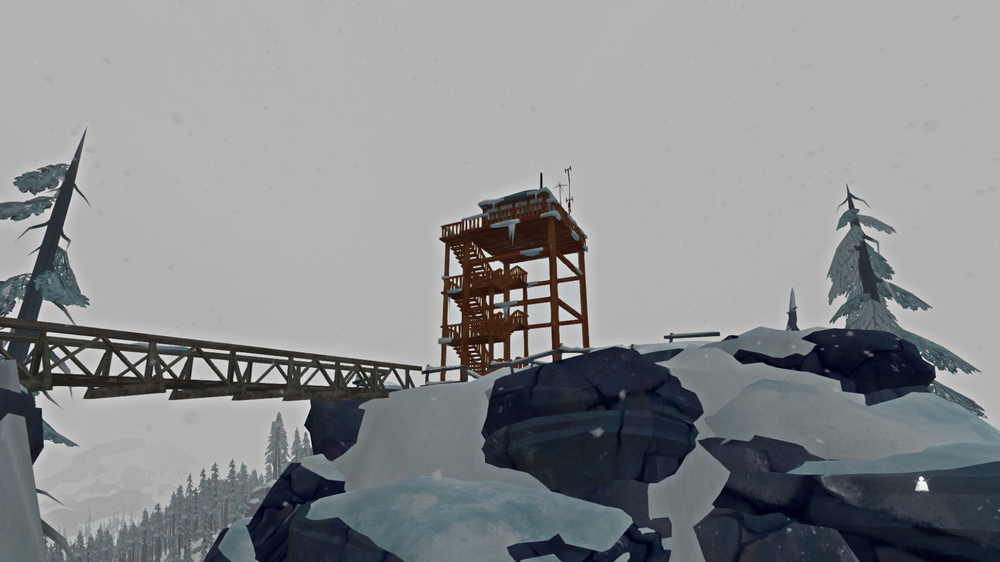
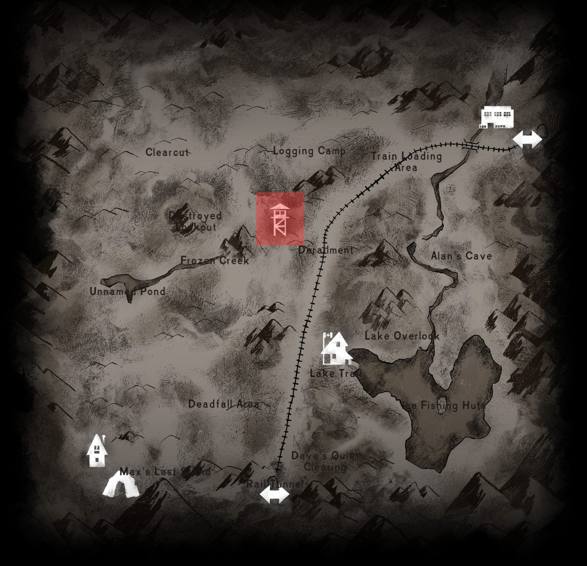
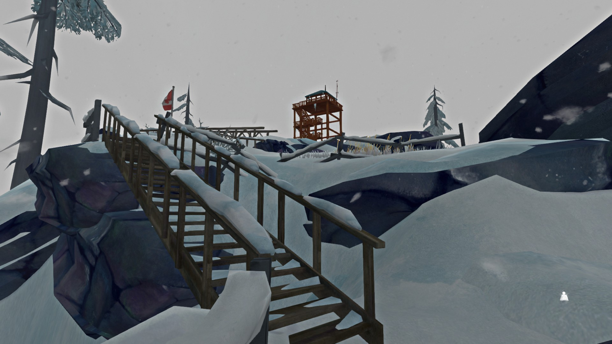
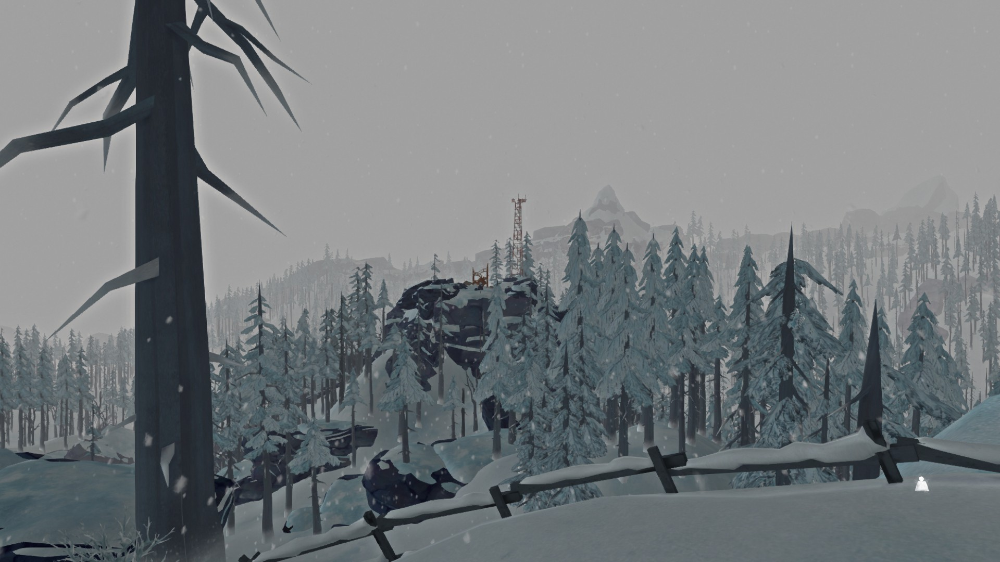
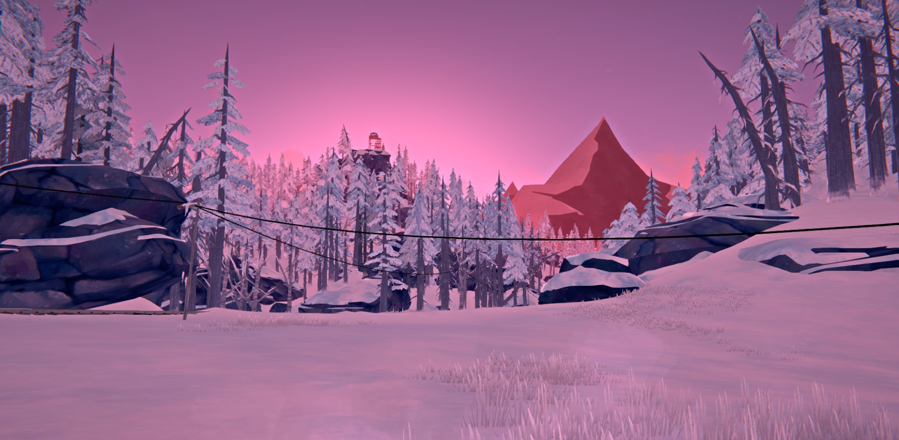
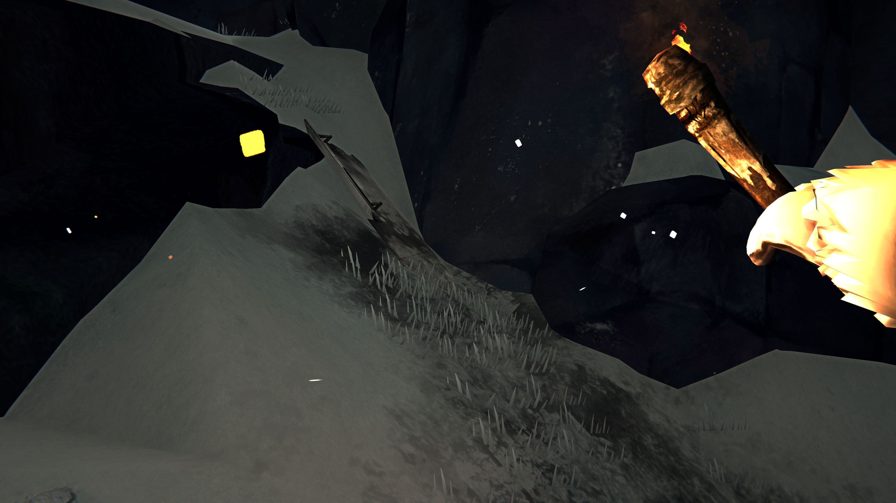
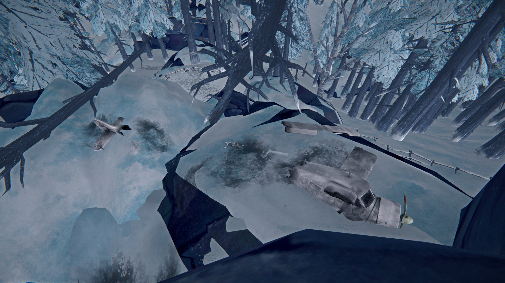

# Forestry Lookout

**Contents**

- [Overview](#overview)
- [Reaching the Tower](#reaching-the-tower)
- [Safehouse](#safehouse)
- [Possible loot](#possible-loot)
- [Game History](#game-history)
- [Trivia](#trivia)
- [Gallery](#gallery)

**Forestry Lookout**

| Property | Details |
| --- | --- |
|  |  / *New\_forestry\_lookout5.jpg* |
| **Location** |  |
|  |  / *Forestry\_Lookout\_Location.png* |
| Region | [Mystery Lake](./Mystery%20Lake%20%28region%29.md)\|- |
| **General** |  |
| Type | Military/Sporting\|- |
|  / *bed\_icon.png* | Has a bed |
|  | Provides some shelter\|} **Forestry Lookout** is a tall, wooden structure found in [Mystery Lake](./Mystery%20Lake%20%28region%29.md). / ## Overview / Forestry Lookout sits on a hill between the [Destroyed Lookout](./Destroyed%20Lookout.md) to the west and [Derailment](./Derailment.md) to the east. / It contains a bunk bed, a wood stove, and some food. A [Hunting Rifle](./Hunting%20Rifle.md), [Hatchet](./Hatchet.md), [Hunting Knife](./Hunting%20Knife.md), or [Prybar](./Prybar.md) may spawn here. A flock of [ptarmigans](./Ptarmigan.md) may also spawn near the walkways up to the lookout. The Forestry Lookout is one of two vista location in Mystery Lake. / There is no loading screen when the player enters the building. Instead, the door swings inside so the player can enter. Do not forget to close the door again after entering to help maintain warmth. / The interior is usually warm enough to keep the player from freezing during daytime, but temperatures may drop below zero during nighttime or blizzards. Warm clothing, a fire, and/or warmth from the bed may be useful to avoid freezing. / In [Episode 2: Luminance Fugue](./Episode%202%20-%20Luminance%20Fugue.md), there's a [lockbox](./Hank%27s%20Hatch.md) under the bed that requires [Hank's Lock Box Key](./Hank%27s%20Lock%20Box%20Key.md) to open. The key is found on a corpse near a campfire in the Unnamed pond, but the corpse &amp; campfire only spawn after completing the Bear hunting main quest. Inside the lockbox, there will be a piece of paper with a three number code that opens a bunker northeast from the Logging camp. The entrance to this bunker, also known as Prepper's cache, is a hatch found behind a large bolder and near a corpse. / A [Crashed Plane](./Plane%20Crashes.md) can be found below the Lookout, on the path up to the Lookout itself. / ## Reaching the Tower / The Forestry Lookout is notoriously elusive and the average traveler could easily find themselves caught in the cold of the [Destroyed Lookout](./Destroyed%20Lookout.md), the intact lookout taunting from the adjacent hill. But simply turning left before the [Derailment](./Derailment.md) and walking up the hill will find you at the foot of the path that takes you up the mountain. It will be hard to miss if you look for the wooden fence. / ## Safehouse / While offering an overview of the landscape in good weather, the Forestry Lookout does not make an ideal long-term [base](./Safehouse.md) because of its elevation, with the trip up and down the hill costing time, warmth, and fatigue. There is a wood stove and a bit of wood inside to provide warmth and cook food, but, after a few fires, fuel will need to be collected at the base of the mountain and carried up. If the player has high scent, wolves may also ascend the path and can attack the player on the way up or down from the lookout, with the hill obstructing clear lines of sight. As such, both the [Camp Office](./Camp%20Office.md) and the [Trapper's Homestead](./Trapper%27s%20Homestead.md) make more adequate bases. / ## Possible loot / - [Hunting Rifle](./Hunting%20Rifle.md) / - [Hatchet](./Hatchet.md) / - [Reclaimed Wood](./Reclaimed%20Wood.md) / - Assorted [food](./Food%20And%20Drink.md) / - [Rifle Ammunition](./Rifle%20Ammunition.md) / - First aid items / - [Prybar](./Prybar.md) / - [Hunting Knife](./Hunting%20Knife.md) / - [Mountaineering Rope](./Mountaineering%20Rope.md) / ## Game History / The Forestry Lookout once stood in the space the [Destroyed Lookout](./Destroyed%20Lookout.md) now occupies. / ## Trivia / - Forestry Lookout is now visible from many parts of the map along the railway. / - Forestry Lookout is a [Fire Lookout Tower](https://en.wikipedia.org/wiki/Fire_lookout_tower), structures built all over America and parts of [Canada](./The%20Collapse.md) beginning in the early 20th century. / - In Story mode, a note in the tower and the name on a lockbox under the bed seem to be a nod to the game *Firewatch*, much of which takes place in a watchtower. *Firewatch* also features a theme of isolation in a vast wilderness, similar to *The Long Dark*. "Hank," the name on the lockbox, is a nickname for Henry, the protagonist of *Firewatch*, and the note in the tower mentions a woman frequently talking on the radio, a major component of the referenced game's plot. / ## Gallery / \| Column 1 \| Column 2 \| Column 3 \| Column 4 \| / \| --- \| --- \| --- \| --- \| / \|  / *New\_forestry\_lookout3.jpg* \|  / *Forestry Lookout seen from the [Camp Office](./Camp%20Office.md)* \|  / *The view from Forestry Lookout towards the railway line* \|  / *A view from Forestry Lookout with the Destroyed Lookout in the distance* \| / \|  / *A view from inside Forestry Lookout. (The items in the photo were placed there)* \|  / *The Forestry Lookout during the Aurora.* \|  / *Forestry Lookout seen from the rails next to Camp Office.* \|  / *Plane Part at Forestry Lookout in Mystery Lake* \| / \|  / *Plane Part at Forestry Lookout in Mystery Lake* \|  / *The crashed plane between the lookout and Derailment* \|  \|  \| / **Lua execution error in Module:Navbox function navbox** / [ru:Дом лесника](ru:%D0%94%D0%BE%D0%BC_%D0%BB%D0%B5%D1%81%D0%BD%D0%B8%D0%BA%D0%B0) |
|  / *New\_forestry\_lookout3.jpg* |  / *Forestry Lookout seen from the [Camp Office](./Camp%20Office.md)* /  / *The view from Forestry Lookout towards the railway line* /  / *A view from Forestry Lookout with the Destroyed Lookout in the distance* |
|  / *A view from inside Forestry Lookout. (The items in the photo were placed there)* |  / *The Forestry Lookout during the Aurora.* /  / *Forestry Lookout seen from the rails next to Camp Office.* /  / *Plane Part at Forestry Lookout in Mystery Lake* |
|  / *Plane Part at Forestry Lookout in Mystery Lake* |  / *The crashed plane between the lookout and Derailment* |
