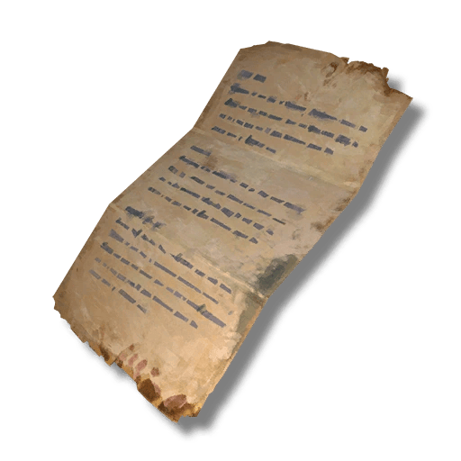

# Forge Blueprints

<table class="infobox">
<caption>Forge Blueprints</caption>
<colgroup>
<col style="width: 50%" />
<col style="width: 50%" />
</colgroup>
<tbody>
<tr>
<td colspan="2"><figure>

<figcaption>Forge_Blueprints_icon.png</figcaption>
</figure></td>
</tr>
<tr>
<td>
Release
</td>
<td>
<a href="./The%20Long%20Dark%20%E2%80%94%20Early%20Access%20Changelog.md#1.00" class="wikilink" title="1 August 2017">1 August 2017</a>
</td>
</tr>
<tr>
<td>
Wintermute
</td>
<td>
<a href="./Episode%202%20-%20Luminance%20Fugue.md" class="wikilink" title="Episode 2">Episode 2</a> - <a href="./Forge%20Blueprints%20%28mission%29.md" class="wikilink" title="Forge Blueprints (mission)">Forge Blueprints (mission)</a>
</td>
</tr>
<tr>
<td colspan="2" class="section">
<strong>Properties</strong>
</td>
</tr>
<tr>
<td>
Item type
</td>
<td>
<a href="./Collectibles.md" class="wikilink" title="Collectibles">Collectibles</a>|-
</td>
</tr>
<tr>
<td>
Stackable
</td>
<td>
No
</td>
</tr>
<tr>
<td>
Examine
</td>
<td>
A few old pages with instructions on how to Craft a few items using the Forge.
</td>
</tr>
<tr>
<td colspan="2" class="section">
<strong>Values</strong>
</td>
</tr>
<tr>
<td>
Weight
</td>
<td>
0.00 kg (0 lbs)
</td>
</tr>
<tr>
<td colspan="2" class="section">
<strong>Actions</strong>
</td>
</tr>
<tr>
<td>
Backpack
</td>
<td>
Examine
</td>
</tr>
<tr>
<td>
On ground
</td>
<td>
Take It, Leave It
</td>
</tr>
</tbody>
</table>

**Forge Blueprints** was a <a href="./Collectibles.md" class="wikilink" title="Collectible">Collectible</a> item found in <a href="./Episode%202%20-%20Luminance%20Fugue.md" class="wikilink" title="Episode 2">Episode 2</a> of the <a href="./Wintermute.md" class="wikilink" title="Wintermute">Wintermute</a> story mode. It was found on a desk inside of <a href="./Jeremiah%27s%20Hideout.md" class="wikilink" title="Jeremiah&#39;s Hideout">Jeremiah's Hideout</a>. It is considered <a href="./Cut%20%E2%80%94%20Discontinued%20Content.md" class="wikilink" title="Cut/Discontinued Content">Cut/Discontinued Content</a>, as it did not survive the transition from Predux Episode 2 to Redux Episode 2, as the premise of the side mission <a href="./Forge%20Blueprints%20%28mission%29.md" class="wikilink" title="Forge Blueprints">Forge Blueprints</a> was instead replaced with the mission <a href="./The%20Best%20Defense.md" class="wikilink" title="The Best Defense">The Best Defense</a>.

## Overview

The side mission Forge Blueprints is given when <a href="./Jeremiah.md" class="wikilink" title="Jeremiah&#39;s">Jeremiah's</a> Trust reaches 75, wherein he will inform <a href="./Will%20Mackenzie.md" class="wikilink" title="Will Mackenzie">Will Mackenzie</a> of some **Forge Blueprints** and an old <a href="./Forge.md" class="wikilink" title="Forge">Forge</a> near <a href="./Old%20Spence%20Family%20Homestead.md" class="wikilink" title="Old Spence Family Homestead">Old Spence Family Homestead</a>. Searching behind the Forge inside a <a href="./Metal%20Container.md" class="wikilink" title="Metal Container">Metal Container</a> and picking them up unlocks the ability to craft the <a href="./Improvised%20Knife.md" class="wikilink" title="Improvised Knife">Improvised Knife</a> and <a href="./Improvised%20Hatchet.md" class="wikilink" title="Improvised Hatchet">Improvised Hatchet</a> Forge recipes. A <a href="./Heavy%20Hammer.md" class="wikilink" title="Heavy Hammer">Heavy Hammer</a> is also conveniently located inside the Metal Container with some <a href="./Coal.md" class="wikilink" title="Coal">Coal</a>.

## Update history

- UPDATE **1 August 2017 (<a href="./The%20Long%20Dark%20%E2%80%94%20Changelog.md#1.00" class="wikilink" title="Update">Update</a>):**
  - Added to game.
- UPDATE **17 December 2018 (<a href="./The%20Long%20Dark%20%E2%80%94%20Changelog.md#1.41" class="wikilink" title="Update">Update</a>):**
  - Removed from the game as part of the Redux edition.

**Lua execution error in Module:Navbox function navbox**

