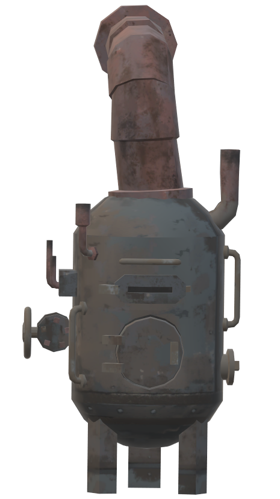
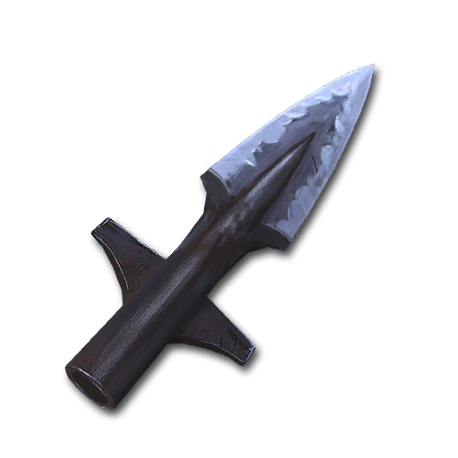
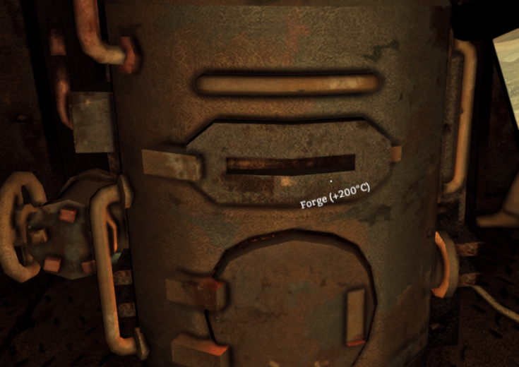

# Forge

**Contents**

- [Furnaces & Forges](#Furnaces_%26_Forges)
- [Locations](#Locations)
- [Working temperature](#Working_temperature)
- [Burn time](#Burn_time)
- [Craftable Items](#Craftable_Items)
- [Tips](#Tips)
- [Gallery](#Gallery)
- [Update history](#Update_history)

<table class="infobox">
<caption>Forge</caption>
<colgroup>
<col style="width: 50%" />
<col style="width: 50%" />
</colgroup>
<tbody>
<tr>
<td colspan="2"><figure>

<figcaption>Forge.png</figcaption>
</figure></td>
</tr>
<tr>
<td>
Release
</td>
<td>
18 September 2015
</td>
</tr>
<tr>
<td>
Update
</td>
<td>
<a href="./The%20Long%20Dark%20%E2%80%94%20Changelog.md#0.264" class="wikilink" title="0.264">0.264</a>
</td>
</tr>
</tbody>
</table>

A **Forge** is the rectangular space located in the middle of a <a href="./Furnace.md" class="wikilink" title="Furnace">Furnace</a> and is used for crafting new items made from <a href="./Scrap%20Metal.md" class="wikilink" title="Scrap Metal">Scrap Metal</a>. Forging is the only method to <a href="./Crafting.md" class="wikilink" title="Craft">Craft</a> new Arrowheads, Improvised Knives, and Improvised Hatchets.

## Furnaces & Forges

The Furnace can be accessed via the circular hatch and operates like a normal firebox. The forge is the horizontal slot above the furnace hatch, and selecting it will open a crafting interface. Furnaces are unique in that they are the only fire boxes capable of exceeding 80°C in temperature.

### Locations

There are 4 available for use in the game:

- <a href="./The%20Riken.md" class="wikilink" title="The Riken">The Riken</a> in <a href="./Desolation%20Point.md" class="wikilink" title="Desolation Point">Desolation Point</a>
- <a href="./Old%20Spence%20Family%20Homestead.md" class="wikilink" title="Old Spence Family Homestead">Old Spence Family Homestead</a> in <a href="./Forlorn%20Muskeg.md" class="wikilink" title="Forlorn Muskeg">Forlorn Muskeg</a>
- <a href="./Maintenance%20Yard.md" class="wikilink" title="Maintenance Yard">Maintenance Yard</a> in <a href="./Broken%20Railroad.md" class="wikilink" title="Broken Railroad">Broken Railroad</a>
- In the <a href="./Hangar%20Basement.md" class="wikilink" title="Hangar Basement">Hangar Basement</a> in the <a href="./Main%20Hangar.md" class="wikilink" title="Main Hangar">Main Hangar</a> in <a href="./Forsaken%20Airfield.md" class="wikilink" title="Forsaken Airfield">Forsaken Airfield</a>. (only available for players who purchase the <a href="./Tales%20from%20the%20Far%20Territory.md" class="wikilink" title="Tales from the Far Territory">Tales from the Far Territory</a> expansion)

### Working temperature

In order to access the forge, the player must create an active <a href="./Fire.md" class="wikilink" title="Fire">Fire</a> in the Furnace to a temperature of around 150° Celsius (302° Fahrenheit). This is only achievable through adding Coal to the fire as it is the only fuel that burns hotter than 80°C.

When the Furnace is 150°C (or 270°F) or greater, forging can be conducted there via a similar interface to that of the <a href="./Work%20Bench.md" class="wikilink" title="Work Bench">Work Bench</a> by selecting the Forge. Note that it's impossible to reach 150°C without <a href="./Coal.md" class="wikilink" title="Coal">Coal</a>. Low temperature materials (such as <a href="./Reclaimed%20Wood.md" class="wikilink" title="Reclaimed Wood">Reclaimed Wood</a> or <a href="./Cedar%20Firewood.md" class="wikilink" title="Cedar Firewood">Cedar Firewood</a>) may be used at the beginning before the introduction of Coal. If too much wood is added to the fire, it will become full and no more fuel can be added for a time.

### Burn time

The furnace burn time is capped at 12 hours like all other fires. However, Coal can continue to be added even when it is capped for purpose of increasing the temperature only, up to the maximum 200°C.

- Once the Furnace fire burns out, the Forge interface will not be usable until a new fire achieves working temperature again.

## Craftable Items

All crafting in the Forge requires a <a href="./Heavy%20Hammer.md" class="wikilink" title="Heavy Hammer">Heavy Hammer</a> in your inventory. Additionally, all recipes require <a href="./Scrap%20Metal.md" class="wikilink" title="Scrap Metal">Scrap Metal</a>. It is advisable to obtain all required materials for Forging the desired item before lighting the Furnace due to the amount of fuel needed to be consumed before forging is permitted.

The specific items that can be crafted, and their respective requirements, can be found below.

<table>
<colgroup>
<col style="width: 33%" />
<col style="width: 33%" />
<col style="width: 33%" />
</colgroup>
<thead>
<tr>
<th>
Item
</th>
<th>
Materials Required
</th>
<th>
Time Required
</th>
</tr>
</thead>
<tbody>
<tr>
<td>
2x  <a href="./Arrowhead.md" class="wikilink" title="Arrowhead">Arrowhead</a>
</td>
<td>
1x  <a href="./Scrap%20Metal.md" class="wikilink" title="Scrap Metal">Scrap Metal</a>
</td>
<td>
1 Hour
</td>
</tr>
<tr>
<td>
| <a href="./Spear%20Head.md" class="wikilink" title="Spear Head">Spear Head</a> (Wintermute Ep2 Only)
</td>
<td>
2x  <a href="./Scrap%20Metal.md" class="wikilink" title="Scrap Metal">Scrap Metal</a>
</td>
<td>
1 Hour 30 Min
</td>
</tr>
<tr>
<td>
 <a href="./Improvised%20Knife.md" class="wikilink" title="Improvised Knife">Improvised Knife</a>
</td>
<td>
3x  <a href="./Scrap%20Metal.md" class="wikilink" title="Scrap Metal">Scrap Metal</a> 
1x  <a href="./Cloth.md" class="wikilink" title="Cloth">Cloth</a>
</td>
<td>
3 Hours
</td>
</tr>
<tr>
<td>
 <a href="./Cougar%20Claw%20Knife.md" class="wikilink" title="Cougar Claw Knife">Cougar Claw Knife</a>
</td>
<td>
1x  <a href="./Cougar%20Claw.md" class="wikilink" title="Cougar Claw">Cougar Claw</a> 3x  <a href="./Scrap%20Metal.md" class="wikilink" title="Scrap Metal">Scrap Metal</a>

1x  <a href="./Cured%20Leather.md" class="wikilink" title="Cured Leather">Cured Leather</a>
</td>
<td>
3 Hours 40 Min
</td>
</tr>
<tr>
<td>
 <a href="./Improvised%20Hatchet.md" class="wikilink" title="Improvised Hatchet">Improvised Hatchet</a>
</td>
<td>
5x  <a href="./Scrap%20Metal.md" class="wikilink" title="Scrap Metal">Scrap Metal</a> 
1x  <a href="./Cloth.md" class="wikilink" title="Cloth">Cloth</a>
</td>
<td>
4 Hours
</td>
</tr>
</tbody>
</table>

## Tips

- Forging is somewhat time consuming, so it can be worthwhile to take along extra food. Water and food can be cooked atop the forge (though keep in mind that it can be burned/boiled away as you work).
- Like any time accelerated activity, be aware that Condition may rapidly drain if <a href="./Needs.md" class="wikilink" title="Needs">Needs</a> are not met.
- When crafting arrowheads, conserve fuel by making a large number at once.
- Using a lot of wood to start a fire can serve to minimize the amount of coal required to reach working temperature. *(Only 4 Coal is required.)*
- Any fuel may be used to extend the duration of the furnace fire once it has reached its working temperature.
- Ensure that the required crafting materials are obtained prior to starting the Furnace.

## Gallery

<table class="gallery">
<colgroup>
<col style="width: 25%" />
<col style="width: 25%" />
<col style="width: 25%" />
<col style="width: 25%" />
</colgroup>
<tbody>
<tr>
<td><figure>
[Missing image: Screen_(-1,_4,_-18)_8b85d96a-957e-4c52-a687-c18d46e560f7.png]
<figcaption>The old forging interface</figcaption>
</figure></td>
<td><figure>

<figcaption>the Forge located above the Furnace</figcaption>
</figure></td>
<td><figure>
[Missing image: The_Riken_-_furnace_room.jpg]
<figcaption>the furnace in the Riken</figcaption>
</figure></td>
<td><figure>

<figcaption>The forging icon found in the <a href="./Survival%20Menu.md" class="wikilink" title="Survival Menu">Survival Menu</a></figcaption>
</figure></td>
</tr>
<tr>
<td><figure>
[Missing image: Old_Spence_Family_Homestead_Forge_in_Forlorn_Muskeg_(Compressed).jpg]
<figcaption>Old Spence Family Homestead Forge in Forlorn Muskeg</figcaption>
</figure></td>
<td></td>
<td></td>
<td></td>
</tr>
</tbody>
</table>

## Update history

- HOTFIX **28 June 2023 (<a href="./The%20Long%20Dark%20%E2%80%94%20Changelog.md#2.19_%28Steam%29" class="wikilink" title="Update">Update</a>):**
  - Environment - Airfield - Fixed an issue where the Forge was missing from the Airfield Hangar Basement.

<!-- -->

- UPDATE **6 May 2019 (<a href="./The%20Long%20Dark%20%E2%80%94%20Changelog%20%E2%80%94%20Archive%201.md#1.48" class="wikilink" title="Update">Update</a>):**
  - \[Survival Mode\] Fixed issue where Forging actions were not being interrupted when the Forge ran out of fuel.

<!-- -->

- HOTFIX **17 January 2019 (<a href="./The%20Long%20Dark%20%E2%80%94%20Changelog%20%E2%80%94%20Archive%201.md#1.46" class="wikilink" title="Update">Update</a>):**
  - \[SURVIVAL MODE\] Fixed issue causing items to float and overlap in the Maintenance Shed due to the new Forge location.

<!-- -->

- UPDATE **14 June 2018 (<a href="./The%20Long%20Dark%20%E2%80%94%20Changelog%20%E2%80%94%20Archive%201.md#1.33" class="wikilink" title="Update">Update</a>):**
  - \[All\] Updated cooking surfaces around the world for new Cooking System.

<!-- -->

- HOTFIX **12 January 2017 (<a href="./The%20Long%20Dark%20%E2%80%94%20Early%20Access%20Changelog.md#0.392" class="wikilink" title="Update">Update</a>):**
  - Fixed issue with being able to use Forge before it's hot enough

<!-- -->

- UPDATE **18 September 2015 (<a href="./The%20Long%20Dark%20%E2%80%94%20Early%20Access%20Changelog.md#0.264" class="wikilink" title="Update">Update</a>):**
  - Added Forging gameplay.

**Lua execution error in Module:Navbox function navbox** <a href="ru:%D0%9A%D1%83%D0%B7%D0%BD%D0%B5%D1%87%D0%BD%D1%8B%D0%B9_%D0%B3%D0%BE%D1%80%D0%BD" class="wikilink" title="ru:Кузнечный горн">ru:Кузнечный горн</a> <a href="fr:Forge" class="wikilink" title="fr:Forge">fr:Forge</a>

