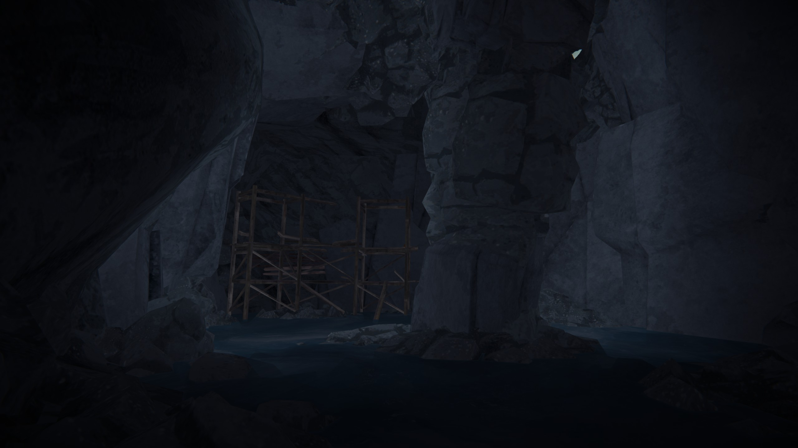

# Forgotten Exploration

**Forgotten Exploration**

| Property | Details |
| --- | --- |
| \[\[File: / \|  / *Western Entrance* \|  / *Eastern Entrance* \| / \| --- \| --- \| | 250px\]\] |
|  / *Western Entrance* |  / *Eastern Entrance* |
| **Location** |  |
|  / *Forgotten\_Exploration\_Location.png* |  |
| Region | [Zone of Contamination](./Zone%20of%20Contamination.md)\|- / Description |
| **General** |  |
|  | Has an interior\|} / **Forgotten Exploration** is a location in the [Zone of Contamination](./Zone%20of%20Contamination.md) found in between [Turbulent Pasture](./Turbulent%20Pasture.md) and [Harrowed Residence](./Harrowed%20Residence.md). It has a very warm interior, and can serve as a good outdoor place to rest if one carries a [Bedroll](./Bedroll.md). [Coal](./Coal.md), [Scrap Metal](./Scrap%20Metal.md), [Lockers](./Locker.md), and [Reclaimed Wood](./Reclaimed%20Wood.md) spawn inside the mine. / An [Emergency Kit](./Emergency%20Kit.md) can spawn in eastern most section of the mine, in a large room with a single column, after climbing the scaffolding. *The Scaffold room* / **Lua execution error in Module:Navbox function navbox** |
