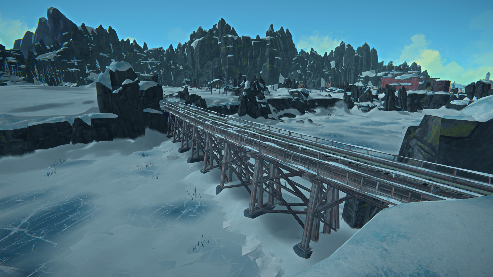

# Forgotten Trestle

**Categories:** Article stubs, DLC Content, Locations, Locations in Port Remnant, Outdoor locations · **Source:** [Fandom](https://thelongdark.fandom.com/wiki/Forgotten_Trestle)

| Column 1 | Column 2 | Column 3 |
| --- | --- | --- |

|  / _Forgotten\_Trestle.jpg_ |  |  |
| **Location** |  |  |
|  / _Forgotten\_Trestle\_Location.png_ |  |  |
| Region | [Port Remnant](./Port%20Remnant.md)\|- |  |
| Description | A small train bridge near [Obstructed Transit](./Obstructed%20Transit.md) |  |
| **General** |  |  |
