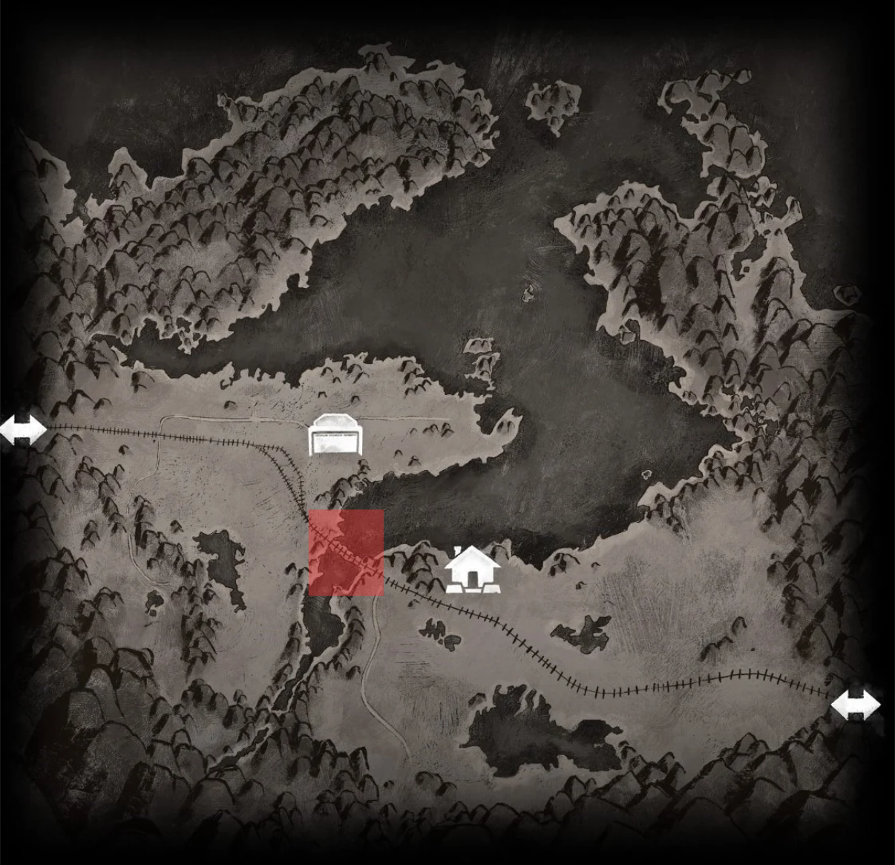

# Forgotten Trestle

**Categories:** Article stubs, DLC Content, Locations, Locations in Port Remnant, Outdoor locations · **Source:** [Fandom](https://thelongdark.fandom.com/wiki/Forgotten_Trestle)

_Seal\_icon.png_

**DLC-Exclusive content.** / This content requires the [Iron Road](./Iron%20Road.md) addon to be installed before it can be seen or used in regular gameplay.

 / **Stub:****This article is a stub. You can help by \[//dummy.host/index.php?title=Forgotten+Trestle&amp;action=edit expanding it\].** / **Forgotten Trestle** /  / _Forgotten\_Trestle.jpg_ / **Location** /  / _Forgotten\_Trestle\_Location.png_ / **Region:** [Port Remnant](./Port%20Remnant.md)\\|- / **Description:** A small train bridge near [Obstructed Transit](./Obstructed%20Transit.md) / **General** / Has no shelter\ **Forgotten Trestle** is a location in [Port Remnant](./Port%20Remnant.md).

## Overview
