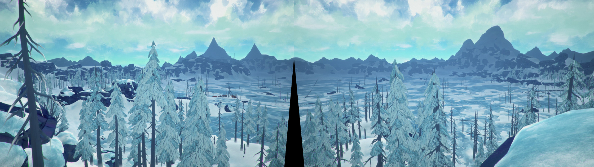
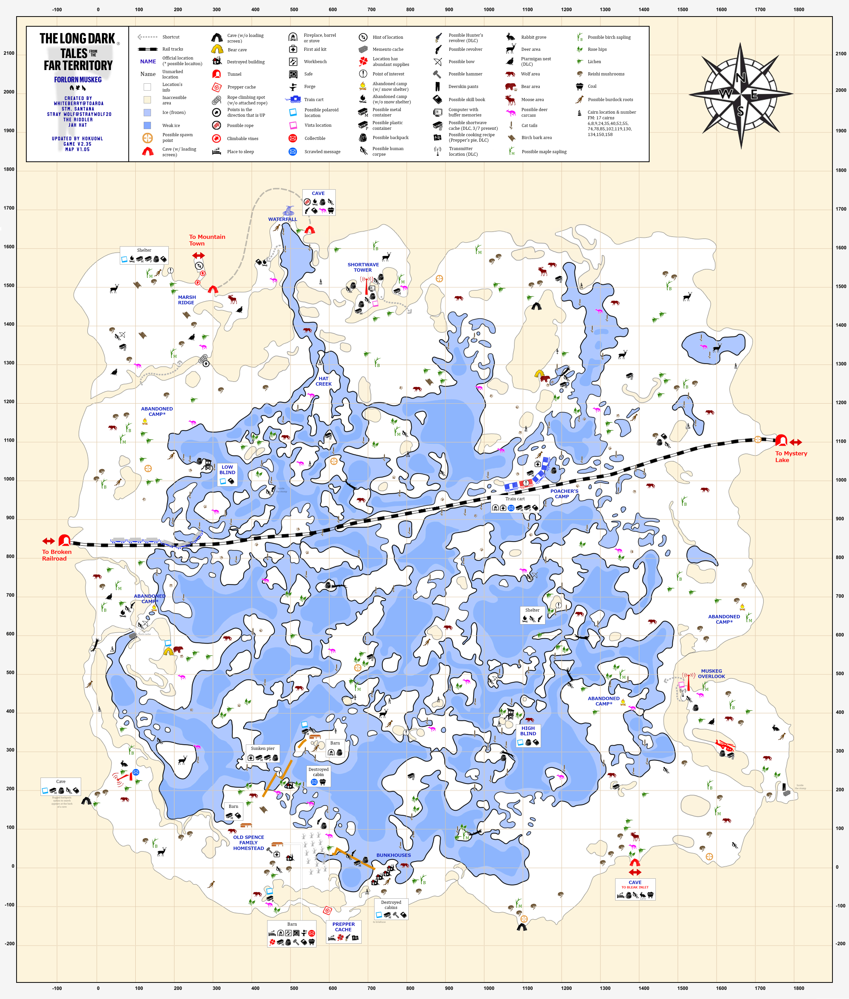
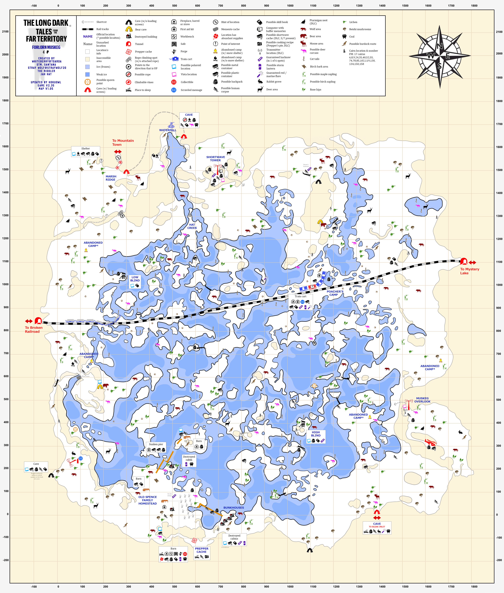
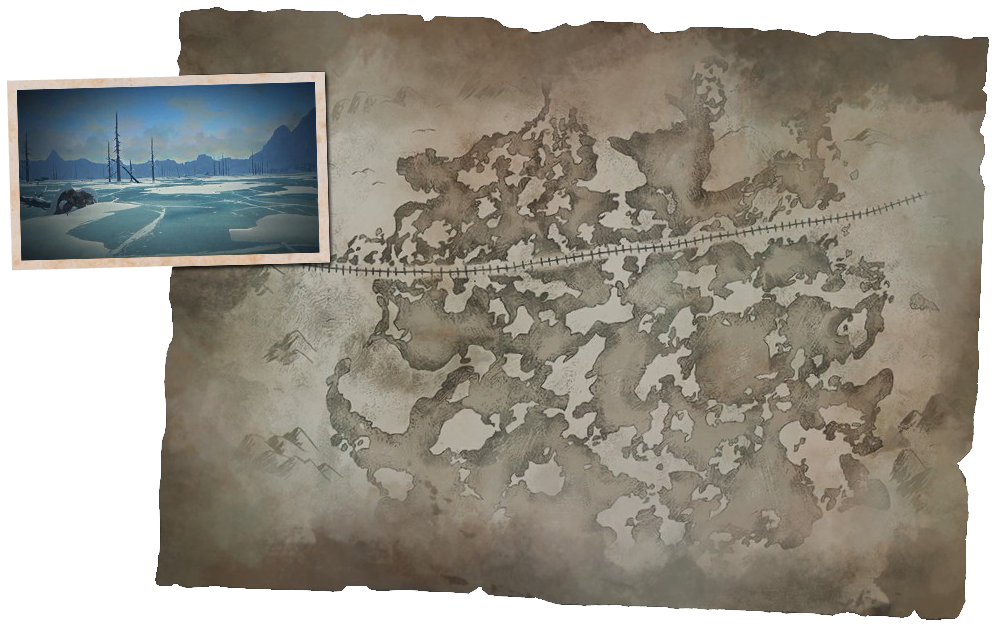
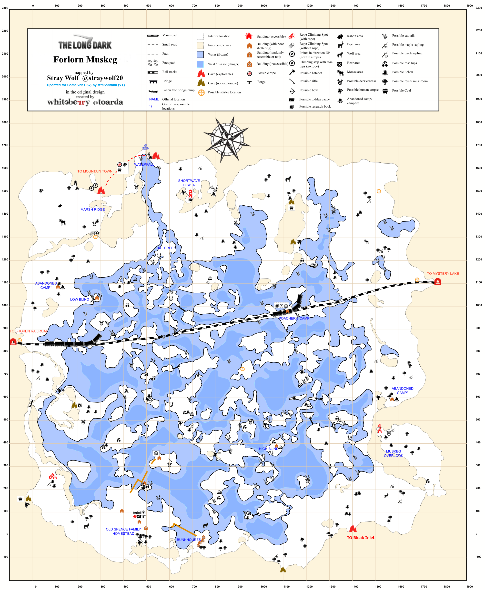

# Forlorn Muskeg

**Categories:** Regions · **Source:** [Fandom](https://thelongdark.fandom.com/wiki/Forlorn_Muskeg)

**Contents**

- [Description](#description)
- [Potential Bases](#potential-bases)
- [Survivability](#survivability)
- [Locations](#locations)
- [Gallery](#gallery)
- [Maps](#maps)

**Forlorn Muskeg**

[Forlorn Muskeg Thumbnail](../assets/Forlorn_Muskeg_Thumbnail.png)

**Location on [Great Bear Island](./Great%20Bear%20Island.md)**

[Forlorn Muskeg Location](../assets/Forlorn_Muskeg_Location.png)

[Forlorn Muskeg map](../assets/Forlorn_Muskeg_map.png)

**Details**

**Description:** A frigid marshland bisected by the [Trans-Island Railway Line](./Trans-Island%20Railway%20Line.md).

**Connecting Regions:** [Mystery Lake](./Mystery%20Lake%20%28region%29.md), [Broken Railroad](./Broken%20Railroad.md), [Bleak Inlet](./Bleak%20Inlet.md), [Mountain Town](./Mountain%20Town.md)

**Difficulty:** Advanced

**Interloper Region Spawn:** Yes

**Locations:** 18

**Hazards and Survivability:** [Wolves](./Wolf.md) and [Bears](./Bear.md) are found throughout the region, but fog and [Weak Ice](./Weak%20Ice.md) can prove far more deadly. There are very few manmade structures to shelter in.

**Date Added:** Dec 2016

> “**For advanced players. A frigid open marshland bisected by a railway line. Weak ice and constant winds make this area highly dangerous.**”
>
> — - In-game description

**Forlorn Muskeg** is the 6th [Region](./Region.md) to be added to [_The Long Dark_](./The%20Long%20Dark.md). As an advanced region, it is a possible spawn location in Interloper difficulty.

## Description

The region is mostly flat, composed of craggy hills surrounding a large, mostly-frozen bog. Bisecting the ice is a broken [railway line](./Trans-Island%20Railway%20Line.md) connected in the east to [Mystery Lake](./Mystery%20Lake%20%28region%29.md) through the [Rail Tunnel](./Rail%20Tunnel.md) (formerly the 'Tunnel Collapse') and in the west to the [Broken Railroad](./Broken%20Railroad.md) region. To the north, there is a path that links to the [Mountain Town](./Mountain%20Town.md) region from [Marsh Ridge](./Marsh%20Ridge.md). To the south, the region is linked with [Bleak Inlet](./Bleak%20Inlet.md) through a cave.

### Potential Bases

There are only a few sheltered areas and structures, and most man-made buildings are partially (or completely) destroyed, making the harsh weather particularly challenging. Within this unpredictable, rugged environment, one mostly intact building is the barn of the [Old Spence Family Homestead](./Old%20Spence%20Family%20Homestead.md), which contains a bed, a [Work Bench](./Work%20Bench.md), and a [Forge](./Forge.md). This is one of the few possible base areas in Forlorn Muskeg and a primary reason for visiting the region.

The deep cave near the waterfall and radio tower on the other side of the region may also serve as a temporary base, but it lacks a forge, work bench, or any other special features besides safety from predators and the elements (allowing it to serve as a place to cure hides and guts).

Another useful though unconventional temporary base is the transition cave to Bleak Inlet, as well as being useful when visiting Bleak Inlet, this cave is midway between the Mystery Lake exit and Spence's. The cave contains a bed, in fact by far the closest indoor bed to Spence's, the entrance to the cave is wind-protected and wolves don't enter it, making it a good place to a light a campfire and cook.

## Survivability

Comparable in size to the open center of [Pleasant Valley](./Pleasant%20Valley.md), there are less than a half dozen suitable shelters in the region, all of which except for the [Poacher's Camp](./Poacher%27s%20Camp.md) are scattered around the perimeter of the region. Temperatures tend to be average for the island, to the point where one could potentially sleep through blizzards if they are sheltered from wind. There are also plentiful natural resources, and there are several good hunting locations in the region: bears and deer patrol past features that can be used as safe perches to hunt from. The moose will also appear near the train tunnel to Mystery Lake. However, if an animal you are hunting runs onto weak ice, you will not be able to harvest it or retrieve any arrows.

The main challenges to long-term survival in this region is the weather, as the frequent fog and blizzards forces travel to be carefully planned. There are limited safe paths through the center of the region, none of which are marked except for the railroad. Travelling through the Forlorn Muskeg with clear weather is simple; the open terrain makes predators easy to spot from far off, along with being able to plan a path and determine which ice is safe to cross. However, a pleasant excursion can quickly become dangerous; the high density of predators, weak ice, and lack of landmarks will pose a much greater threat when the visibility is poor. Even a short blizzard will likely be lethal if it descends as players cross through the center of the region.

## Locations

There are several accessible locations within Forlorn Muskeg including:

| Column 1 | Column 2 |
| --- | --- |
| - [Abandoned Camp](./Abandoned%20Camp.md) - [Bunkhouses](./Bunkhouses.md) - [Hat Creek](./Hat%20Creek.md) - [High Blind](./High%20Blind.md) - [Low Blind](./Low%20Blind.md) - [Marsh Ridge](./Marsh%20Ridge.md) - [Muskeg Overlook](./Muskeg%20Overlook.md) - [Old Bear's Den](./Old%20Bear%27s%20Den.md) (Wintermute [Episode 2](./Episode%202%20-%20Luminance%20Fugue.md) Only) - [Old Spence Family Homestead](./Old%20Spence%20Family%20Homestead.md) | - [Poacher's Camp](./Poacher%27s%20Camp.md) - [Shortwave Tower (North)](./Shortwave%20Tower.md) - [Shortwave Tower West](./Shortwave%20Tower%20West.md) - [Shortwave Tower East](./Shortwave%20Tower%20East.md) (Muskeg Overlook) - To Broken Railway (Transition to [Broken Railroad](./Broken%20Railroad.md)) - To Cave System (Transition to [Bleak Inlet](./Bleak%20Inlet.md)) - To Mountain Town (Milton) (Transition to [Mountain Town](./Mountain%20Town.md)) - To Mystery Lake (Transition to [Mystery Lake](./Mystery%20Lake%20%28disambiguation%29.md)) - [Waterfall (Forlorn Muskeg)](./Waterfall%20%28Forlorn%20Muskeg%29.md) |

There is also 1 [Prepper Cache](./Prepper%20Cache.md) located near Old Spence Family Homestead.

## Gallery

_A south-facing panorama of Forlorn Muskeg, taken from beside the [Shortwave Tower](./Shortwave%20Tower.md)._

## Maps

