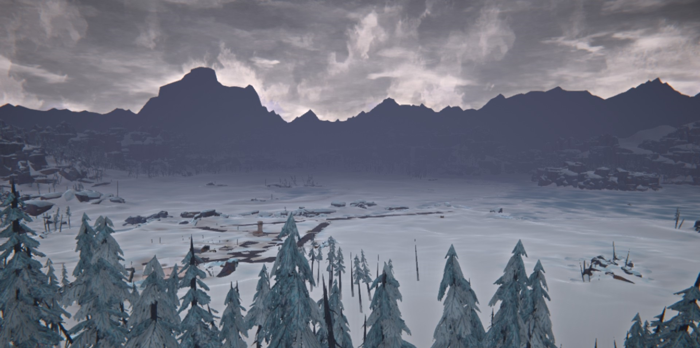
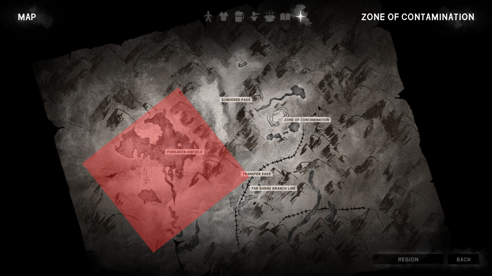
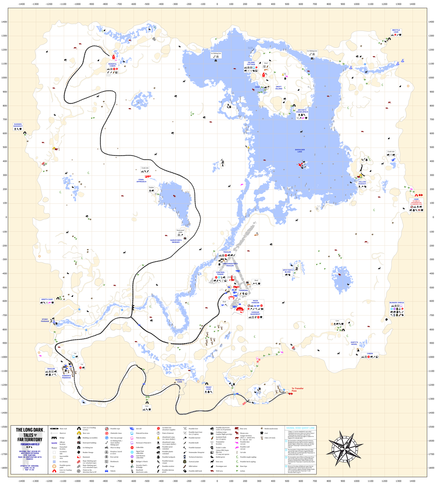
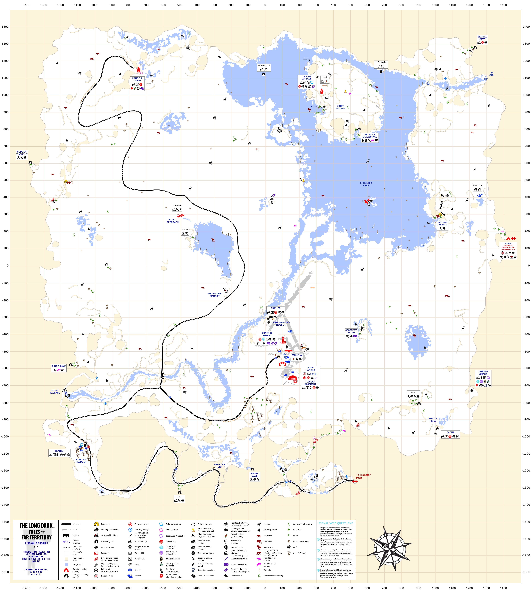
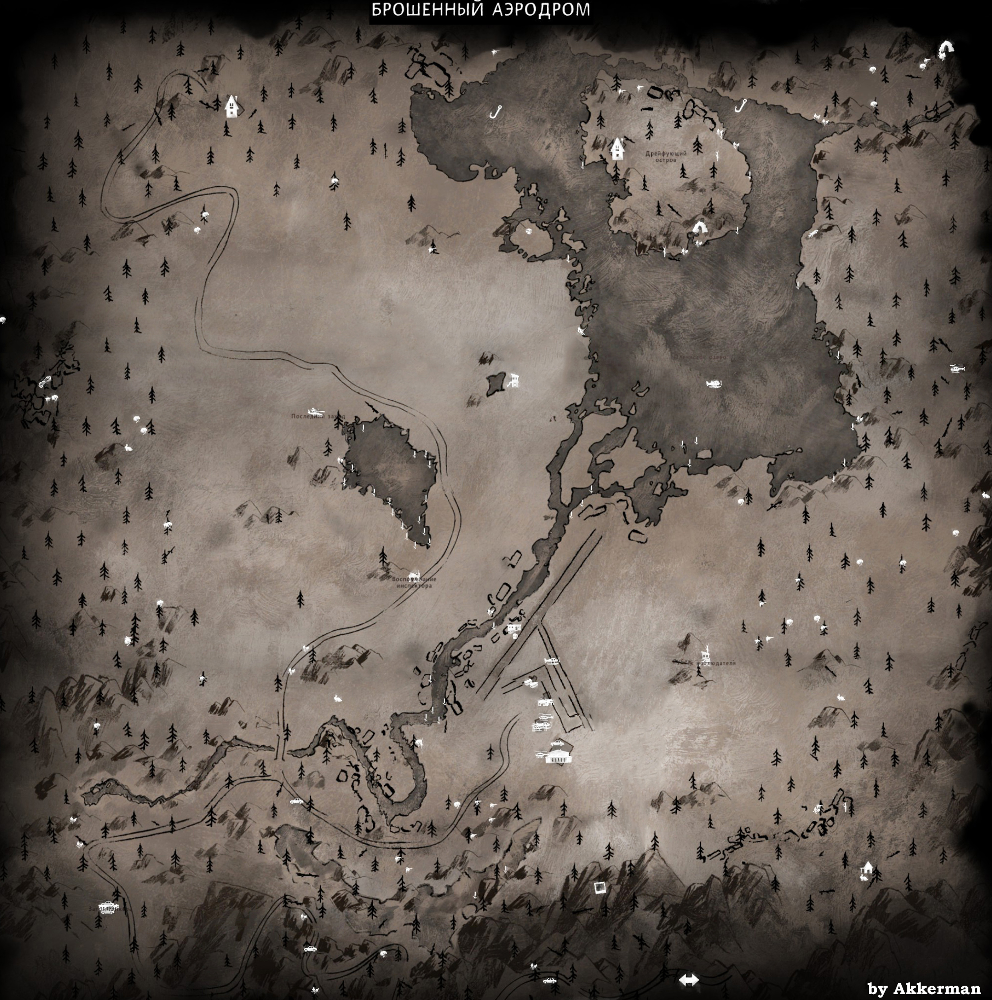
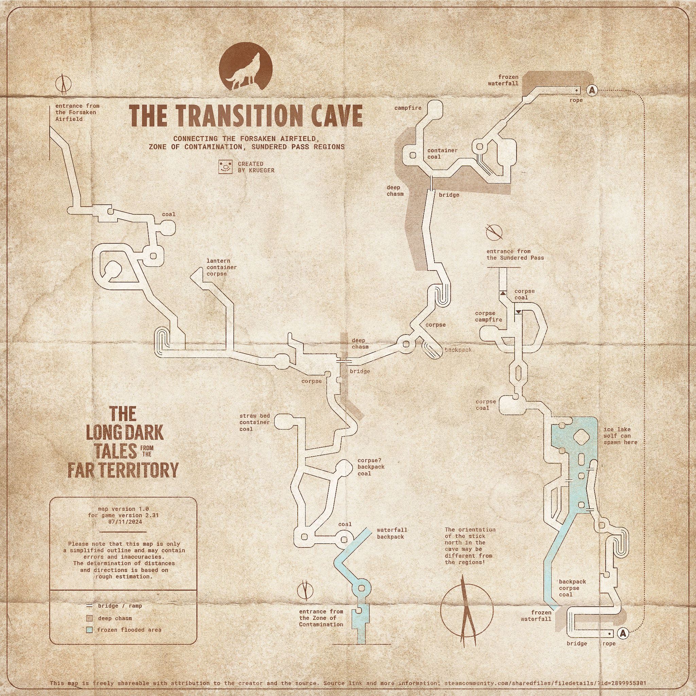

# Forsaken Airfield

**Contents**

- [Overview](#overview)
- [Survivability](#survivability)
- [Description](#description)
- [Approach Road](#approach-road)
- [Field 31](#field-31)
- [Central Plain](#central-plain)
- [Shoulder Lake and Area](#shoulder-lake-and-area)
- [Region Edges](#region-edges)
- [Locations](#locations)
- [Maps](#maps)
- [Gallery](#gallery)

**Forsaken Airfield**

| Property | Details |
| --- | --- |
|  |  / *Forsaken\_Airfield.jpg* |
| **Location on [Great Bear Island](./Great%20Bear%20Island.md)** |  |
|  |  / *Forsaken\_Airfield\_Location.png* |
|  |  / *Forsaken\_Airfield\_In-game\_Map.png* |
| **Details** |  |
| Description | A small airstrip situated within an expansive wind blasted valley basin |
| Connecting Regions | [Transfer Pass](./Transfer%20Pass.md) [Zone of Contamination](./Zone%20of%20Contamination.md) or [Sundered Pass](./Sundered%20Pass.md) (Through Transition Cave) |
| TFTFT paid content | Yes |
| Characters | None |
| Difficulty | Advanced |
| Interloper Region Spawn | No |
| Locations | 26 |
| Date Added | Dec 5, 2022 |

| Column 1 | Column 2 | Column 3 | Column 4 | Column 5 | Column 6 |
| --- | --- | --- | --- | --- | --- |
|  / *Ptarmigan\_icon.png* | **DLC-Exclusive content.** / This content requires the [Tales from the Far Territory](./Tales%20from%20the%20Far%20Territory.md) addon to be installed before it can be seen or used in regular gameplay. | \|} / > “**A vast open plain hides a remote airfield that once served as a critical transport hub for the interior of Great Bear. Between the Hangar, Control Tower, and the Ranger's Cabin on the outskirts of the region, Forsaken Airfield is one of the harshest, coldest regions yet. What secrets will the Aurora reveal...**” / > / > — Official Marketing Description / {\| style="margin:auto" | “ | **For advanced players. Once an active entry point for the Far Territory's wild interior, Forsaken Airfield lives in the shadow of better days, long departed. Its broken landing strip and support buildings sit wedged between various natural obstacles, including frozen fields, a broad lake, and sheer cliffs along the Region’s perimeter. Travelers here need guile, and warm clothes. / Connects to Transfer Pass, The Zone of Contamination, and Sundered Pass.** / In-game description | ” |
| “ | **A vast open plain hides a remote airfield that once served as a critical transport hub for the interior of Great Bear. Between the Hangar, Control Tower, and the Ranger's Cabin on the outskirts of the region, Forsaken Airfield is one of the harshest, coldest regions yet. What secrets will the Aurora reveal...** / Official Marketing Description | ” |  |  |  |

**Forsaken Airfield** is the 14th [Region](./Region.md) found in [*The Long Dark*](./The%20Long%20Dark.md) released for [Survival Mode](./Survival%20Mode.md), and is available for players who purchased the [Tales from the Far Territory](./Tales%20from%20the%20Far%20Territory.md) expansion pack released on December 5, 2022.

The Region connects to [Transfer Pass](./Transfer%20Pass.md) via the mountain road and to the [Zone of Contamination](./Zone%20of%20Contamination.md) and [Sundered Pass](./Sundered%20Pass.md) via a large cave system south-east of [Fallow Dugout](./Fallow%20Dugout.md) near the downed helicopter.

## Overview

A massive flat basin situated within a mountainous valley, the Forsaken Airfield Region is home to the titular Airfield 31, or '[Field 31](./Field%2031.md)' as signs in the location read. The small, abandoned air travel terminal is littered with non-functioning airplanes and helicopters.

The region's geography consists of winding, long, crumbling roads from the mountains through the central map. The middle is mostly dominated by a large, frozen lake and expansive, frozen plains, with one small frozen pond in the direct center. Rocky hills dot a few areas, but are more common near the treacherous cliffsides and sharp, angular mountains that ring the edges and much of the south of Forsaken Airfield.

Foggy weather and deafening, howling winds are common, often hindering navigation of the many wide open areas. In addition to normal foggy conditions, a special electrostatic variant of heavy fog called [Glimmer Fog](./Glimmer%20Fog.md) often appears during the day, powering the machinery and lights of many of the area's remote buildings and vehicles, as well giving the player character the unique [Insomnia](./Insomnia.md) [Affliction](./Afflictions.md).

## Survivability

Forsaken Airfield is much more open than most of the other regions on Great Bear Island, which makes it quite easy to navigate and avoid predators when the weather's clear. When the visibility falls, however, these same characteristics make it very difficult to know one's location, which is compounded by the region's lack of roads. Additionally, the flat terrain makes it difficult for players to find a location that's protected from the often strong winds or sudden blizzards. Starting and sustaining [Campfires](./Campfire.md) can be a challenge in these situations, making [Hypothermia](./Hypothermia.md) and [Frostbite](./Frostbite.md) a serious concern. Carrying along enough [cloth](./Cloth.md) and [sticks](./Stick.md) to make an emergency [snow shelter](./Snow%20Shelter.md) can help prevent disaster; a [Bear Skin Bedroll](./Bear%20Skin%20Bedroll.md) can also help. Using a [Travois](./Travois.md) can help make hauling these supplies over the flat, open terrain much easier.

There are few shelters available in the center of the region aside from the airport itself and the [Final Approach](./Final%20Approach.md): several caves can be found in the cliffs along the region's edges, as well as a few crashed air vehicles, and occasional cabin or trailer, all of which can be life-saving in case of inclement weather.

The five main man-made shelters in the region are: the airport complex near the center, [Mindful Cabin](./Mindful%20Cabin.md) to the northwest, [Island Cottage](./Island%20Cottage.md) to the north, [Junker's Paddock](./Junker%27s%20Paddock.md) to the southwest, and [Justy's Hovel](./Justy%27s%20Hovel.md) to the southeast.

## Description

In a broad sense, Forsaken Airfield can be divided into a few major areas, each with their own characteristics.

### Approach Road

This is the road that connects Forsaken Airfield to [Transfer Pass](./Transfer%20Pass.md). It is a long, winding road, with little in the way of resources, though it does offer some shelter in a cave and occasional vehicles. Notable locations include [Whealy's Turn](./Whealy%27s%20Turn.md), the first place where Survivors will see the airfield itself, and the [Junker's Paddock](./Junker%27s%20Paddock.md) where the road opens up into the wide open field. No wildlife can be found along this road, aside from a few [rabbits](./Rabbit.md) near Junker's Paddock. Much of this long walk can be bypassed when leaving the region by taking a narrow footpath just south of Field 31.

### [Field 31](./Field%2031.md)

Following the road from Junker's Paddock and staying right will eventually lead the Survivor towards Field 31, an abandoned airport terminal littered with many non-functional airplanes, helicopters, and vehicles. Most players who choose to live here will end up living in the airport's [hangar](./Main%20Hangar.md), as it offers all the essentials, along with the only [forge](./Forge.md) in the Far Territory. This area has limited hunting and natural resources, however, and is frequented by [wolves](./Wolf.md), so Survivors should be alert.

### Central Plain

Most of the centre of the region is occupied by a relatively flat plain with few features, aside from a river flowing into [Shoulder Lake](./Shoulder%20Lake.md) and a road leading to [Mindful Cabin](./Mindful%20Cabin.md). Although the wide open nature of this plain makes it easy to navigate in good weather and has good [deer](./Deer.md) and [moose](./Moose.md) hunting, low visibility can make it extremely difficult to navigate and the Survivor can easily fall victim to a [wolf](./Wolf.md) here. There are also very few shelters in the area, aside from the helicopter at [Final Approach](./Final%20Approach.md). It is also difficult to find much firewood here, due to the area's severe lack of trees. There are also few natural resources to forage here, aside from [cat tails](./Cat%20Tail.md) on the pond near Final Approach, where it is also possible to Ice Fish.

### [Shoulder Lake](./Shoulder%20Lake.md) and Area

Located in the northeastern corner of the map beyond the airfield, Shoulder Lake is the largest freshwater body in the game, and features two [Ice Fishing](./Ice%20Fishing.md) huts. Several small islands are scattered throughout the lake, and a [Hunter's Blind](./Hunter%27s%20Blind.md) may be found on the lake's southern shore. Towards the lake's northern shore lies the largest island, [Drift Island](./Drift%20Island.md), home to [Island Cottage](./Island%20Cottage.md) and [Archie's Crawlspace](./Archie%27s%20Crawlspace.md). To the northeast of the island, the land goes uphill, and there is a valley and river that leads into the lake.

Although this area is one of the most popular places to live in the Far Territory, owing to Island Cottage, abundant [rabbits](./Rabbit.md), [Ptarmigan](./Ptarmigan.md), [deer](./Deer.md), fishing firewood, and forageable resources, survivors should be careful as there are many wolves on the lake, along with a [bear](./Bear.md) that wanders near the east end of Drift Island.

### Region Edges

Near the edges of the large central plain, the region features more uneven terrain, more trees, richer natural resources, and much more shelter. In addition to the shallow caves in the cliffs, much of the region's man-made shelter can also be found here. The left fork of the road entering from Transfer Pass goes through the central plain before gradually gaining altitude and ending at [Mindful Cabin](./Mindful%20Cabin.md), located atop a cliff near the region's western edge. The eastern and southern edges are home to [Justy's Hovel](./Justy%27s%20Hovel.md) and [Bunker Omega](./Bunker%20Omega.md).

## Locations

| Column 1 | Column 2 |
| --- | --- |
| - [Archie's Crawlspace](./Archie%27s%20Crawlspace.md) / - [Brittle Cave](./Brittle%20Cave.md) / - [Bunker Omega](./Bunker%20Omega.md) / - [Cargomaster's Trailer](./Cargomaster%27s%20Trailer.md) / - [Control Tower](./Control%20Tower.md) / - [Cove](./Cove.md) / - [Drift Island](./Drift%20Island.md) / - [Fallow Dugout](./Fallow%20Dugout.md) / - [Final Approach](./Final%20Approach.md) / - [Frost Cave](./Frost%20Cave.md) / - [Hangar Basement](./Hangar%20Basement.md) / - [Island Cottage](./Island%20Cottage.md) / - [Junker's Paddock](./Junker%27s%20Paddock.md) | - [Justy's Hovel](./Justy%27s%20Hovel.md) / - [Grip's Cave](./Grip%27s%20Cave.md) / - [Main Hangar](./Main%20Hangar.md) / - [Mindful Cabin](./Mindful%20Cabin.md) / - [Shoulder Lake](./Shoulder%20Lake.md) / - [Spotter's Blind](./Spotter%27s%20Blind.md) / - [Sudden Washout](./Sudden%20Washout.md) / - [Surveyor's Memory](./Surveyor%27s%20Memory.md) / - [Stony Passage](./Stony%20Passage.md) / - [Terminal](./Terminal.md) / - [Whealy's Turn](./Whealy%27s%20Turn.md) / - To Cave System (Region Transition to [Sundered Pass](./Sundered%20Pass.md)/[Zone of Contamination](./Zone%20of%20Contamination.md)) / - To Transfer Pass (Region Transition to [Transfer Pass](./Transfer%20Pass.md)) |

1 [Hunter's Blind](./Hunter%27s%20Blinds.md) is found between [Shoulder Lake](./Shoulder%20Lake.md) and [Final Approach](./Final%20Approach.md), though it is unnamed.

## Maps

| Column 1 | Column 2 | Column 3 | Column 4 |
| --- | --- | --- | --- |
|  / *A detailed map of Forsaken Airfield v2.35 (contains spoilers)* |  / *A detailed map of Forsaken Airfield v2.35 (Interloper/Misery edition, contains spoilers)* |  / *The forsaken airfield map with icons for all locations and valuable items. Created by Alana Akkerman.* |  / *Map of the transition cave connecting Forsaken Airfield, Zone of Contamination and Sundered Pass* |

## Gallery

| Column 1 | Column 2 | Column 3 | Column 4 |
| --- | --- | --- | --- |
|  / *Airfield at the sunset* |  / *Airfield\_during\_aurora.png* | \[Missing image: 20230520075647\_1.jpg\] / *A sign in Transfer Pass directing motorists to Field 31* |  / *Field 31 at sunrise* |

**Lua execution error in Module:Navbox function navbox****Lua execution error in Module:Navbox function navbox** [ru:Брошенный аэродром](ru:%D0%91%D1%80%D0%BE%D1%88%D0%B5%D0%BD%D0%BD%D1%8B%D0%B9_%D0%B0%D1%8D%D1%80%D0%BE%D0%B4%D1%80%D0%BE%D0%BC)
