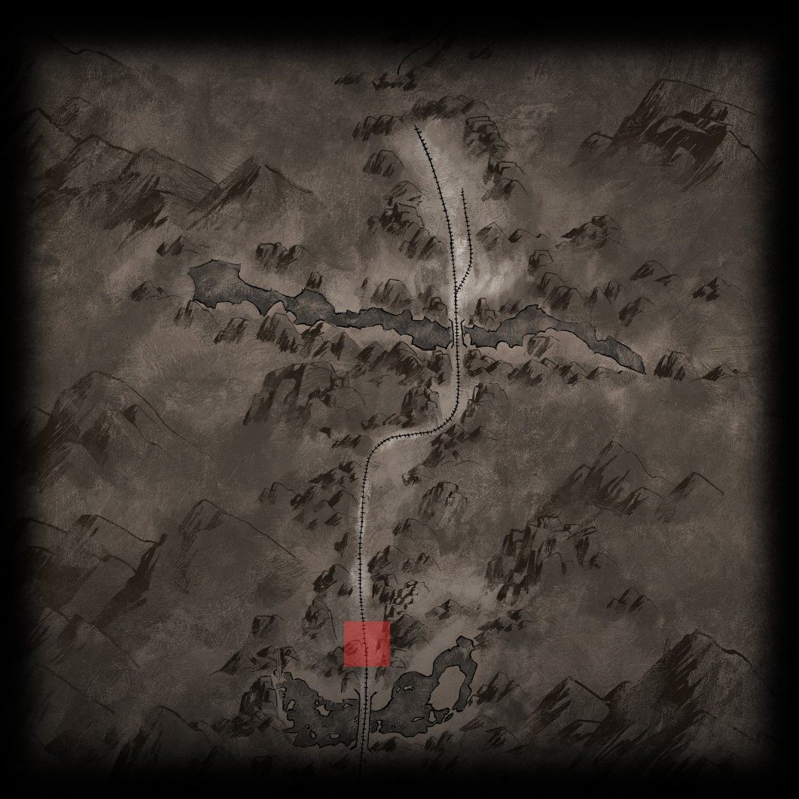
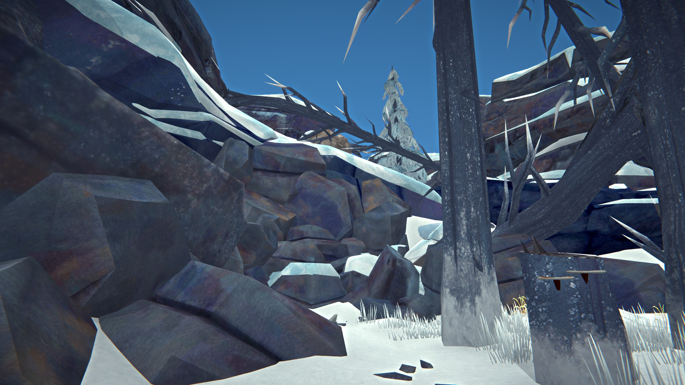

# Foundered Track

**Foundered Track**

| Property | Details |
| --- | --- |
|  |  / *Foundered\_Track\_Front.jpg* |
| **Location** |  |
|  |  / *Foundered\_Track\_Location.png* |
| Region | [Far Range Branch Line](./Far%20Range%20Branch%20Line.md)\|- |
| **General** |  |
|  | Has no shelter\|} / *The track as seen from Surfeit Trestle* **Foundered Track** is an unmarked location in the [Far Range Branch Line](./Far%20Range%20Branch%20Line.md). / The area is a rockfall that blocks a section of the [Trans-Island Railway Line](./Trans-Island%20Railway%20Line.md) near the [Mountaineering Rope](./Mountaineering%20Rope.md) spot and passenger train car near [Surfeit Trestle](./Surfeit%20Trestle.md). Due to the nature of the rockfall, players are forced to travel through the [Platelayer's Shortcut](./Platelayer%27s%20Shortcut.md) to get to the other side of the railroad it blocks. Once on the other side of the cave system, it can be accessed by following the railroad south and simply walking over as a one way shortcut, similar to the [Landslide](./Landslide.md) in the [Broken Railroad](./Broken%20Railroad.md) region. There is no loot or shelter here, aside from the passenger train car on the other side. / **Lua execution error in Module:Navbox function navbox** |
