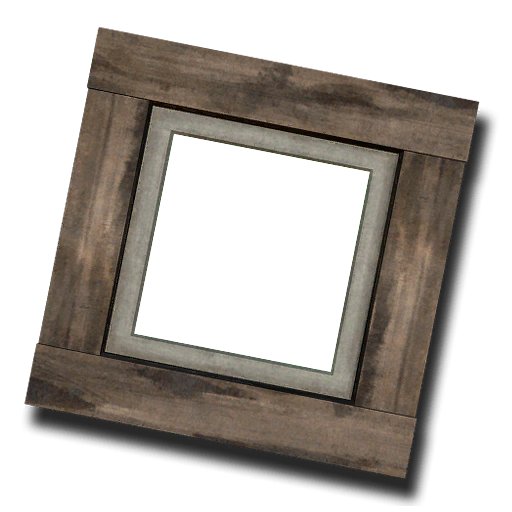

# Framed Photo

<table class="infobox">
<caption>Framed Photo</caption>
<colgroup>
<col style="width: 50%" />
<col style="width: 50%" />
</colgroup>
<tbody>
<tr>
<td colspan="2"><figure>

<figcaption>Framed_Photo_icon.png</figcaption>
</figure></td>
</tr>
<tr>
<td>
Release
</td>
<td>
<a href="./The%20Long%20Dark%20%E2%80%94%20Changelog.md#2.33" class="wikilink" title="TFTFT Part 6 Broken Silence">TFTFT Part 6 Broken Silence</a>
</td>
</tr>
<tr>
<td colspan="2" class="section">
<strong>Values</strong>
</td>
</tr>
<tr>
<td>
Weight
</td>
<td>
0.25 kg (0.55 lbs)
</td>
</tr>
<tr>
<td colspan="2" class="section">
<strong>Actions</strong>
</td>
</tr>
<tr>
<td>
Backpack
</td>
<td>
Drop, Place
</td>
</tr>
</tbody>
</table>

<table>
<colgroup>
<col style="width: 33%" />
<col style="width: 33%" />
<col style="width: 33%" />
</colgroup>
<tbody>
<tr>
<td style="vertical-align: top; font-size: 3em; color: #5d5980; padding-right: 10px">
“
</td>
<td>
A decorative picture frame. Suitable for hanging instant photographs on the wall.

&#10;

In-Game Description

</td>
<td style="vertical-align: bottom; font-size: 3em; color: #5d5980; padding-left: 10px">
”
</td>
</tr>
</tbody>
</table>

The **Framed Photo** is a <a href="./Decorations.md" class="wikilink" title="Decorations">Decorations</a> item that can be <a href="./Crafting.md" class="wikilink" title="Crafted">Crafted</a> as part of the <a href="./Safehouse%20Customization.md" class="wikilink" title="Safehouse Customization">Safehouse Customization</a> feature.

## Overview

A small display portrait of scraped together wood featuring the player's polaroid photo, a Framed Photo can be crafted at a <a href="./Furniture%20Workbench.md" class="wikilink" title="Furniture Workbench">Furniture Workbench</a>, but requires <a href="./Woodworking%20Tools.md" class="wikilink" title="Woodworking Tools">Woodworking Tools</a> and 1 photograph taken by the player's <a href="./Camera.md" class="wikilink" title="Camera">Camera</a>.

Once crafted, the item is automatically placed into the player's inventory. It can only be placed on walls when in Customization Mode. It can later be picked up and placed back into the player's inventory or destroyed (yielding no resources).

## Crafting

<table class="infobox">
<caption>Framed Photo</caption>
<tbody>
<tr>
<td colspan="2">
-
</td>
</tr>
<tr>
<td colspan="2">
-
</td>
</tr>
<tr>
<td colspan="2">
120 minutes (2 hour 0 minutes)
</td>
</tr>
<tr>
<td colspan="2" class="section">
<strong>Requirements</strong>
</td>
</tr>
<tr>
<td>
Facility
</td>
<td>
<strong>Template:iconlink</strong>
</td>
</tr>
<tr>
<td>
Tool
</td>
<td>
<strong>Template:iconlink</strong>
</td>
</tr>
<tr>
<td colspan="2" class="section">
<strong>Materials</strong>
</td>
</tr>
<tr>
<td colspan="2" class="section">
<strong>Template:iconlink plain</strong>
</td>
</tr>
<tr>
<td>
Item
</td>
<td>
<a href="./Fir%20Firewood.md" class="wikilink" title="Fir Firewood">Fir Firewood</a>
</td>
</tr>
<tr>
<td>
Quantity
</td>
<td>
1
</td>
</tr>
<tr>
<td colspan="2" class="section">
<strong>Template:iconlink plain</strong>
</td>
</tr>
<tr>
<td colspan="2">
<a href="./Camera.md" class="wikilink" title="Camera">Camera</a>
</td>
</tr>
<tr>
<td colspan="2">
1
</td>
</tr>
</tbody>
</table>

## Update History

**Template:update historyLua execution error in Module:Navbox function navbox**

