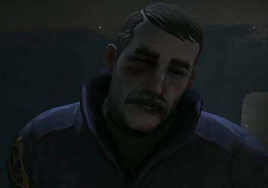
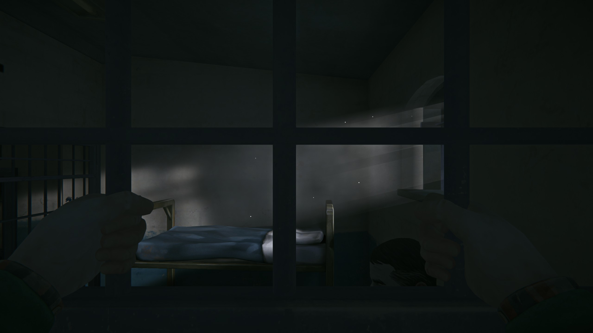
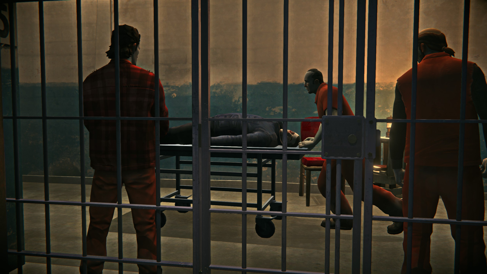
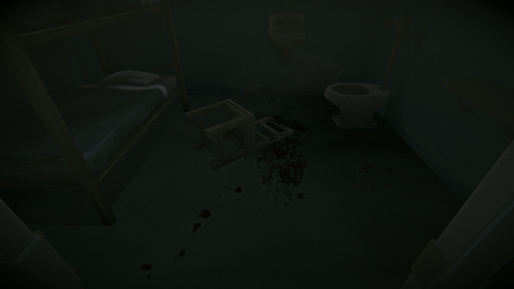

# Franklin

**Categories:** Characters, Pages with update history · **Source:** [Fandom](https://thelongdark.fandom.com/wiki/Franklin)

**Contents**

- [Background](#background)
- [Story](#story)
- [Episode 4](#episode-4)
- [Blackrock Blues](#blackrock-blues)
- [The Power Plant](#the-power-plant)
- [The Detonators](#the-detonators)
- [Donner (mission)](#donner-mission)
- [Trivia](#trivia)
- [Gallery](#gallery)
- [Update history](#update-history)

**Franklin**

[Franklin](../assets/Franklin.png)

**Release:** [1.95](./The%20Long%20Dark%20%E2%80%94%20Changelog%20%E2%80%94%20Archive%202.md#1.95)

**Date:** 6 October 2021

**Wintermute:** [Episode 4](./Episode%204%20-%20Fury%2C%20Then%20Silence.md)

**Location(s):** [Blackrock Prison](./Blackrock%20Prison.md)

**Biographical Information**

**Age:** 40's - 50's

**Status:** Dead

**Place of death:** Blackrock Prison

**Occupation:** Warden

**Game Information**

**Voiced by:** Laurie Mcginnis

> “__The Warden at Blackrock Penitentiary, Franklin has found himself caught up in Mathis’ deadly schemes.  
   
 More an administrator than a disciplinarian, no one is more aware of the notorious prison’s dark history than its Warden. But Franklin is clear-eyed about his purpose on Great Bear Island -- the worst of the worst end up with him at Blackrock. And if someone has to be in charge, it might as well be him.__”
>
> — [What I Know](./What%20I%20Know.md) description

> **Yes well, normally I'm on the other side of the bars. Name's Franklin. I'm Warden here at Blackrock.**
>
>
> — Franklin introducing himself inside his cell to Mackenzie

**Franklin**is a character that appears in [Episode 4: Fury, Then Silence](./Episode%204%20-%20Fury%2C%20Then%20Silence.md).

<!-- #Background -->
​

<!-- #background -->
## Background

Franklin is the warden of [Blackrock Prison](./Blackrock%20Prison.md), the only surviving representative of authority that can be seen in the story mode so far. Franklin is an intelligent man, with convictions, but not very authoritarian and far too gentle for the position he occupies. He will end up paying the price by being captured by [Mathis](./Mathis.md) and his men, trying all the same to resist them heroically. More administrator than disciplinary, no one knows the dark history of the infamous prison better than its director. But Franklin is clear-headed about his goal on Great Bear Island – the worst of men ends up with him in Blackrock. And if anyone has to accept the burden of holding them, it might as well be him.

After the [First Flare](./First%20Flare.md) struck the Prison, backup power initially kept the prisoners in check, until the Convicts overwhelmed the Prison's security. All prison personnel were rounded up into the snow and shot outside the prison walls, with Franklin being tied to a chair and placed in a cell. The prisoners headed to solitary but were unable to open the doors due to mechanical fail safes, due to some [unknown force](./Jace.md) that inadvertently ensures Franklin's survival in the meantime.

<!-- #blackrock_blues -->
​

<!-- #Blackrock_Blues -->
​

<!-- #Blackrock_blues -->
​

<!-- #blackrock-blues -->
### [Blackrock Blues](./Blackrock%20Blues.md)

Franklin is first encountered by [Will Mackenzie](./Will%20Mackenzie.md) after he first arrives at the Prison. After a short exchange between the two regarding the current situation, Mathis arrives and begins interrogating Franklin on how to enter solitary, even beating Franklin for uttering Donner's name. When Franklin explains that he really doesn't know who is altering the failsafes or how to even get into solitary, he is brutally beaten by Mathis in order to better "jog his memory."

Being left to clean up the Warden and quickly realizing that they will take the bad side of Mathis' temper if Franklin dies, [Vachon](./Vachon.md) and [Heller](./Heller.md) task Mackenzie to find medicine for Franklin, leveraging him to come back since they still hold [Astrid's Hardcase](./Astrid%27s%20Hardcase.md). When Mackenzie returns with [Blackrock Infirmary Medication](./Blackrock%20Infirmary%20Medication.md) and stiches up the Warden's wounds, Franklin reveals to Mackenzie that solitary runs on its own circuit channels, and he is only being kept alive because Mathis thinks Franklin owns some sort of admin override to open the cells. Franklin is also aware that someone is messing with the Convicts, and Mackenzie reveals that he spoke to this person over the phone. Mathis almost returns before Franklin urges Mackenzie to do whatever the person on the phone asks, as they are the only person keeping Donner in solitary.

<!-- #the_power_plant -->
​

<!-- #The_Power_Plant -->
​

<!-- #The_power_plant -->
​

<!-- #the-power-plant -->
### [The Power Plant](./The%20Power%20Plant.md)

When Mathis returns and realizes that Vachon and Heller were too cowardly to fix the Warden's wounds, he sends Mackenzie to reroute power from the [Power Plant](./Power%20Plant.md) and [Steam Tunnels](./Steam%20Tunnels.md) to fix solitary. After sabotaging the Steam Tunnels with some help, Mackenzie returns to a not so enraged Mathis, as he has found another way into solitary, Detonators.

<!-- #the_detonators -->
​

<!-- #The_Detonators -->
​

<!-- #The_detonators -->
​

<!-- #the-detonators -->
### [The Detonators](./The%20Detonators.md)

Mathis interrogates Franklin for info about the Detonators' location, and ultimately succeeds without resorting to violence, with Mackenzie offering to retrieve them in order to spare the Warden.

<!-- #donner_mission -->
​

<!-- #Donner_(mission) -->
​

<!-- #donner_(mission) -->
​

<!-- #donner-mission -->
### [Donner (mission)](./Donner%20%28mission%29.md)

When Mackenzie returns, it is revealed that Mathis tortured and ultimately killed Franklin, even as he revealed that he knew that Mackenzie had an accomplice helping him sabotage the locking mechanisim in the Steam Tunnels. Franklin's lifeless body is last shown being wheeled out of his cell on a gurney by a Convict, and he is never seen again.

<!-- #Trivia -->
​

<!-- #trivia -->
## Trivia

Despite being unarmed in Wintermute, his [pistol](./Warden%27s%20Revolver.md) can be found in Survival Mode.

<!-- #Gallery -->
​

<!-- #gallery -->
## Gallery

<!-- #update_history -->
​

<!-- #Update_history -->
​

<!-- #Update_History -->
​

<!-- #update-history -->
## Update history

- UPDATE **6 October 2021 ([Update](./The%20Long%20Dark%20%E2%80%94%20Changelog%20%E2%80%94%20Archive%202.md#1.95)):**
  - Added to game.
