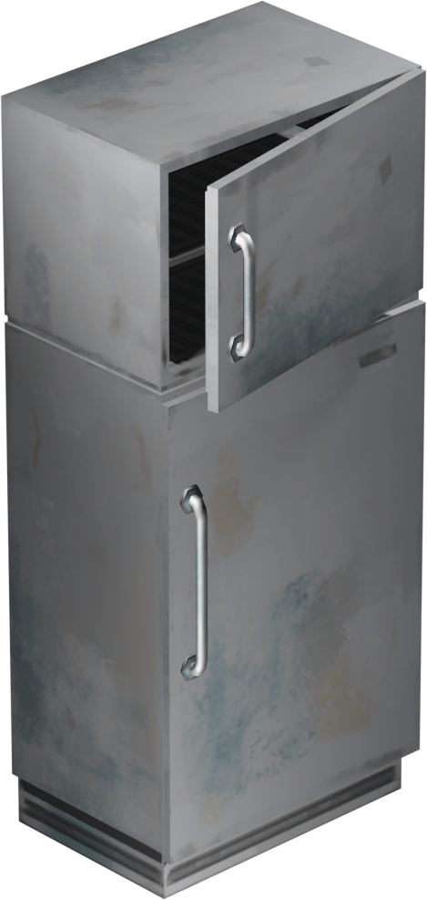

# Freezer

**Freezer**

| Property | Details |
| --- | --- |
|  |  / *Fridge.png* |
| Release | TBD |
| Update | [0.00](./The%20Long%20Dark%20%E2%80%94%20Changelog.md#0.00) |
| Story item | Yes |
| **Container** |  |
| Capacity | 20.00 kg(44 lbs) |

A **Freezer** is a storage container found as part of refrigerators, being the top door compartment with the bottom door being the [Fridge](./Fridge.md). They are found inside many kitchens of homes and industrial buildings across the Island. Ironically, it is best to store certain foods outdoors (mainly meat) in order to preserve them for longer periods of time, as the Freezer is not functional. If looted, they may rarely contain raw venison. **Lua execution error in Module:Navbox function navbox**
