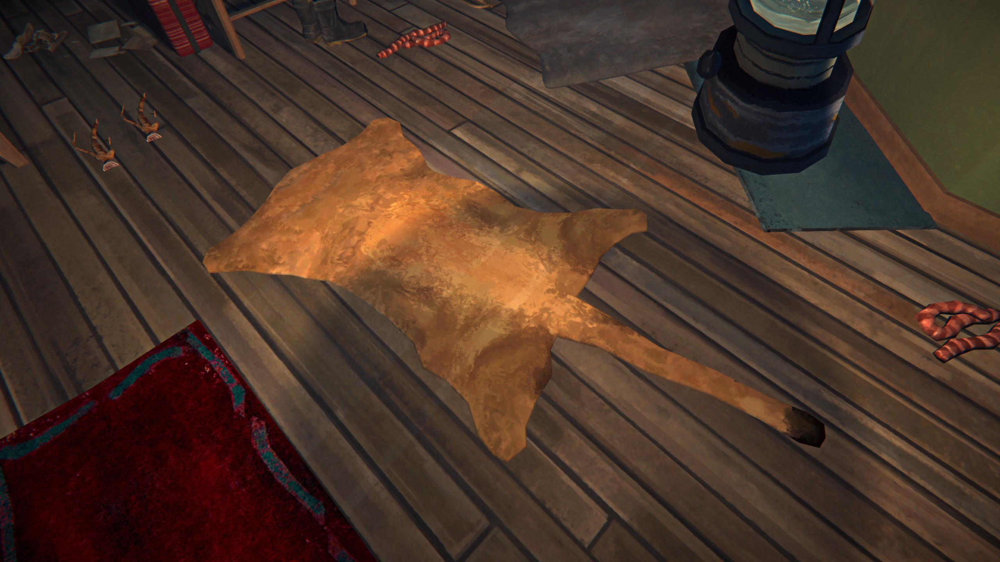

# Fresh Cougar Hide

**Categories:** DLC Content, Materials, Pages with update history · **Source:** [Fandom](https://thelongdark.fandom.com/wiki/Fresh_Cougar_Hide)

**Fresh Cougar Hide**

| Property | Details |
| --- | --- |
|  | [Fresh Cougar Hide icon](../assets/Fresh_Cougar_Hide_icon.png) |
| Release | [24 June 2024](./The%20Long%20Dark%20%E2%80%94%20Changelog.md#2.28) |
| Wintermute | No |
| **Properties** |  |
| Item type | [Materials](./Materials.md)\|- |
| Stackable | No |
| Examine | Freshly harvested hide from a Cougar. A reminder of the predator's fearsome strength. / Can be used for crafting and repairs after air-drying indoors for 10 days. |
| **Values** |  |
| Weight | 0.75 kg (1.65 lbs) |
| **Advanced data** |  |
| Item key | GAMEPLAY\_CougarHide |

[Ptarmigan icon](../assets/Ptarmigan_icon.png)

**DLC-Exclusive content.** This content requires the [Tales from the Far Territory](./Tales%20from%20the%20Far%20Territory.md) addon to be installed before it can be seen or used in regular gameplay.

A **Fresh Cougar Hide** is a [Material](./Materials.md) that can be [cured](./Curing.md) into a [Cured Cougar Hide](./Cured%20Cougar%20Hide.md). A fresh hide takes 10 days to cure.

## Drop sources

| Source | Quantity | Rarity |
| --- | --- | --- |
| [Cougar](./Cougar.md) | 1 | Always |

## Update history

- UPDATE **24 June 2024 ([Update](./The%20Long%20Dark%20%E2%80%94%20Changelog.md#2.28)):**
  - Added to game.
