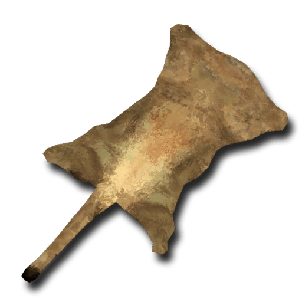
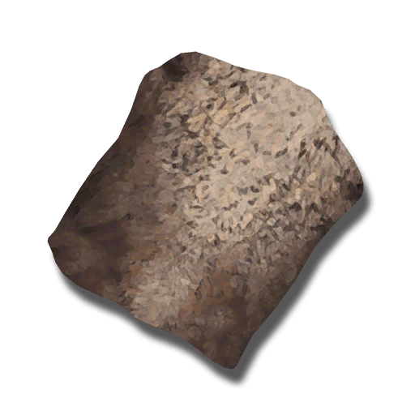

# Fresh Cougar Hide

**Categories:** DLC Content, Materials, Pages with update history · **Source:** [Fandom](https://thelongdark.fandom.com/wiki/Fresh_Cougar_Hide)

**Fresh Cougar Hide**

| Property | Details |
| --- | --- |
|  |  / _Fresh\_Cougar\_Hide\_icon.png_ |
| Release | [24 June 2024](./The%20Long%20Dark%20%E2%80%94%20Changelog.md#2.28) |
| Wintermute | No |
| **Properties** |  |
| Item type | [Materials](./Materials.md)\|- |
| Stackable | No |
| Examine | Freshly harvested hide from a Cougar. A reminder of the predator's fearsome strength. / Can be used for crafting and repairs after air-drying indoors for 10 days. |
| **Values** |  |
| Weight | 0.75 kg (1.65 lbs) |
| **Advanced data** |  |
| Item key | GAMEPLAY\_CougarHide |

| Column 1 | Column 2 | Column 3 |
| --- | --- | --- |

| Source | Quantity | Rarity |
| [Cougar](./Cougar.md) | 1 | Always |
|  / _3d model_ |  / _Old icon_ |  |
