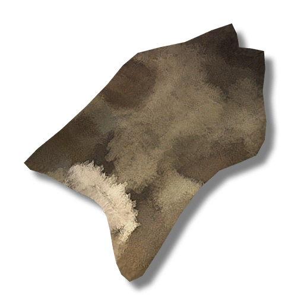

# Fresh Deer Hide

**Contents**

- [Overview](#Overview)
- [Drop sources](#Drop_sources)
- [Gallery](#Gallery)
- [Update history](#Update_history)

<table class="infobox">
<caption>Fresh Deer Hide</caption>
<colgroup>
<col style="width: 50%" />
<col style="width: 50%" />
</colgroup>
<tbody>
<tr>
<td colspan="2"><figure>

<figcaption>Fresh_Deer_Hide_icon.png</figcaption>
</figure></td>
</tr>
<tr>
<td>
Release
</td>
<td>
<a href="./The%20Long%20Dark%20%E2%80%94%20Changelog.md#0.233" class="wikilink" title="22 May 2015">22 May 2015</a>
</td>
</tr>
<tr>
<td>
Wintermute
</td>
<td>
No
</td>
</tr>
<tr>
<td colspan="2" class="section">
<strong>Properties</strong>
</td>
</tr>
<tr>
<td>
Item type
</td>
<td>
<a href="./Materials.md" class="wikilink" title="Materials">Materials</a>|-
</td>
</tr>
<tr>
<td>
Stackable
</td>
<td>
No
</td>
</tr>
<tr>
<td>
Examine
</td>
<td>
Freshly harvested hide from a Deer. 
Can be used for crafting and repair after air-drying indoors for 5 days.
</td>
</tr>
<tr>
<td colspan="2" class="section">
<strong>Values</strong>
</td>
</tr>
<tr>
<td>
Weight
</td>
<td>
0.50 kg (1.1 lbs)
</td>
</tr>
</tbody>
</table>

**Fresh Deer Hide** is the raw hide of a <a href="./Deer.md" class="wikilink" title="Deer">Deer</a>. It can be used as a <a href="./Materials.md" class="wikilink" title="Material">Material</a> for crafting or repairing <a href="./Deerskin%20Pants.md" class="wikilink" title="Deerskin Pants">Deerskin Pants</a> or <a href="./Deerskin%20Boots.md" class="wikilink" title="Deerskin Boots">Deerskin Boots</a> once they have <a href="./Curing.md" class="wikilink" title="Cured">Cured</a> into a <a href="./Cured%20Deer%20Hide.md" class="wikilink" title="Cured Deer Hide">Cured Deer Hide</a>.

## Overview

Fresh Deer Hide are acquired by harvesting a <a href="./Deer%20Carcass.md" class="wikilink" title="Deer Carcass">Deer Carcass</a>. They can be cured by leaving them indoors for 5 days (in-game). Fresh Deer Hide <a href="./Decay.md" class="wikilink" title="Decay">Decay</a> at a rate of 3.333 Condition a day (Stalker difficulty) and will decay into Ruined status if not left to cure indoors. The current curing status can be checked by hovering your reticle over the item, where it will display a "X% Cured" progress. This increases until the item is 100% cured, where the item will automatically become fully cured, will change to a darker texture, and is ready for crafting use. Completely cured items never decay.

Deer are quite common and can often be found in pairs of 2 or 3. Occasionally, a <a href="./Deer%20Carcass.md" class="wikilink" title="Deer Carcass">Deer Carcass</a> can be found in several places across <a href="./Great%20Bear%20Island.md" class="wikilink" title="Great Bear Island">Great Bear Island</a>. Multiple Carcasses can be found within a region, and can be harvested for their pelts even when a survivor lacks <a href="./Tools.md" class="wikilink" title="weapons">weapons</a> to hunt Deer.

## Drop sources

| Source                                                     | Quantity | Rarity |
|------------------------------------------------------------|----------|--------|
| <a href="./Deer.md" class="wikilink" title="Deer">Deer</a> | 1        | Always |

## Gallery

<table class="gallery">
<colgroup>
<col style="width: 50%" />
<col style="width: 50%" />
</colgroup>
<tbody>
<tr>
<td><figure>
[Missing image: Fresh_deer_hide.png]
<figcaption>Old model.</figcaption>
</figure></td>
<td><figure>

<figcaption>old model</figcaption>
</figure></td>
</tr>
</tbody>
</table>

## Update history

- UPDATE **30 March 2023 (<a href="./The%20Long%20Dark%20%E2%80%94%20Changelog.md#2.10" class="wikilink" title="Update">Update</a>):**
  - Gameplay - Updated the Deer Pelt icon to better match the in-game item.
- HOTFIX **17 January 2019 (<a href="./The%20Long%20Dark%20%E2%80%94%20Changelog.md#1.46" class="wikilink" title="Update">Update</a>):**
  - \[WINTERMUTE\] Fixed issue causing Grey Mother to float if a Deer Hide was placed under her chair.
- HOTFIX **21 April 2016 (<a href="./The%20Long%20Dark%20%E2%80%94%20Early%20Access%20Changelog.md#0.325" class="wikilink" title="Update">Update</a>):**
  - Fixed issue where some containers could be inactive when containing hides.
- UPDATE **22 May 2015 (<a href="./The%20Long%20Dark%20%E2%80%94%20Early%20Access%20Changelog.md#0.233" class="wikilink" title="Update">Update</a>):**
  - Added to game.

**Lua execution error in Module:Navbox function navbox**

<a href="ru:%D0%A1%D0%B2%D0%B5%D0%B6%D0%B0%D1%8F_%D0%BE%D0%BB%D0%B5%D0%BD%D1%8C%D1%8F_%D1%88%D0%BA%D1%83%D1%80%D0%B0" class="wikilink" title="ru:Свежая оленья шкура">ru:Свежая оленья шкура</a>

