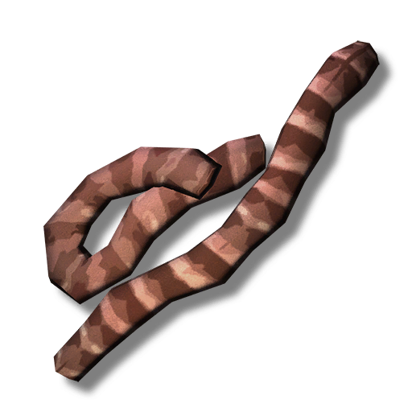

# Fresh Gut

<table class="infobox">
<caption>Fresh Gut</caption>
<colgroup>
<col style="width: 50%" />
<col style="width: 50%" />
</colgroup>
<tbody>
<tr>
<td colspan="2"><figure>

<figcaption>Fresh_Gut_icon.png</figcaption>
</figure></td>
</tr>
<tr>
<td>
Release
</td>
<td>
<a href="./The%20Long%20Dark%20%E2%80%94%20Changelog.md#0.01" class="wikilink" title="12 June 2014">12 June 2014</a>
</td>
</tr>
<tr>
<td>
Wintermute
</td>
<td>
No
</td>
</tr>
<tr>
<td>
Renewable
</td>
<td>
Yes
</td>
</tr>
<tr>
<td colspan="2" class="section">
<strong>Properties</strong>
</td>
</tr>
<tr>
<td>
Item type
</td>
<td>
<a href="./Materials.md" class="wikilink" title="Materials">Materials</a>|-
</td>
</tr>
<tr>
<td>
Stackable
</td>
<td>
No
</td>
</tr>
<tr>
<td>
Examine
</td>
<td>
Freshly harvested gut. 
Can be used for crafting and repair after air-drying indoors for 5 days.
</td>
</tr>
<tr>
<td colspan="2" class="section">
<strong>Values</strong>
</td>
</tr>
<tr>
<td>
Weight
</td>
<td>
0.10 kg (0.22 lbs)
</td>
</tr>
</tbody>
</table>

**Fresh Gut** is an animal-based <a href="./Materials.md" class="wikilink" title="Material">Material</a> that can be harvested from <a href="./Wildlife.md" class="wikilink" title="Wildlife">Wildlife</a> carcasses. Fresh Guts can also be used as a <a href="./Scent.md#Baiting%2FDecoys" class="wikilink" title="Baiting">Baiting</a> to distract predators, but are primarily used to craft or repair various animal based <a href="./Clothing.md" class="wikilink" title="Clothing">Clothing</a> once they have <a href="./Curing.md" class="wikilink" title="Cured">Cured</a> into <a href="./Cured%20Gut.md" class="wikilink" title="Cured Gut">Cured Gut</a>.

## Overview

Fresh Gut can be harvested from <a href="./Hunting.md" class="wikilink" title="Hunting">Hunting</a> or <a href="./Trapping.md" class="wikilink" title="Trapping">Trapping</a> the various land animals of <a href="./Great%20Bear%20Island.md" class="wikilink" title="Great Bear Island">Great Bear Island</a>, specifically the carcasses of <a href="./Moose.md" class="wikilink" title="moose">moose</a>, <a href="./Wolf.md" class="wikilink" title="wolves">wolves</a>, <a href="./Rabbit.md" class="wikilink" title="rabbit">rabbits</a>, <a href="./Bear.md" class="wikilink" title="bear">bears</a>, and <a href="./Deer.md" class="wikilink" title="deer">deer</a>. Fish and <a href="./Ptarmigan.md" class="wikilink" title="Ptarmigan">Ptarmigan</a> will never contain Guts.

| Animal Carcass | Fresh Gut Quantity |
|----|----|
| <a href="./Ptarmigan.md" class="wikilink" title="Ptarmigan">Ptarmigan</a> | 0 |
| Any Fish | 0 |
| <a href="./Rabbit.md" class="wikilink" title="Rabbit">Rabbit</a> | 1 |
| <a href="./Cougar.md" class="wikilink" title="Cougar">Cougar</a> | 2 |
| <a href="./Deer.md" class="wikilink" title="Deer">Deer</a> | 2 |
| <a href="./Poisoned%20Wolf.md" class="wikilink" title="Poisoned Wolf">Poisoned Wolf</a> | 2 |
| <a href="./Timberwolf.md" class="wikilink" title="Timberwolf">Timberwolf</a> | 2 |
| <a href="./Wolf.md" class="wikilink" title="Wolf">Wolf</a> | 2 |
| <a href="./Bear.md" class="wikilink" title="Bear">Bear</a> | 10 |
| <a href="./Moose.md" class="wikilink" title="Moose">Moose</a> | 12 |

Once harvested, Fresh Gut can be cured by letting them air-dry indoors for 5 days into <a href="./Cured%20Gut.md" class="wikilink" title="Cured Gut">Cured Gut</a>. Fresh Gut <a href="./Decay.md" class="wikilink" title="Decay">Decay</a> at a rate of 5 Condition a day (Stalker difficulty) and will decay into Ruined status if not left to cure indoors. The current curing status can be checked by hovering your reticle over the item, where it will display a "X% Cured" progress. This increases until the item is 100% cured, where the item will automatically become fully cured, will change to a darker texture, and is ready for crafting use. Completely cured items never decay.

## Drop decoy

Fresh Gut contributes to a survivor's overall <a href="./Scent.md" class="wikilink" title="Scent">Scent</a>. This can either be a detriment or a useful advantage when Baiting predator animals. Higher scent will also upset prey <a href="./Wildlife.md" class="wikilink" title="wildlife">wildlife</a>, such as alerting <a href="./Deer.md" class="wikilink" title="Deer">Deer</a> to a survivor's presence when upstream of wind. Pressing the Drop Decay button will automatically drop any Fresh Gut in the player's inventory onto the ground.

## Update history

- UPDATE **30 March 2023 (<a href="./The%20Long%20Dark%20%E2%80%94%20Changelog.md#2.09_%26_2.10" class="wikilink" title="Update">Update</a>):**
  - UI - Added a unique Icon for Cured/Dried Guts.
- HOTFIX **10 February 2015 (<a href="./The%20Long%20Dark%20%E2%80%94%20Early%20Access%20Changelog.md#0.193" class="wikilink" title="Update">Update</a>):**
  - Re-balanced gut yield for Bear.
- UPDATE **11 November 2014 (<a href="./The%20Long%20Dark%20%E2%80%94%20Early%20Access%20Changelog.md#0.163" class="wikilink" title="Update">Update</a>):**
  - Gut can now be Harvested from Wolf carcasses.
- UPDATE **12 June 2014 (<a href="./The%20Long%20Dark%20%E2%80%94%20Early%20Access%20Changelog.md#0.01" class="wikilink" title="Update">Update</a>):**
  - Added to the game.

**Lua execution error in Module:Navbox function navbox**

