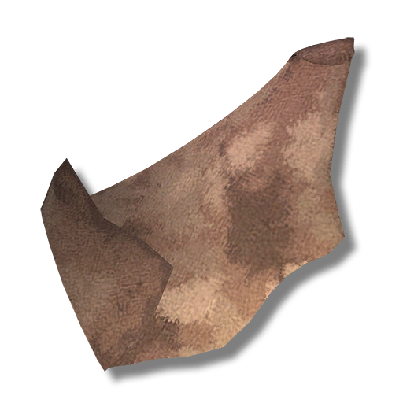

# Fresh Leather

**Contents**

- [Overview](#Overview)
- [Early Game Builds](#Early_Game_Builds)
- [Gallery](#Gallery)
- [Update history](#Update_history)

<table class="infobox">
<caption>Fresh Leather</caption>
<colgroup>
<col style="width: 50%" />
<col style="width: 50%" />
</colgroup>
<tbody>
<tr>
<td colspan="2"><figure>

<figcaption>Fresh_Leather_icon.png</figcaption>
</figure></td>
</tr>
<tr>
<td>
Release
</td>
<td>
<a href="./The%20Long%20Dark%20%E2%80%94%20Changelog.md#0.05" class="wikilink" title="9 July 2014">9 July 2014</a>
</td>
</tr>
<tr>
<td>
Wintermute
</td>
<td>
No
</td>
</tr>
<tr>
<td colspan="2" class="section">
<strong>Properties</strong>
</td>
</tr>
<tr>
<td>
Item type
</td>
<td>
<a href="./Materials.md" class="wikilink" title="Materials">Materials</a>|-
</td>
</tr>
<tr>
<td>
Stackable
</td>
<td>
No
</td>
</tr>
<tr>
<td>
Examine
</td>
<td>
Freshly harvested leather. 
Can be used for crafting and repair after air-drying indoors for 5 days.
</td>
</tr>
<tr>
<td colspan="2" class="section">
<strong>Values</strong>
</td>
</tr>
<tr>
<td>
Weight
</td>
<td>
0.10 kg (0.22 lbs)
</td>
</tr>
</tbody>
</table>

**Fresh Leather** is the very rare, uncured version of <a href="./Cured%20Leather.md" class="wikilink" title="Leather">Leather</a>. It can be used as a <a href="./Materials.md" class="wikilink" title="Material">Material</a> for crafting or repairing certain items once they have <a href="./Curing.md" class="wikilink" title="Cured">Cured</a> into <a href="./Cured%20Leather.md" class="wikilink" title="Cured Leather">Cured Leather</a>.

## Overview

Fresh Leather can only be found at outside locations such as <a href="./Poacher%27s%20Camp.md" class="wikilink" title="Poacher&#39;s Camp">Poacher's Camp</a>, <a href="./The%20Ravine.md" class="wikilink" title="The Ravine">The Ravine</a>, and the <a href="./Maintenance%20Yard.md" class="wikilink" title="Maintenance Yard">Maintenance Yard</a>, and may be cured into Cured Leather over 5 days. The "Fresh Leather" item is still present in *The Long Dark*, but is extremely rare that cannot be created in any way outside of world generation at game start. Fresh Leather also decays over time, like fresh animal hides and guts, making it even more difficult to find the already rare item before it decays to 0% condition inside a container and is deleted.

Fresh Leather is so rare of a find that many players mistakenly believe it is <a href="./Cut%20%E2%80%94%20Discontinued%20Content.md" class="wikilink" title="Cut/Discontinued Content">Cut/Discontinued Content</a>. Most instances of this item will have already cured indoors at 76% by the time the player finds them, or will be outdoors at 0% if the player takes too long.

## Early Game Builds

In early builds of *The Long Dark* (alpha/beta), Fresh Leather was a very common material obtained from Carcass Harvesting Deer. Instead of <a href="./Fresh%20Deer%20Hide.md" class="wikilink" title="Fresh Deer Hide">Fresh Deer Hide</a> being produced, "Fresh Leather" would be harvested; this item could then be converted into "Cured Leather" by curing it indoors, and then used for repairing clothing. Cured Leather is the default form of Leather found in the game, and is found by Harvesting leather footwear, gloves, the Moose-Hide Satchel, finding it in the game world, and <a href="./Beachcombing.md" class="wikilink" title="Beachcombing">Beachcombing</a>.

## Gallery

<table class="gallery">
<colgroup>
<col style="width: 100%" />
</colgroup>
<tbody>
<tr>
<td><figure>
[Missing image: Fresh_Leather.jpg]
<figcaption>Old model.</figcaption>
</figure></td>
</tr>
</tbody>
</table>

## Update history

- UPDATE **22 May 2015 (<a href="./The%20Long%20Dark%20%E2%80%94%20Early%20Access%20Changelog.md#0.233" class="wikilink" title="Update">Update</a>):**
  - Animal skins and certain types of Wood now need to be Cured (Dried) before they can be used as raw materials for Crafting.
- UPDATE **9 July 2014 (<a href="./The%20Long%20Dark%20%E2%80%94%20Early%20Access%20Changelog.md#0.05" class="wikilink" title="Update">Update</a>):**
  - Added to game.

**Lua execution error in Module:Navbox function navbox**

<a href="ru:%D0%A1%D0%B2%D0%B5%D0%B6%D0%B0%D1%8F_%D0%BA%D0%BE%D0%B6%D0%B0" class="wikilink" title="ru:Свежая кожа">ru:Свежая кожа</a>

