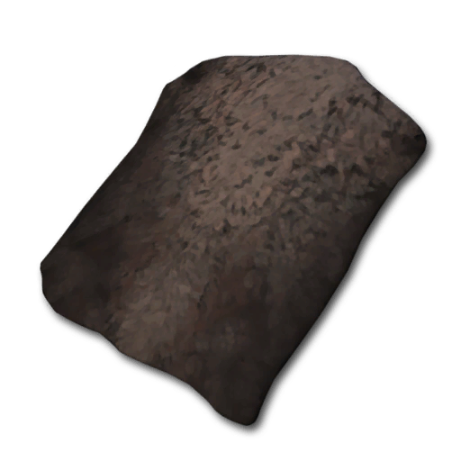

# Fresh Moose Hide

<table class="infobox">
<caption>Fresh Moose Hide</caption>
<colgroup>
<col style="width: 50%" />
<col style="width: 50%" />
</colgroup>
<tbody>
<tr>
<td colspan="2"><figure>

<figcaption>Fresh_Moose_Hide_icon.png</figcaption>
</figure></td>
</tr>
<tr>
<td>
Release
</td>
<td>
<a href="./The%20Long%20Dark%20%E2%80%94%20Changelog.md#1.16" class="wikilink" title="7 December 2017">7 December 2017</a>
</td>
</tr>
<tr>
<td>
Wintermute
</td>
<td>
No
</td>
</tr>
<tr>
<td colspan="2" class="section">
<strong>Properties</strong>
</td>
</tr>
<tr>
<td>
Item type
</td>
<td>
<a href="./Materials.md" class="wikilink" title="Materials">Materials</a>|-
</td>
</tr>
<tr>
<td>
Stackable
</td>
<td>
No
</td>
</tr>
<tr>
<td>
Examine
</td>
<td>
Freshly harvested skin of a Moose. 
Can be used for crafting and repairs after air-drying indoors for 10 days.
</td>
</tr>
<tr>
<td colspan="2" class="section">
<strong>Values</strong>
</td>
</tr>
<tr>
<td>
Weight
</td>
<td>
5.00 kg (11 lbs)
</td>
</tr>
</tbody>
</table>

**Fresh Moose Hide** is the raw hide of a <a href="./Moose.md" class="wikilink" title="Moose">Moose</a>. It can be used as a <a href="./Materials.md" class="wikilink" title="Material">Material</a> for crafting or repairing <a href="./Moose-Hide%20Satchel.md" class="wikilink" title="Moose-Hide Satchel">Moose-Hide Satchel</a> or <a href="./Moose-Hide%20Cloak.md" class="wikilink" title="Moose-Hide Cloak">Moose-Hide Cloak</a> once they have <a href="./Curing.md" class="wikilink" title="Cured">Cured</a> into a <a href="./Cured%20Moose%20Hide.md" class="wikilink" title="Cured Moose Hide">Cured Moose Hide</a>.

## Overview

Fresh Moose Hide are acquired by harvesting a <a href="./Moose%20Carcass.md" class="wikilink" title="Moose Carcass">Moose Carcass</a>. They can be cured by leaving them indoors for 10 days (in-game). Fresh Moose Hide <a href="./Decay.md" class="wikilink" title="Decay">Decay</a> at a rate of 2.857 Condition a day (Stalker difficulty) and will decay into Ruined status if not left to cure indoors. The current curing status can be checked by hovering your reticle over the item, where it will display a "X% Cured" progress. This increases until the item is 100% cured, where the item will automatically become fully cured, will change to a darker texture, and is ready for crafting use. Completely cured items never decay.

Fresh Moose Hides are a very rare resource to obtain, since they require first finding a very rare encounter with a <a href="./Moose.md" class="wikilink" title="Moose">Moose</a> and it's hunting it with a <a href="./Tools.md" class="wikilink" title="weapon">weapon</a>. Each Moose Carcass will always have one hide, along with <a href="./Moose%20Meat%20%28Raw%29.md" class="wikilink" title="meat">meat</a> and <a href="./Cured%20Gut.md" class="wikilink" title="Cured Gut">Cured Gut</a>.

## Drop sources

| Source | Quantity | Rarity |
|----|----|----|
| <a href="./Moose.md" class="wikilink" title="Moose">Moose</a> | 1 | Always |

## Update history

- UPDATE **7 December 2017 (<a href="./The%20Long%20Dark%20%E2%80%94%20Changelog.md#1.16" class="wikilink" title="Update">Update</a>):**
  - Added to the game.

**Lua execution error in Module:Navbox function navbox**

<a href="ru:%D0%A1%D0%B2%D0%B5%D0%B6%D0%B0%D1%8F_%D0%BB%D0%BE%D1%81%D0%B8%D0%BD%D0%B0%D1%8F_%D1%88%D0%BA%D1%83%D1%80%D0%B0" class="wikilink" title="ru:Свежая лосиная шкура">ru:Свежая лосиная шкура</a>

