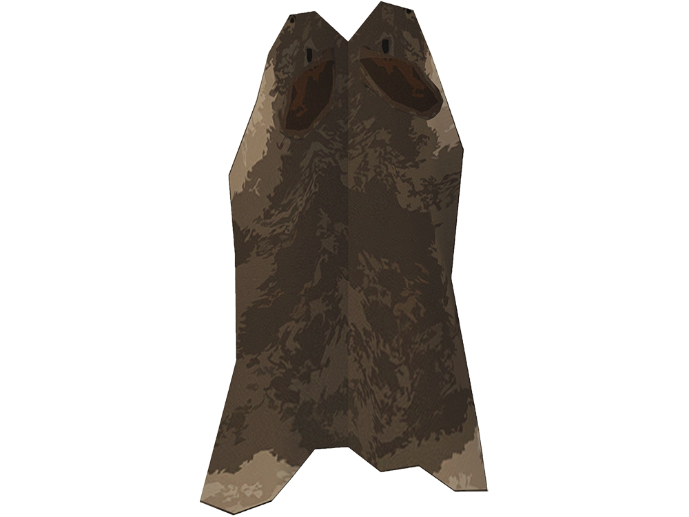

# Fresh Rabbit Pelt

**Categories:** Materials, Pages with update history · **Source:** [Fandom](https://thelongdark.fandom.com/wiki/Fresh_Rabbit_Pelt)

**Contents**

- [Overview](#overview)
- [Drop sources](#drop-sources)
- [Gallery](#gallery)
- [Update history](#update-history)

**Fresh Rabbit Pelt**

**Release:** [1 April 2015](./The%20Long%20Dark%20%E2%80%94%20Changelog.md#0.212)

**Wintermute:** No

**Renewable:** Yes

**Properties**

**Item type:** [Materials](./Materials.md)

**Stackable:** No

**Examine:** Freshly harvested rabbit pelt. Can be used for crafting and repairs after air-drying indoors for 3 days.

**Values**

**Weight:** 0.10 kg (0.22 lbs)

**Fresh Rabbit Pelt** is the raw hide of a [Rabbit](./Rabbit.md). It can be used as a [Material](./Materials.md) for crafting or repairing [Rabbitskin Hats](./Rabbitskin%20Hat.md) and [Rabbitskin Mitts](./Rabbitskin%20Mitts.md) once they have [Cured](./Curing.md) into a [Cured Rabbit Pelt](./Cured%20Rabbit%20Pelt.md).

## Overview

Fresh Rabbit Pelts are acquired by harvesting a [Rabbit Carcass](./Rabbit%20Carcass.md). They can then be cured by leaving them indoors for 3 days (in-game). Fresh Rabbit Pelts [Decay](./Decay.md) at a rate of 6.667 Condition a day (Stalker difficulty) and will decay into Ruined status if not left to cure indoors. The current curing status can be checked by hovering your reticle over the item, where it will display a "X% Cured" progress. This increases until the item is 100% cured, where the item will automatically become fully cured, will change to a darker texture, and is ready for crafting use. Completely cured items never decay.

Rabbit Pelts are acquired by [Trapping](./Trapping.md), stunning Rabbits with a [Stone](./Stone.md), or shooting a Rabbit. Each Rabbit Carcass will have one pelt, along with [meat](./Rabbit%20%28Raw%29.md) and [Fresh Guts](./Fresh%20Gut.md).

## Drop sources

| Source | Quantity | Rarity |
| --- | --- | --- |
| [Rabbit](./Rabbit.md) | 1 | Always |

## Gallery

## Update history

- UPDATE **22 May 2015 ([Update](./The%20Long%20Dark%20%E2%80%94%20Early%20Access%20Changelog.md#0.233)):**
  - Animal skins and certain types of Wood now need to be Cured (Dried) before they can be used as raw materials for Crafting.
- UPDATE **22 May 2015 ([Update](./The%20Long%20Dark%20%E2%80%94%20Early%20Access%20Changelog.md#0.212)):**
  - Rabbit Pelt is now used to repair Rabbitskin Mitts.
  - Added to game.
