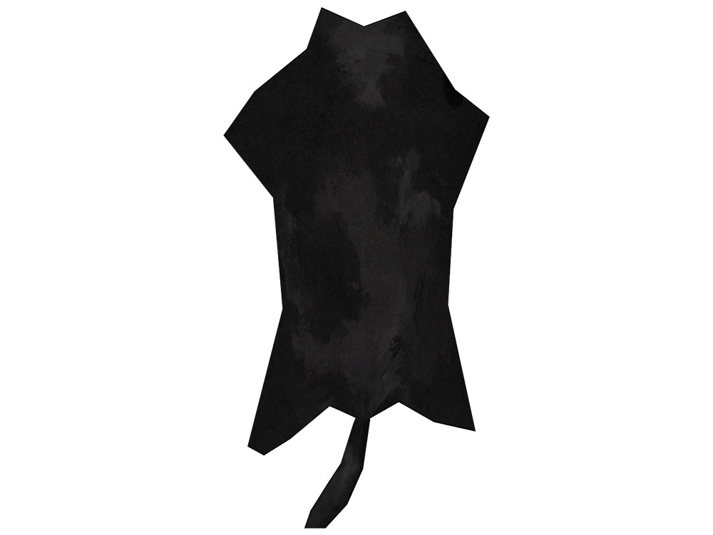

# Fresh Wolf Pelt

**Categories:** Materials, Pages with update history · **Source:** [Fandom](https://thelongdark.fandom.com/wiki/Fresh_Wolf_Pelt)

**Contents**

- [Overview](#overview)
- [Drop sources](#drop-sources)
- [Gallery](#gallery)
- [Update history](#update-history)

**Fresh Wolf Pelt**

| Property | Details |
| --- | --- |
|  | [Fresh Wolf Pelt icon](../assets/Fresh_Wolf_Pelt_icon.png) |
| Release | [1 April 2015](./The%20Long%20Dark%20%E2%80%94%20Early%20Access%20Changelog.md#0.212) |
| Wintermute | No |
| **Properties** |  |
| Item type | [Materials](./Materials.md)\|- |
| Stackable | No |
| Examine | Freshly harvested fur from a Wolf. Warm, and striking to look at. / Can be used for crafting and repair after air-drying indoors for 7 days. |
| **Values** |  |
| Weight | 0.75 kg (1.65 lbs) |

**Fresh Wolf Pelt** is the raw hide of a [Wolf](./Wolf.md), [Timberwolf](./Timberwolf.md), or [Poisoned Wolf](./Poisoned%20Wolf.md). It can be used as a [Material](./Materials.md) for crafting or repairing [Wolfskin Coats](./Wolfskin%20Coat.md) once they have [Cured](./Curing.md) into a [Cured Wolf Pelt](./Cured%20Wolf%20Pelt.md).

## Overview

Fresh Wolf Pelts are acquired by harvesting a [Wolf](./Wolf%20Carcass.md), [Timberwolf](./Timberwolf%20Carcass.md), or [Poisoned Wolf Carcass](./Poisoned%20Wolf%20Carcass.md). They can then be cured by leaving them indoors for 7 days (in-game). Fresh Wolf Pelts [Decay](./Decay.md) at a rate of 5 Condition a day (Stalker difficulty) and will decay into Ruined status if not left to cure indoors. The current curing status can be checked by hovering your reticle over the item, where it will display a "X% Cured" progress. This increases until the item is 100% cured, where the item will automatically become fully cured, will change to a darker texture, and is ready for crafting use. Completely cured items never decay.

Wolf Pelts can be dangerous or resource-expensive to obtain, since they requiring killing a Wolf with a [Hunting Rifle](./Hunting%20Rifle.md), [Revolver](./Revolver.md), or [Survival Bow](./Survival%20Bow.md).

An alternative but very dangerous method of obtaining a pelt involves allowing a Wolf [struggle](./Struggle.md) to begin, and then using a [Hunting Knife](./Hunting%20Knife.md) or [Improvised Knife](./Improvised%20Knife.md) to puncture a Wolf, then waiting a few hours for the Wolf to bleed out after it runs away. This method is incredibly dangerous if a survivor has very low [Condition](./Condition.md) as it will often result in death.

Each Wolf Carcass (or variant) will always contain one pelt, along with [meat](./Wolf%20Meat%20%28Raw%29.md) and [Fresh Gut](./Fresh%20Gut.md). Occasionally, dead ravaged Wolf Carcasses can be found across [Great Bear Island](./Great%20Bear%20Island.md).

## Drop sources

| Source | Quantity | Rarity |
| --- | --- | --- |
| [Wolf](./Wolf.md) | 1 | Always |
| [Timberwolf](./Timberwolf.md) | 1 | Always |
| [Poisoned Wolf](./Poisoned%20Wolf.md) | 1 | Always |

## Gallery

## Update history

- UPDATE **22 May 2015 ([Update](./The%20Long%20Dark%20%E2%80%94%20Early%20Access%20Changelog.md#0.233)):**
  - Animal skins and certain types of Wood now need to be Cured (Dried) before they can be used as raw materials for Crafting.
- UPDATE **22 May 2015 ([Update](./The%20Long%20Dark%20%E2%80%94%20Early%20Access%20Changelog.md#0.212)):**
  - Wolfskin Pelt is now used to repair the Wolfskin Coat (instead of Leather).
  - Added to game.
