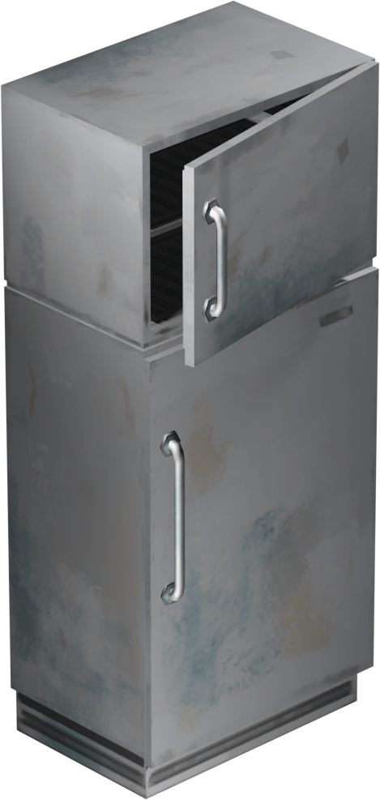
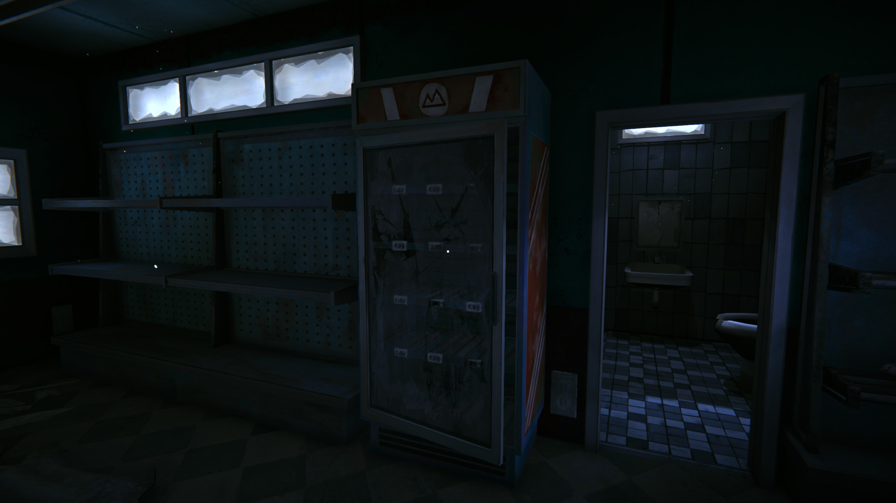

# Fridge

**Categories:** Interactable Objects · **Source:** [Fandom](https://thelongdark.fandom.com/wiki/Fridge)

**Fridge**

| Property | Details |
| --- | --- |
| \[\[File: /  / _Fridge_ /  / _Soda_ | 250px\]\] |
|  / _Fridge_ |  / _Soda_ |
| Release | 12 June 2014 |
| Update | [0.01](./The%20Long%20Dark%20%E2%80%94%20Changelog.md#0.01) |
| Story item | No |
| **Container** |  |
| Capacity | 40.00 kg(88 lbs) |

A **Fridge** is a storage container found as part of refrigerators inside many the kitchens of homes and industrial buildings across the island. Most refrigerators have a **Fridge** on the bottom and a [Freezer](./Freezer.md) on the top. Ironically, it is best to store certain foods outdoors (mainly meat) in order to preserve them for longer periods of time, as the Fridge is not functional.

Though very rarely found, sometimes a mini fridge can be found in certain trailers.

A second type of Fridge (often nicknamed Soda Fridges) that can be found has a single clear glass door and only ever contains [Sodas](./Soda%20%28disambiguation%29.md) or [Water (Potable)](./Water%20%28Potable%29.md), which can be looted by opening the door and peaking through the right side to grab them. These types of Fridges cannot be used to store items. They come in green or red colors on the outside, neither of which affect the contents.
