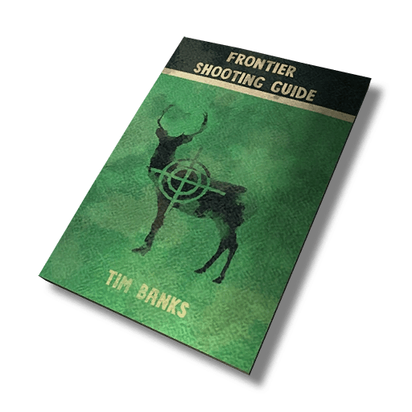

# Frontier Shooting Guide \(Survival School\)

  
*For the version encountered in <a href="./Survival%20Mode.md" class="wikilink" title="Survival Mode">Survival Mode</a>, see <a href="./Frontier%20Shooting%20Guide.md" class="wikilink" title="Frontier Shooting Guide">Frontier Shooting Guide</a>.*

<table class="infobox">
<caption>Frontier Shooting Guide</caption>
<colgroup>
<col style="width: 50%" />
<col style="width: 50%" />
</colgroup>
<tbody>
<tr>
<td colspan="2"><figure>

<figcaption>Frontier_Shooting_Guide_icon.png</figcaption>
</figure></td>
</tr>
<tr>
<td>
Release
</td>
<td>
<a href="./The%20Long%20Dark%20%E2%80%94%20Early%20Access%20Changelog.md#1.00" class="wikilink" title="1 August 2017">1 August 2017</a>
</td>
</tr>
<tr>
<td>
Wintermute
</td>
<td>
<a href="./Episode%202%20-%20Luminance%20Fugue.md" class="wikilink" title="Episode 2">Episode 2</a> - <a href="./Survival%20School.md" class="wikilink" title="Survival School">Survival School</a>
</td>
</tr>
<tr>
<td colspan="2" class="section">
<strong>Properties</strong>
</td>
</tr>
<tr>
<td>
Item type
</td>
<td>
<a href="./Collectibles.md" class="wikilink" title="Collectibles">Collectibles</a>|-
</td>
</tr>
<tr>
<td>
Stackable
</td>
<td>
No
</td>
</tr>
<tr>
<td>
Examine
</td>
<td>
Reprint of a late 19th-century handbook about shooting, meant for green pioneers.
</td>
</tr>
<tr>
<td colspan="2" class="section">
<strong>Values</strong>
</td>
</tr>
<tr>
<td>
Weight
</td>
<td>
0.00 kg (0 lbs)
</td>
</tr>
<tr>
<td colspan="2" class="section">
<strong>Actions</strong>
</td>
</tr>
<tr>
<td>
Backpack
</td>
<td>
Examine
</td>
</tr>
</tbody>
</table>

**Frontier Shooting Guide** is a <a href="./Collectibles.md" class="wikilink" title="Collectible">Collectible</a> found in <a href="./Episode%202%20-%20Luminance%20Fugue.md" class="wikilink" title="Episode 2: Luminance Fugue">Episode 2: Luminance Fugue</a> in <a href="./Wintermute.md" class="wikilink" title="Wintermute">Wintermute</a> inside the Hunter's Blind at <a href="./Unnamed%20Pond.md" class="wikilink" title="Unnamed Pond">Unnamed Pond</a>. Taking it causes the side quest <a href="./Survival%20School.md" class="wikilink" title="Survival School">Survival School</a> to start and asks the player to cull a single <a href="./Wolf.md" class="wikilink" title="Wolf">Wolf</a> in the <a href="./Mystery%20Lake%20%28region%29.md" class="wikilink" title="Mystery Lake">Mystery Lake</a>, <a href="./Forlorn%20Muskeg.md" class="wikilink" title="Forlorn Muskeg">Forlorn Muskeg</a>, <a href="./Broken%20Railroad.md" class="wikilink" title="Broken Railroad">Broken Railroad</a> regions.

## Update history

- UPDATE **17 December 2018 (<a href="./The%20Long%20Dark%20%E2%80%94%20Changelog.md#1.41" class="wikilink" title="Update">Update</a>):**
  - Added to game.

**Lua execution error in Module:Navbox function navbox**

