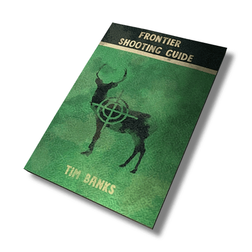
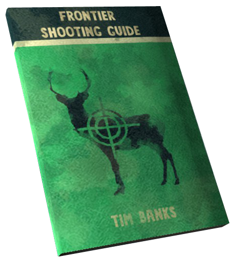
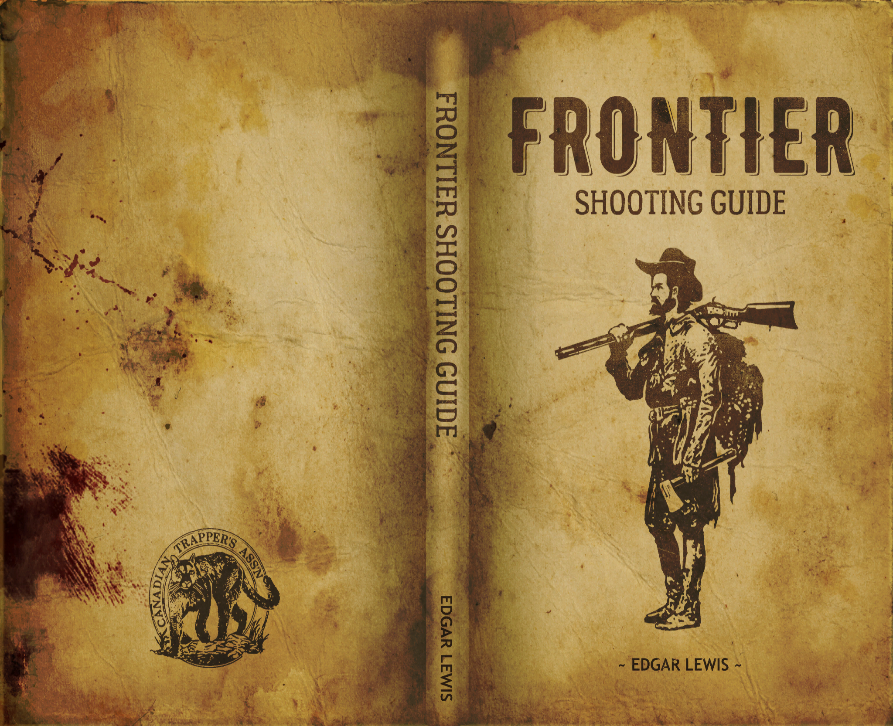

# Frontier Shooting Guide

**Categories:** Fire Starting, Pages with update history, Tools · **Source:** [Fandom](https://thelongdark.fandom.com/wiki/Frontier_Shooting_Guide)

**Contents**

- [Research info](#research-info)
- [Fire Starting info](#fire-starting-info)
- [Trivia](#trivia)
- [Gallery](#gallery)
- [Update history](#update-history)

**Frontier Shooting Guide**

_Frontier\_Shooting\_Guide\_icon.png_

**Release:** [23 June 2016](./The%20Long%20Dark%20%E2%80%94%20Changelog.md#0.346)

**Wintermute:** No

**Properties**

**Item type:** [Fire Starting](./Fire%20Starting.md)[Tools](./Tools.md)

**Stackable:** No

**Examine:** Reprint of a late 19th-century handbook about shooting, meant for green pioneers. Researching this will improve your Skill.

**Values**

**Weight:** 0.50 kg (1.1 lbs)

**Actions**

**Backpack:** Research, Drop

_For the version encountered in [Wintermute](./Wintermute.md), see [Frontier Shooting Guide (Survival School)](./Frontier%20Shooting%20Guide%20%28Survival%20School%29.md)._

**Frontier Shooting Guide** is a [Research Book](./Research%20Book.md) used to improve the [Rifle Firearm](./Rifle%20Firearm.md) skill. It can also be used as Fuel when starting a [Fire](./Fire.md).

## Research info

_Frontier Shooting Guide_ can be researched for 4 hours, which can be broken into multiple research sessions. 5 [Rifle Firearm skill points](./Rifle%20Firearm.md#Skill_levels) are awarded on completing the research. This [Research Book](./Research%20Book.md) can only be used to increase the skill level to a maximum of 4.

Research can only be performed under the following conditions:

- There is light present to read
- [Warmth](./Warmth.md), [Fatigue](./Fatigue.md), [Thirst](./Thirst.md), and [Hunger](./Hunger.md) exceed 0%
- No negative [Afflictions](./Afflictions.md)

## Fire Starting info

**Frontier Shooting Guide**

**Type:** Fuel

**Statistics**

**Duration:**  18 minutes

**Start Chance:**  +35%

**Heat:**  +2°C (+3.6°F)

**Burn Density:** 0.6 hr/kg (0.27 hr/lb)

## Trivia

- Reaching 0% in any Needs while researching will immediately end the research session and negate any progress for that research attempt.
- Attempting to burn a copy of _Rifle Firearm_ when it has not been fully read will give a confirmation warning before it can be burned.
- Once a copy of _Rifle Firearm_ is fully researched, it will no longer appear in the Tools section of the Backpack.

## Gallery

_3D Model_

_Old model_

## Update history

- UPDATE **23 June 2016 ([Update](./The%20Long%20Dark%20%E2%80%94%20Early%20Access%20Changelog.md#.346)):**
  - Added to game.
