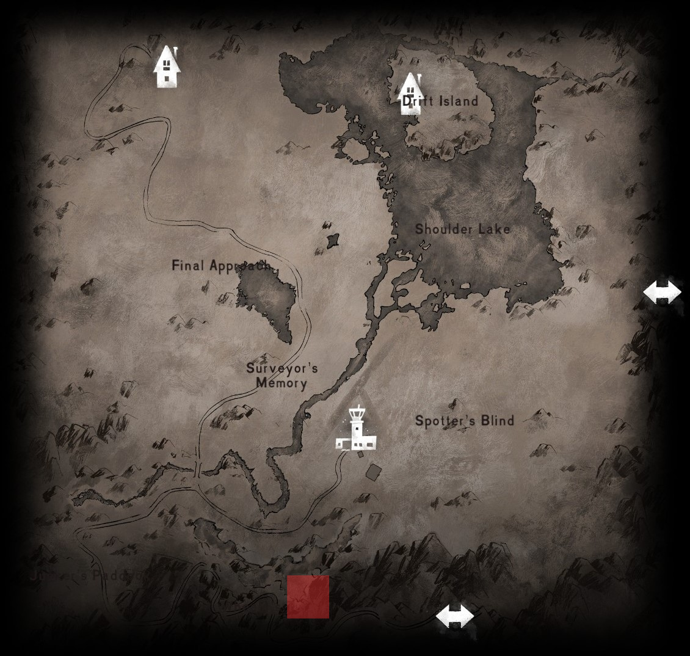

# Frost Cave

**Categories:** Caves, Locations, Locations in Forsaken Airfield, Sheltered locations · **Source:** [Fandom](https://thelongdark.fandom.com/wiki/Frost_Cave)

**Frost Cave**

_Frost\_Cave\_Interior.png_

**Location**

_Frost\_Cave\_Location.png_

**Region:** [Forsaken Airfield](./Forsaken%20Airfield.md)

**Description:** A cave next to a frozen river

**General**

**Type:** Cave

Provides some shelter / **Frost Cave** is a small cave located in [Forsaken Airfield](./Forsaken%20Airfield.md). It can be reached by climbing down the collapsed road near [Whealy's Turn](./Whealy%27s%20Turn.md) or by walking south of the [Main Hangar](./Main%20Hangar.md) at [Field 31](./Field%2031.md).

## Overview

The cave doesn't have a bed, but spawns a [Campfire](./Campfire.md), a [Frozen Corpse](./Frozen%20Corpse.md) and a [Backpack](./Backpack.md). The backpack often contains basic food, drink, and clothing. Despite its spartan amenities, the cave's shelter can be a lifesaver if caught in a blizzard in the area.
