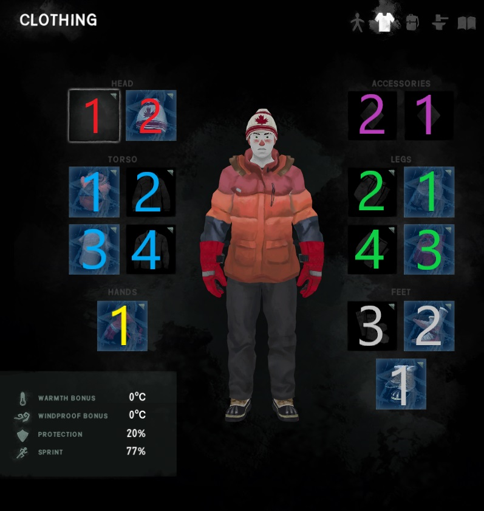

# Frostbite Risk

**Categories:** Afflictions · **Source:** [Fandom](https://thelongdark.fandom.com/wiki/Frostbite_Risk)

**Frostbite Risk**

[Frostbite Risk icon](../assets/Frostbite_Risk_icon.png)

**Properties**

**Category:** [Afflictions](./Afflictions.md)

**Description:** Your skin is directly exposed to the cold. If it remains exposed for long enough, you'll get Frostbite.

**Caused By:** No [Clothing](./Clothing.md) on body parts Bare Skin exposed to inner layer Frozen Clothing

**Effect:** Negative

**Type:** Risk

**Affliction Duration:** Until Treated

**Treatment**

**Treatment:** Warm and cover exposed body part

**Frostbite Risk** is incurred when a player's bare skin is exposed to freezing conditions, particularly with severe windchill.

## Risk

> “**Your skin is directly exposed to the cold. If it remains exposed for long enough, you'll get Frostbite.**”
>
> — In-game description

Frostbite Risk will only appear when 1 of 5 extremities of bare skin is exposed directly to the cold (Head, Torso, Hands, Legs, Feet), or by wearing Clothing that is currently Frozen on a particular body part. No Clothing worn on one of the 5 major body parts for long periods of time in a cold location is the most common way to begin Frostbite Risk (especially on higher difficulties where the player often begins without head or hand clothing).

It is possible to have multiple Risks develop on multiple limbs at once, but this only occurs once per exposed body part (I.E: cannot have 2 risks for hands). Game difficulty determines how quickly Frostbite Risk develops and how fast the meter fills.

Wearing Accessories, such as [Wool Ear Wrap](./Wool%20Ear%20Wrap.md) (shown on the head) or [Improvised Insulation](./Improvised%20Insulation.md) (shown on the body), will still cause Frostbite Risk to develop for those body parts. As long as one Clothing slot (except Accessories) has any kind of unfrozen Clothing on it, Frostbite Risk will not develop for that extremity.

## Mechanics

- Frostbite Risk is calculated by game world temperature, which consists of ambient air temperature, windchill, and weather. This is not the same as "[Feels Like](./Feels%20Like.md)", a combination of the player's Clothing stats, any [Feats](./Feats.md), or Afflictions (ex. [Warming Up](./Warming%20Up.md), [Frigid Bones](./Frigid%20Bones.md)).
- Frostbite Risk only increases when temperature goes below -20C.
  - Between -1C and -20C Risk doesn't change.
  - Frostbite Risk stops when temperature is above +1C.
  - Frostbite Risk is immediately stopped by standing next to a [Fire](./Fire.md) and will gradually lowers the Risk the warmer the fire becomes.
  - Sleeping/passing time in a warm location with an uncovered body part suffering from Frostbite Risk will stop any Risk progression, but will not lower it if the temperature is not above +1C.
  - Frostbite Risk increases faster on higher difficulties.
- Different parts of the body develop Frostbite Risk faster than others:
  - Bare Hands and Feet are the most vulnerable and freeze the fastest (2-5 hours)
  - Bare Head and Legs freeze moderately quickly (3-7.5 hours)
  - Bare Torso freezes the slowest (4-10 hours)
- Wearing Frozen Clothing on an inner layer of the body will begin Frostbite Risk and accelerate it 50% faster than normal, and lowers the Warmth bonus of that Clothing. The player will also get Frostbite Risk with Frozen Clothing worn even if the air temperature is above -20C.
  - Passing through waterfalls [Environmental Hazards](./Environmental%20Hazard.md)/[Weak Ice](./Weak%20Ice.md) will immediately wet portions of the player's outer layer Clothing, which can quickly freeze over. Blizzards and light snow fall also wets the player's outer layer Clothing, though to a slower effect.
  - Covering the affected by part with unfrozen Clothing will also begin lowering the Affliction.
  - Clothing that is damaged and Ruined in a Wildlife [Struggle](./Struggle.md) will notify the player in the top right corner, and that section of the body must immediately be covered up again to prevent Risk.

Should a body part continue to remain exposed to the freezing cold, [Frostbite](./Frostbite.md) will develop. If Frostbite develops on that limb and it is not covered, Frostbite Risk will begin again.

## Trivia
