# Frozen Corpse

**Frozen Corpse**

| Property | Details |
| --- | --- |
|  | 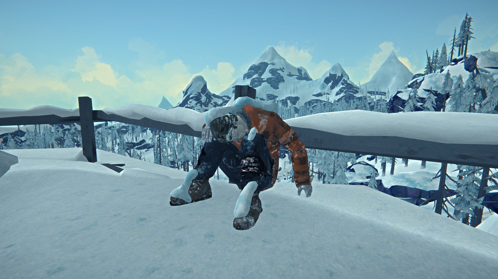 / *Frozen\_Corpse.jpg* |
| Story item | Yes |
| **Container** |  |
| Capacity | 10.00 kg(22 lbs) |

> “**A frozen corpse brings Great Bear Island's harsh reality front and centre.  
 Leave them in peace, or search the body for supplies to help you avoid their fate.**”
>
> — [What I Know](./What%20I%20Know.md) description

{| style="margin:auto" | style="vertical-align:top; font-size:3em; color:#5d5980; padding-right:10px" |“ | **Woah. Someone's just...sitting here. Frozen. What the hell?**

[Will Mackenzie](./Will%20Mackenzie.md)

| style="vertical-align:bottom; font-size:3em; color:#5d5980; padding-left:10px" |” |} **Frozen Corpses** (sometimes labeled as just **Corpse**) are the remains of seemingly recently deceased people. They are usually found outdoors, although some can be found indoors, in caves, or crushed under structures or other landmarks.

## Overview

Corpses can be searched for modest loot. Tools or weapons can often be found nearby. Sometimes, corpses will spawn with items in-hand. [Crow Feathers](./Crow%20Feather.md) also can spawn near corpses, and [Crows](./Crow.md) can be spotted circling above some spawned corpses.

The causes of death and identities of frozen corpses are almost universally a mystery, although the Hinterland Forums community has given some of these corpses [unofficial backstories](https://hinterlandforums.com/forums/topic/38131-tsd-the-sitting-dead/). The bodies also do not defrost, regardless of surrounding temperature, and they are essentially useless and inert once looted (although the can technically serve as storage containers, albeit macabre ones).

If a frozen corpse is found inside a [safehouse](./Safehouse.md), it can be "Respectfully Removed" via [Safehouse Customization](./Safehouse%20Customization.md). Occasionally in [Wintermute](./Wintermute.md), a [Dead Prison Guard](./Dead%20Prison%20Guard.md) or dead Convict can be found.

## Gallery

| Column 1 | Column 2 | Column 3 | Column 4 |
| --- | --- | --- | --- |
| 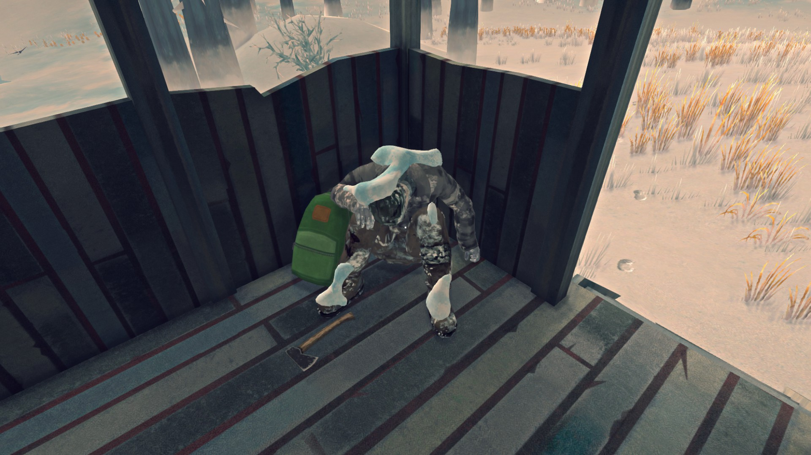 / *A corpse inside a [Hunting Blind](./Hunter%27s%20Blinds.md) with a [hatchet](./Hatchet.md)* | 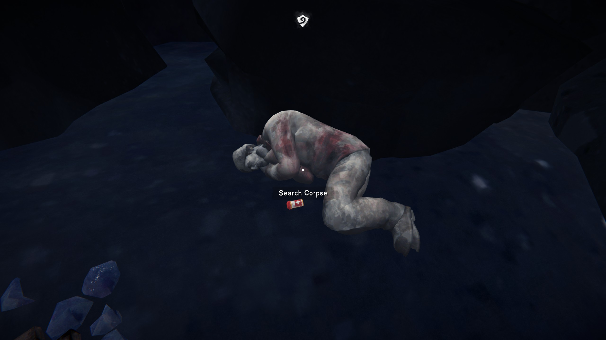 / *A Frozen Corpse labeled just "Corpse"* | 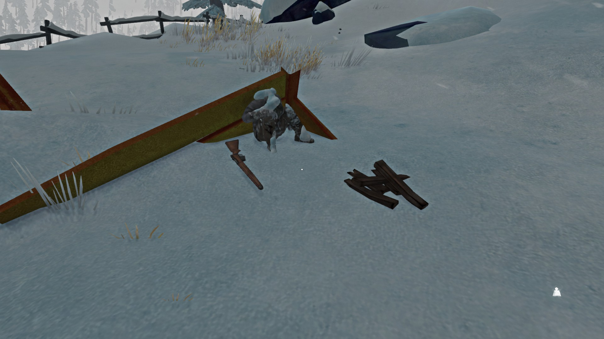 / *A corpse at the [Destroyed Lookout](./Destroyed%20Lookout.md) with a [rifle](./Hunting%20Rifle.md) lying nearby* | 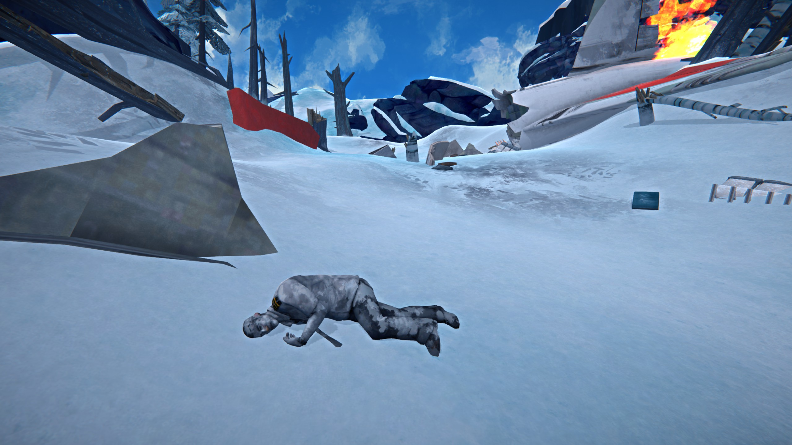 / *Dead pilot model* |
| 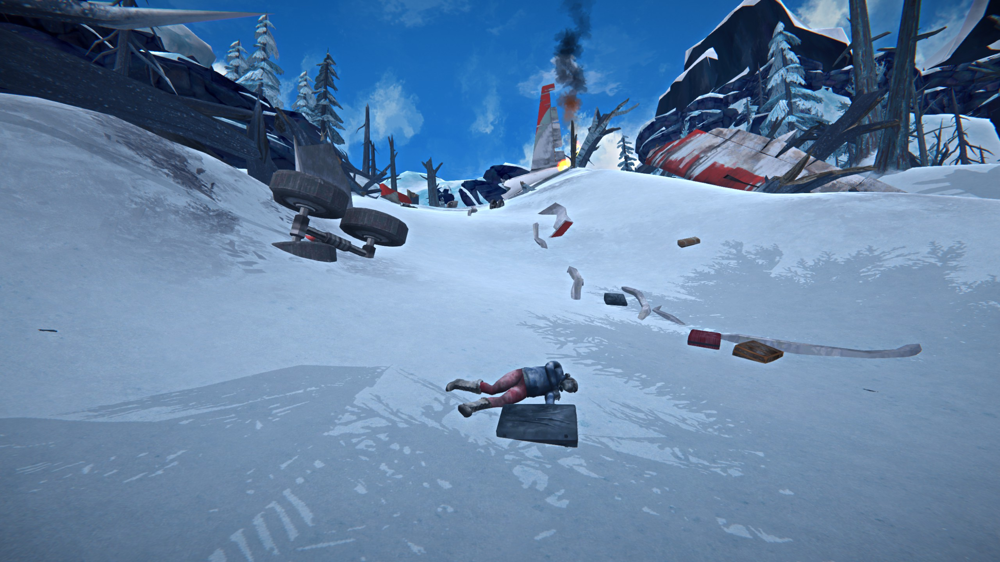 / *R.\_Tan\_location.jpg* | 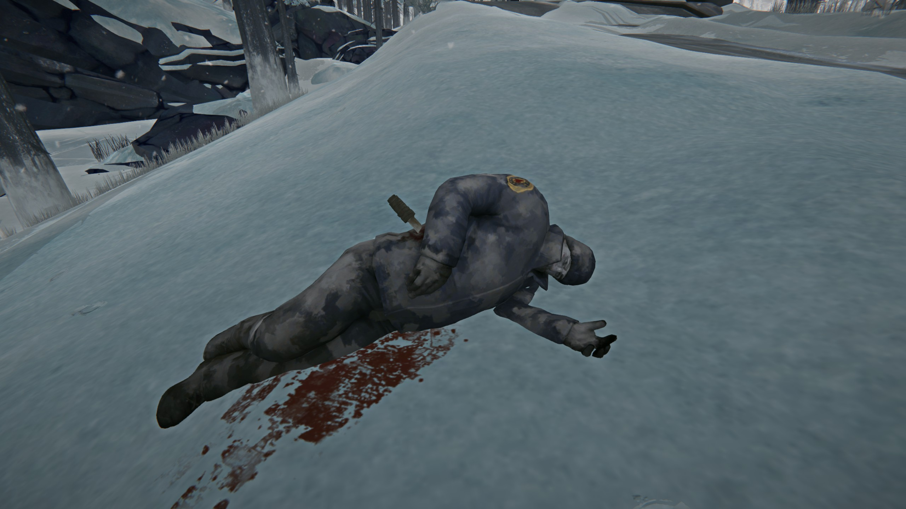 / *[Dead Prison Guard](./Dead%20Prison%20Guard.md)* | 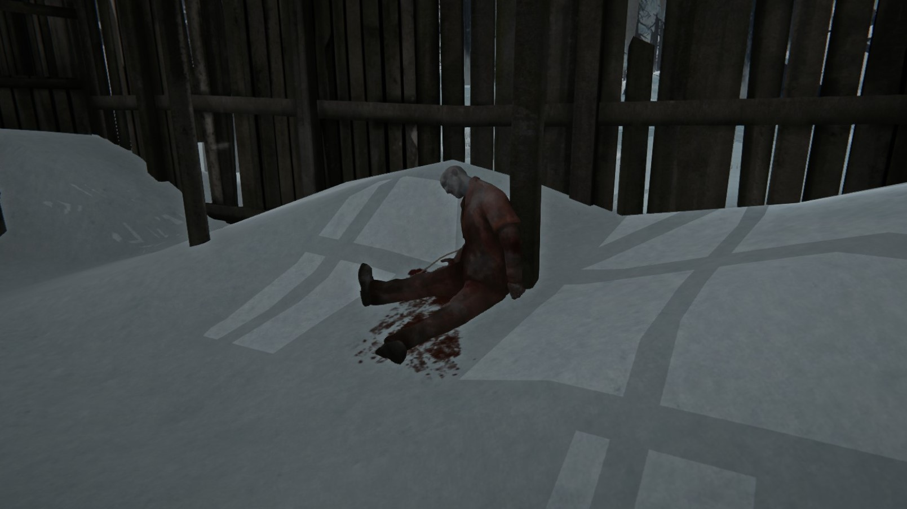 / *One of many dead [Convicts](./Convicts.md) in Wintermute* | 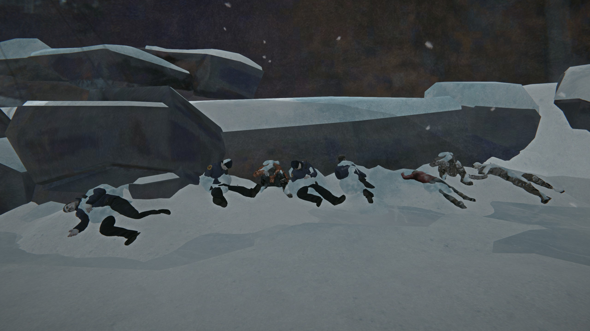 / *Several executed prison guards and civilians outside of [Blackrock Prison](./Blackrock%20Prison.md) in [Episode 4](./Episode%204%20-%20Fury%2C%20Then%20Silence.md)* |
| 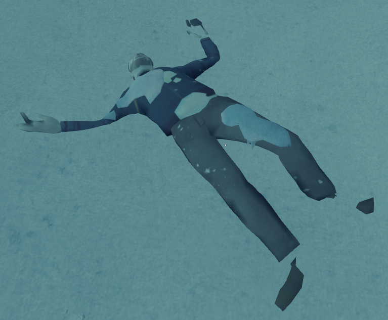 / *very old version* | 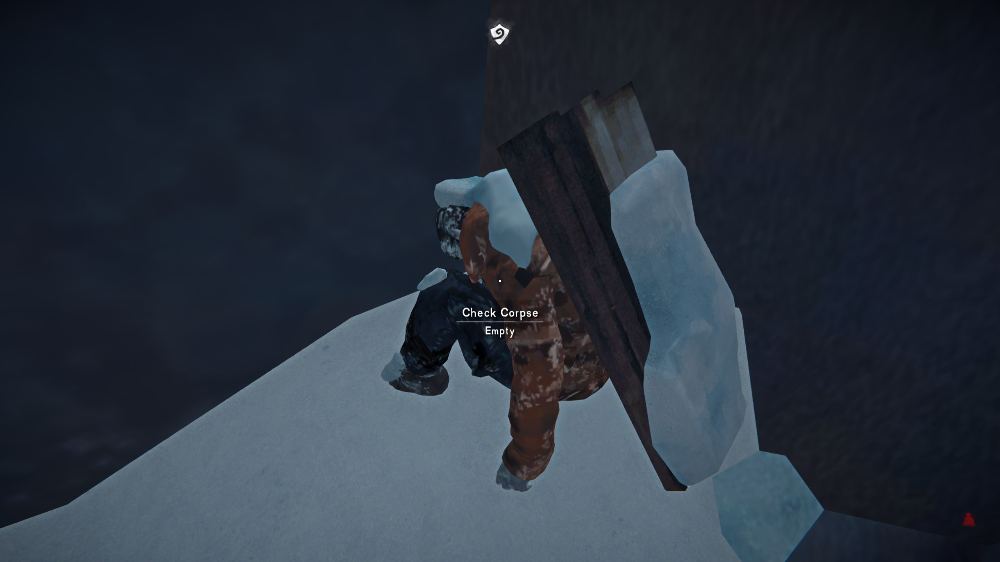 / *A corpse in [Ash Canyon](./Ash%20Canyon.md)* | 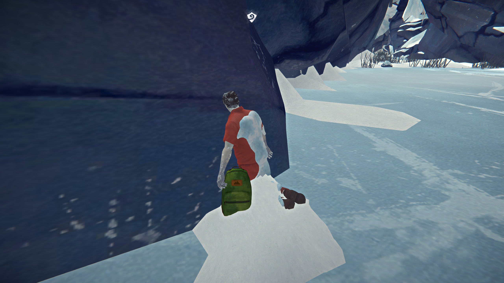 / *A dead Convict* |  |

**Lua execution error in Module:Navbox function navbox** [ru:Труп](ru:%D0%A2%D1%80%D1%83%D0%BF)
