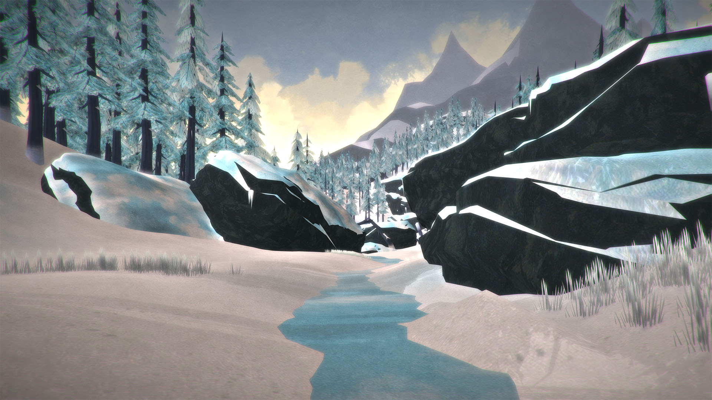
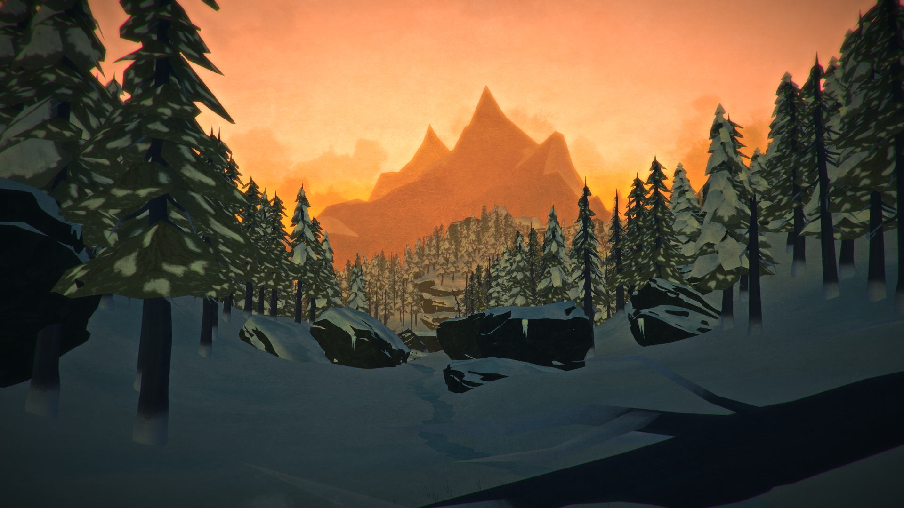

# Frozen Creek

**Categories:** Locations, Locations in Mystery Lake, Outdoor locations · **Source:** [Fandom](https://thelongdark.fandom.com/wiki/Frozen_Creek)

**Frozen Creek**

[Frozen Creek upstream](../assets/Frozen_Creek_upstream.jpg)

**Location**

[Frozen Creek Location](../assets/Frozen_Creek_Location.png)

**Region:** [Mystery Lake](./Mystery%20Lake%20%28region%29.md)

**Type:** Outdoors

<!-- #Overview -->
​

<!-- #overview -->
## Overview

Frozen Creek is located east upstream from [Unnamed Pond](./Unnamed%20Pond.md), south-east of [Forestry Lookout](./Forestry%20Lookout.md), and west of [Derailment](./Derailment.md).

A few [deer](./Deer.md) can be found roaming the area, and often [Wolves](./Wolf.md).

Some [Reishi Mushroom](./Reishi%20Mushroom.md) and [Rose Hip](./Rose%20Hip.md) can be found on the southern side of the creek.

Oddly enough, [Coal](./Coal.md) may spawn in the area and along the river, however it's very scarce, just one to three pieces spawn, and whether it respawns or not is untested

<!-- #Gallery -->
​

<!-- #gallery -->
## Gallery

[es:Arroyo helado](https://es.wikipedia.org/wiki/Arroyo_helado) [ru:Замороженный ручей](https://ru.wikipedia.org/wiki/%D0%97%D0%B0%D0%BC%D0%BE%D1%80%D0%BE%D0%B6%D0%B5%D0%BD%D0%BD%D1%8B%D0%B9_%D1%80%D1%83%D1%87%D0%B5%D0%B9)
